

# NewDoe illustrated user guide

**App 0.11.19 / device firmware 0.11.18 / B language resources 0.11.2 · 21 October 2026**  
[한국어](Guide.md) · [Downloads](https://github.com/SerialSniffyHeck3r/noodoe_cfw/releases/latest)

You need an Android phone and your vehicle's buttons. Normal installation does not require opening Noodoe or connecting a programmer. **[PHONE] means the Android app; [NOODOE] means the round vehicle display.** Distances and progress values in the screen examples will differ on your device.

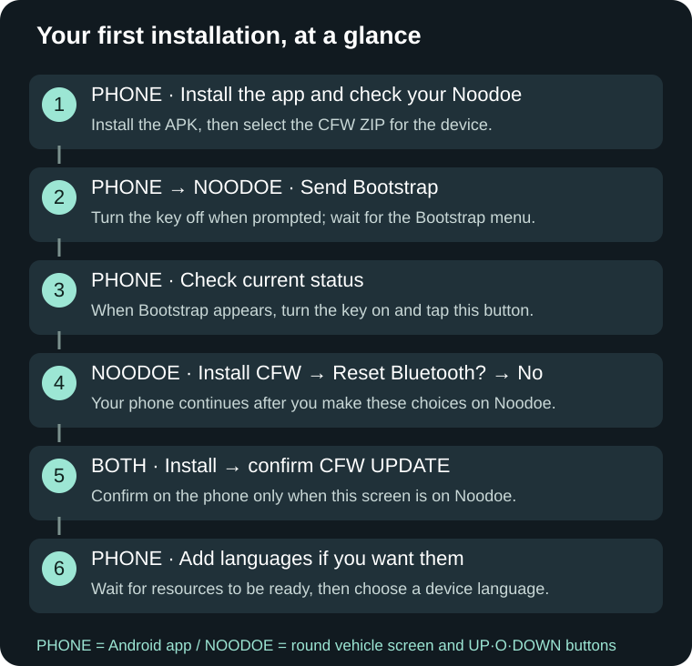

**Jump to what you need.**

| What do you want to do? | Start here |
|---|---|
| Install for the first time | [Prepare](#prepare) → [Follow the screens](#first-install) |
| Update an existing installation | [Updating NewDoe](#update) |
| Change the menu language | [Language resources and settings](#language) |
| Fix a connection or interrupted installation | [Connection help](#connection) · [Screen-by-screen help](#troubleshooting) |
| Return to stock without a phone | [Device recovery menu](#recovery) |
| Use NewDoe | [Buttons](#controls) · [Trips and maintenance](#vehicle) · [Media](#media) · [Maps](#map) |
| Set up the app or parking | [App pages](#dashboard) · [Parking](#parking) · [Get help](#report) |

## 1. Can I install it?

| Item | Supported |
|---|---|
| Phone | Android 6.0 or later. There is no iPhone app. |
| Noodoe unit | F4-family KYMCO Noodoe. Other vehicle models besides the AK550 can use the app's device check. |
| First installation from stock | Stock firmware **5.14 or 5.16** |
| Already running CFW | Follow [Updating NewDoe](#update). |
| Device menu languages | Nine languages on B-language units; English on A-language units |

You do not need to open the unit to identify it. Tap **Check current device** in the app. If it reports an unsupported device, save the message and [ask for help](#report). Returning to stock installs **stock 5.16**.

## 2. Buttons and the ignition key

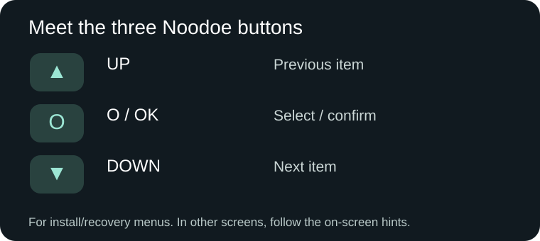

- **O** is the centre confirmation button, not the number zero.
- A **short press** means press and release. A **hold** means keep it pressed; follow the displayed duration when a screen says two or three seconds.
- **IGN ON** means turn the vehicle key/power switch on. **It does not mean start the engine.**
- **IGN OFF** means turn the key/power switch off. **Do not disconnect the battery or Noodoe wiring.**
- If your vehicle has a switch that assigns the buttons to Noodoe or the normal dashboard, select **Noodoe**.

**Bootstrap** is the temporary installer used for first installation. **CFW** is the NewDoe firmware you normally use. **Recovery/Gate** is the device's startup and recovery menu.

## 3. Get ready

### Download the right files

Open the [download page](https://github.com/SerialSniffyHeck3r/noodoe_cfw/releases/latest) on your phone.

| File | What is it for? |
|---|---|
| **NewDoe-0.11.19.apk** | The Android app |
| **NewDoe-CFW-0.11.18.zip** | The device firmware package. Select this ZIP inside the app. |
| **NewDoe-LANGUAGE-B-0.11.2.zip** | Optional menu languages. You can also use the app's download instructions. |

**Do not extract the ZIP files.** Installing the APK alone does not update Noodoe. The language resource version **0.11.2** is correct.

### Park before you begin

1. Park safely and stop the engine. Make sure the vehicle and phone batteries have enough charge.
2. Open the new APK and install it. If NewDoe is already installed, **update the existing app**. Do not uninstall it or clear its data.
3. If Android asks to allow installation from this source, check that you downloaded the APK yourself and allow it. Open NewDoe afterward.
4. Enable Bluetooth and keep the phone close to the vehicle. Leave NewDoe in the foreground during installation.
5. Disconnect any other Noodoe app that is using the device.

**Keep the battery and Noodoe wiring connected during installation and stock recovery.** Do not operate the starter. Charge or service a heavily discharged vehicle before updating it.

### Confirm the five safety screens

When you press an install button, read each picture and tap **Got it**. **Cancel** stops before installation starts. The same installation can continue through Bootstrap without repeating these confirmations. A different device, file or new installation requires them again.

1. Do not disconnect the battery or Noodoe wiring.
2. With the key OFF, do not press **UP + O** together.
3. Do not press the starter button.
4. Check that the battery voltage is **at least 11.5V**. This is your confirmation; the app does not measure it.
5. Keep the key OFF when the step allows it. **The first transfer from stock needs the key ON.** Then follow the screen instructions.

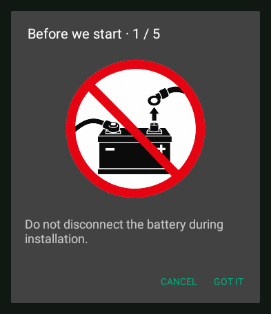
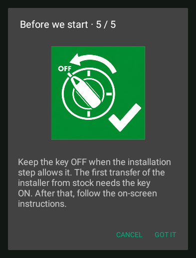

All five signs stay under the installation status while it runs. They are reminders, not extra buttons.

### First launch and the optional installation guide

On first launch, answer whether you have used NewDoe before. If not, open the illustrated guide to learn the buttons. Choose what is currently running on your Noodoe, then choose **Guided installation** or **Go to home**. Your answer does not select firmware for the vehicle: **Check current status** identifies the device.

You can reopen **Guided installation** on the Device/status page. **Next** moves between device selection, ZIP selection, transfer and checking the restarted device. Once a transfer or verification starts, wait until it finishes; do not look for another Next button. You can also keep using the original Device page.

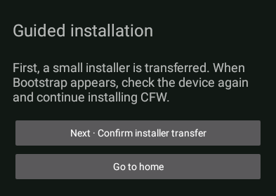

## 4. First installation from stock

### ① Select your Noodoe on the phone

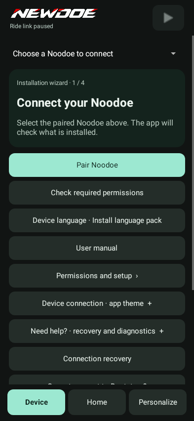

1. **[NOODOE]** Turn the key ON without starting the engine.
2. **[PHONE]** Open the **Device** page. Swipe sideways or use its bottom button.
3. For a first connection, tap **Pair Noodoe** to open Android Bluetooth settings. Put stock Noodoe into pairing mode and select your unit. Do not pair again if it is already registered.
4. Return to NewDoe and select your device. Refresh the device list if it is missing.
5. Open **Permissions & integration** and allow Bluetooth/Nearby devices access. Music, calling and location permissions can be set up [after installation](#phone).
6. Tap **Check current device**. Confirm that the app identifies **stock Noodoe**.

### ② Select the CFW ZIP and send the installer

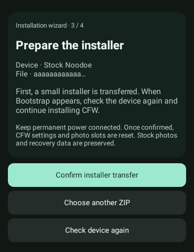

1. **[PHONE]** Choose the installation ZIP option.
2. Open Downloads and select **NewDoe-CFW-0.11.18.zip** itself. Do not select the language ZIP.
3. On the installer preparation screen above, confirm sending the installer.
4. Wait for transfer and checking to finish. Do not turn the key off early.

### ③ Wait for Bootstrap, then tap Check current status

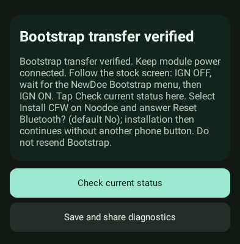

1. **[PHONE]** When this message appears, follow the stock display's instruction to turn the **key OFF**. Leave the battery connected.
2. **[NOODOE]** Wait until the **NewDoe Bootstrap menu** below appears. The intermediate **NOODOE INSTALLER** screen is not that menu.
3. When Bootstrap is visible, turn the **key ON**.
4. **[PHONE]** Tap **Check current status**. This step needs your tap. Do not resend Bootstrap.

| A brief file check comes first | Then the Bootstrap menu appears |
|---|---|
| 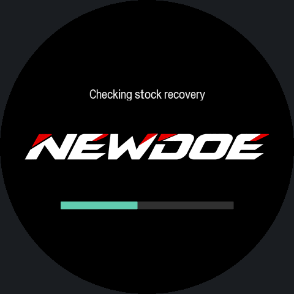 | 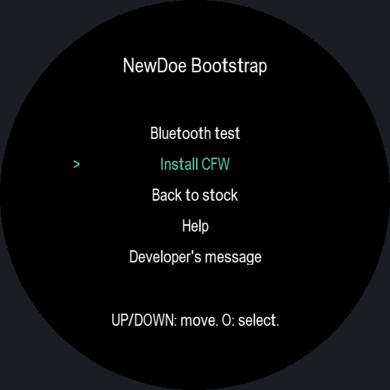 |

The first three seconds show only the NEWDOE wordmark. Checks continue in the background. If still running afterwards, the current check and a horizontal bar appear around the wordmark; otherwise the menu opens.

### ④ Choose Install CFW on Noodoe

1. **[NOODOE]** Use UP/DOWN to select **Install CFW**, then press **O**.
2. At **Reset Bluetooth?**, keep the default **No** and press **O** if your connection is working.
3. The phone continues the installation. You do not need to find another installation-start button on the phone.

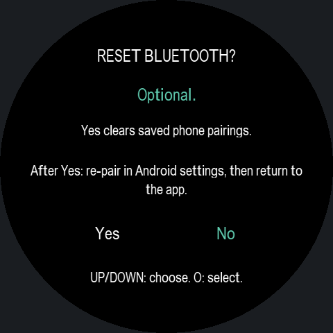

**Yes erases saved pairings.** Use it only when you need to reset a failed connection. For “Couldn't pair,” follow [the pairing recovery steps](#connection). This question has no automatic countdown.

If the app finds data from a previous CFW installation, choose **Restore retained data** to keep your settings, trips and photos. Choose **Start fresh** only if you want a new setup. You may not see this choice on a first installation.

### ⑤ Wait while the two bars fill

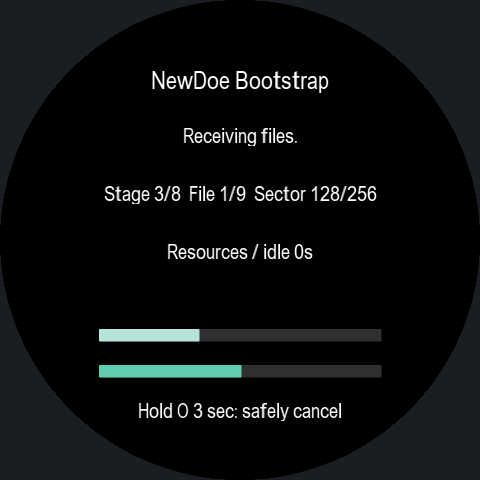

- **Upper, lighter bar:** overall installation progress.
- **Lower, darker bar:** the current operation. It can start again when the next operation begins.
- The text identifies the file or operation. Your numbers may differ from the example.

Keep power and the phone connection available. Do not force a restart just because progress is slow. To cancel, follow the displayed **hold O for three seconds** instruction, then wait for the stopped message.

### ⑥ Everything is ready: install

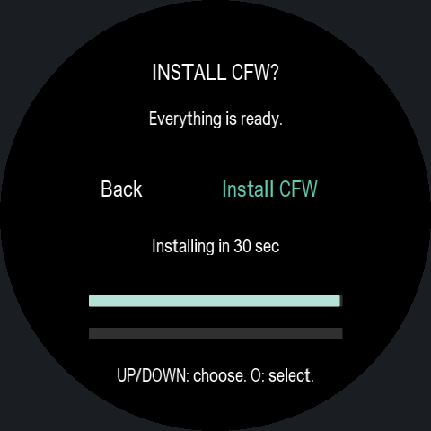

The files are ready.

- Install now: select **Install CFW → O**.
- Leave it alone: installation begins **after 30 seconds**.
- Go back: press UP/DOWN to stop the countdown, then choose **Back → O**.

Noodoe restarts during installation. Leave the app open even if the connection briefly drops or you see a startup screen.

### ⑦ Look at CFW UPDATE on Noodoe, then confirm on the phone

| Look for this on Noodoe | Then confirm on the phone |
|---|---|
| 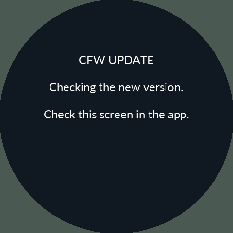 | 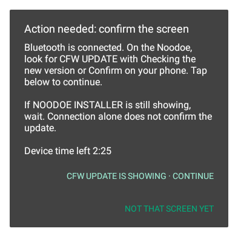 |

1. **[NOODOE]** Check that it shows **CFW UPDATE** and **Checking the new version** or **Confirm on your phone**.
2. **[PHONE]** Tap the button confirming that **CFW UPDATE is visible**. If Noodoe still shows Bootstrap, NOODOE INSTALLER or a black screen, choose the “not that screen yet” option and wait.
3. Wait for the phone to report **installation complete** and for Noodoe HOME to open.

**Confirm before the phone's countdown expires.** Otherwise the device may return to the previous version or recovery menu. Dismissing the popup does not confirm the installation.

### ⑧ Add languages after firmware installation

The app now asks whether to install language resources. Choose **Install** for other menu languages, or **Later** to use English first. You can add resources later. Continue with [the language instructions](#language).

## 5. Updating an existing NewDoe

App 0.11.19 connects to devices running 0.11.17 and 0.11.18. After updating the app, tap the Home connection button once. If your device already runs 0.11.18, only the app needs updating.

**Updating from 0.11.16/0.11.17 to 0.11.18? Use the normal CFW update below. No stock return or language-pack reinstall is needed.**

### Normal CFW update

1. Install the new APK over the existing app.
2. Park and tap the app's top **pause** button to stop the riding connection.
3. On **Device**, select your Noodoe and the new **CFW ZIP**.
4. Choose **CFW update / resume** and wait for transfer, installation and restart.
5. Complete [the CFW UPDATE confirmation](#confirm-update) from step ⑦.
6. Follow the language prompt if needed. **A healthy installed B 0.11.2 pack does not need to be sent again.**

Normal updates retain settings, brightness, photos, trips and maintenance records. If disconnected, check the result using the same device and ZIP. Do not clear app data.

### If the app asks you to return to stock first

**If your recovery menu predates 0.11.16, return to stock and reinstall while keeping CFW data.** This also applies to 0.11.15. It is not needed if 0.11.16 is already installed. Once this recovery menu is installed, later matching-Gate Product updates use the normal CFW update above. The app identifies which route is needed.

1. Return to stock with **Keep CFW data**. Do not choose complete removal.
2. Once the actual stock screen appears, tap the phone's **I've returned to stock · check** option.
3. Follow [first installation](#first-install) with the new ZIP and select **Restore retained data**.

**Do not disconnect power while returning to stock.** An interruption during this step on older versions can require separate repair.

## 6. Install resources and choose a language

**Firmware installation and language installation finish separately.** Complete the CFW UPDATE confirmation first.

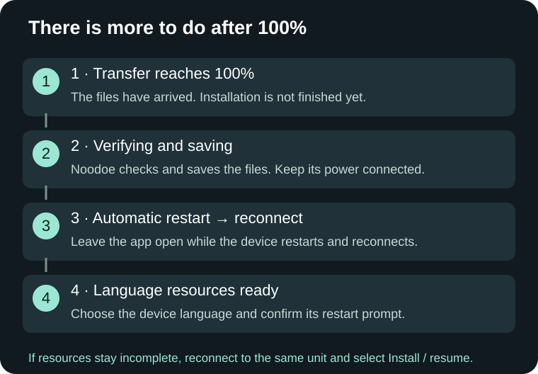

### Install or update language resources

1. Choose **Install** in the post-installation question, or open **Device language / language resources → Install / resume language resources** later.
2. Follow the app's download instructions. For manual selection, choose **NewDoe-LANGUAGE-B-0.11.2.zip**.
3. If the same healthy pack is already installed, the app checks it without sending everything again. Follow the update prompt for an older pack.
4. Wait through **100% → Verifying and saving → automatic restart → reconnect → language resources ready**.

Turning the key ON or OFF does not cancel this job. Keep the vehicle parked and **keep the battery and Noodoe wiring connected**. You do not have to send text and font files individually.

**If asked to repair fonts:** “Repair fonts and continue” restores the required stock fonts before proceeding. “Continue in English” leaves those fonts alone and uses English. If the question does not appear, continue normally.

### Change the device language

1. **[NOODOE]** Press **O + DOWN** for quick settings, then **hold O** to open the main menu.
2. Open **Settings → System → Language** and choose your language. Turn **English only** off if enabled. You can also use the phone's **View / change current device settings**.
3. **[NOODOE]** Confirm the restart prompt. Choosing “Later” applies the selection at the next restart.
4. Wait for the blue preparation screen. When HOME opens, check the menu language.

| Preparation after a language change | Example: Korean menu afterward |
|---|---|
| 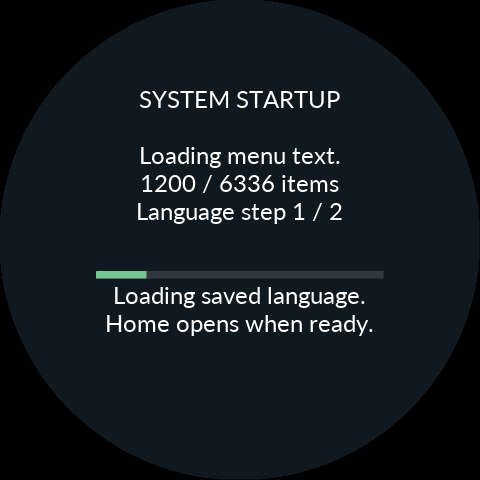 | 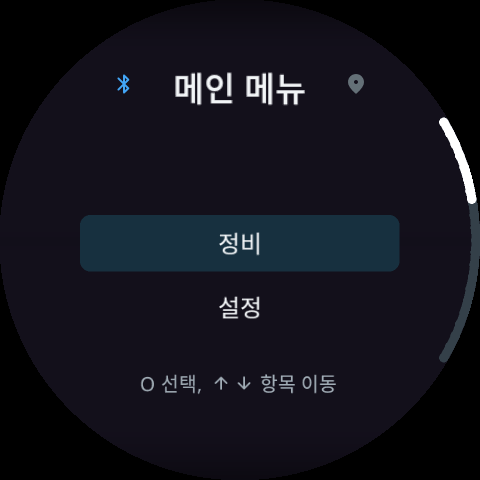 |

Preparation is shown after a language change or resource update. **You do not reinstall the pack every time you use the same language.** There is no need to press unrelated app buttons or leave the ignition off for a long time to activate it.

### Available languages

B units support **English · Deutsch · Español · Français · Italiano · Ελληνικά · 한국어 · Tiếng Việt · 日本語**. All menu translations are included in one pack, so switching languages does not require another transfer. A units use English menus.

**App language** changes the phone UI; **device language** changes Noodoe. You may choose **Follow app language** on the device. A manually selected device language stays selected after reconnection. The app also supports Simplified and Traditional Chinese; following either of these uses English for device menus.

| Music and notification text setting | Choose it when… |
|---|---|
| **Render on phone** — default | You want the phone's wide character support and colour emoji. Preparing the display may take a moment. |
| **Use device fonts** | You want quick text delivery. Emoji are monochrome and unsupported characters may appear as □. |

If you still see English, check **English only is off → the device language is selected → the restart was confirmed → language resources are ready**.

## 7. When the phone cannot connect

### “Couldn't pair” in Bootstrap

If files are being written, let that finish first. Follow these steps at the Bootstrap menu or connection screen.

1. **[PHONE]** Open **Can't connect? / Bootstrap connection help**.
2. Tap **Open Bluetooth settings**, then **forget only your Noodoe** in Android. Keep the NewDoe app's data.
3. **[NOODOE]** If you already chose **Reset Bluetooth? → Yes**, follow that screen. Otherwise, use **UP** on the connection screen to open the pairing menu and choose the phone. Release O, then **hold O again for two seconds** to delete it. ALL deletes every phone.
4. At **PAIR YOUR PHONE**, search for Noodoe again in Android and pair it.
5. Return to NewDoe, select the same device, and tap **Check current status**.
6. Choose **Install CFW** on Noodoe. If the recovery workflow appears, follow **Check last operation → Check and resume installation**.

### Disconnection during normal use

Check that the app's riding connection is not paused and Bluetooth/Nearby devices access is allowed. Allow NewDoe to run in the background in Android's app battery settings. After force-stopping the app, open it again and start the connection. If another app, such as the camera, interrupted it, return to NewDoe and check the connection.

**The recovery menu has no Bluetooth connection.** Use [the device buttons](#recovery) when the skull or Recovery menu is showing.

## 8. What should I do on this screen?

| Screen or message | What to do |
|---|---|
| **NOODOE INSTALLER** | Wait for Bootstrap or the next screen. Do not confirm CFW UPDATE yet. |
| **100% / Verifying and saving** | Keep power connected and wait for saving. See [the remaining stages](#language). |
| **CFW UPDATE** | Tap the phone button confirming that this screen is visible. |
| **Firmware installed / Language resources are incomplete** | Firmware is installed. Reconnect to the same device and choose **Install / resume language resources**. Do not immediately return to stock or reinstall firmware. |
| **opcode 0xAA / socket closed / read -1** | Check whether Noodoe restarted, reconnect, and check resource status again. Save the error and diagnostics if it repeats. |
| **Installation success or cancellation not confirmed** | Keep the same device and ZIP; use **Check current device → Check last operation**. |
| **Paused / Stage 6/8 / Code 6 / Phase 4** | Look for an explicit manual-reset instruction. If shown, follow the steps below. |
| **English after a language change** | Follow [the four language checks](#language). |
| **ODO ------ / no speed** | Check that the ignition is ON. If it persists, send your vehicle model and a screen photo. |

### When the device says “Please manually reset”

1. Photograph the message and code.
2. Release all buttons, then **hold UP + O together for three seconds** and release.
3. With the key OFF, the screen may stay dark. Release the buttons and **turn the key ON**.
4. Check the same device and ZIP again. Confirm CFW UPDATE if shown, or follow the recovery menu below.

Use this reset **when the device asks for it**. Do not interrupt writing just because progress is slow.

## 9. Recover or return to stock without a phone

### Open the recovery menu

- When the device starts from power-off and shows the NewDoe logo, **hold DOWN for about one second**.
- If CFW is running: **key OFF → hold O → keep holding while turning key ON → hold for at least two more seconds → release at recovery**.
- If UP+O with ignition OFF left the screen dark, release the buttons and turn the key ON to start again.

| An error shows this first | Press a button, or wait 30 seconds, for the menu |
|---|---|
| 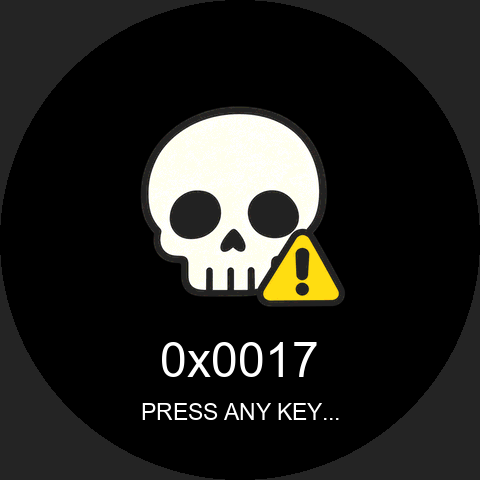 | 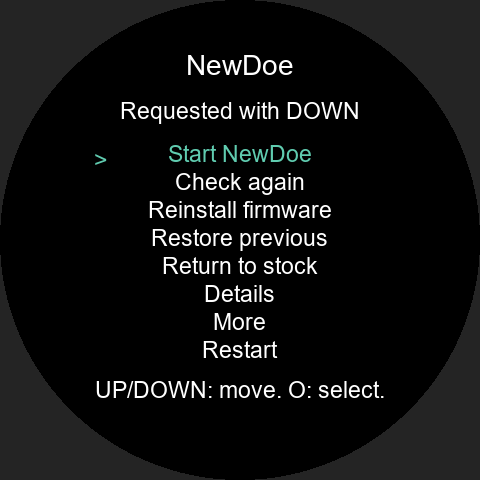 |

Manual entry may go straight to the menu. Use **UP/DOWN to move and O to select**. Grey items are unavailable right now. The reason and code at the top depend on how you entered recovery.

| Menu item | What it does |
|---|---|
| **Start NewDoe** | Start the current firmware |
| **Check again** | Look for recovery options again |
| **Reinstall firmware** | Reinstall using the stored installation image |
| **Restore previous** | Recover the previous firmware |
| **Return to stock** | Restore stock firmware |
| **Try recovery anyway** | Look for another recovery copy when normal recovery failed |
| **Details** | Show error and status details |
| **More** | Help, dashboard values and a simple game |
| **Restart** | Restart the device |

### Return to stock

1. Select **Return to stock → O**.
2. Read the confirmation, **release O and hold it again for two seconds**.
3. On the new Gate, read the battery, UP + O and starter warnings in order. **Release O, then press it again** for each screen. UP or DOWN goes back. These screens also appear for a manually chosen forced stock recovery.
4. Keep power connected until the stock screen appears. **No phone connection is needed.** Older recovery menus may not show the three new pictures.

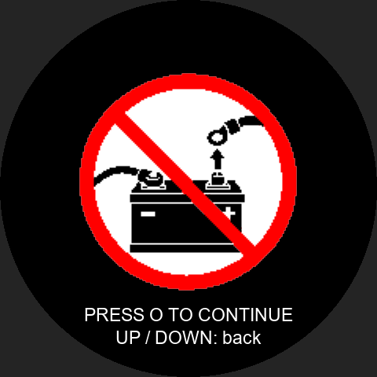
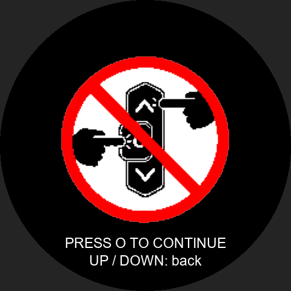
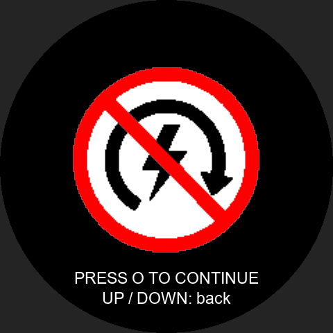

| Example recovery confirmation | Stock recovery in progress |
|---|---|
| 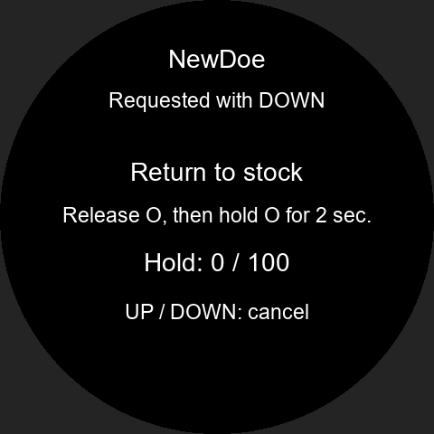 | 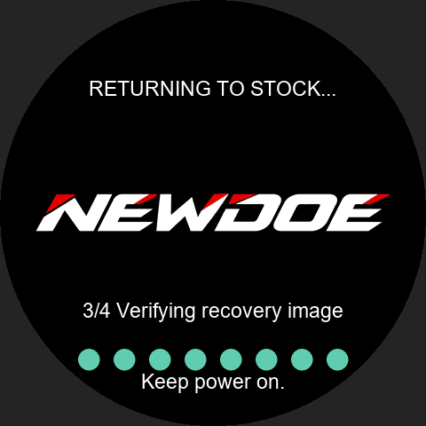 |

If recovery fails, use **Check again** and, if available, **Try recovery anyway**. Press **O** to leave an unsuccessful-recovery message. If it keeps failing, send the code and a photo through [Get help](#report). If no recovery copy can be used, servicing or recovery after opening the unit may be needed.

**Use recovery scratch** means giving up an unfinished language/font repair so its workspace can be used for recovery. Approve it only if you want to abandon that unfinished job.

### Return to stock using the phone

Stop the riding connection, then choose **Return to stock → Keep CFW data**. Confirm on the phone after the actual stock screen appears. Choose **Restore retained data** during a later reinstall to keep your environment. Choose **Remove CFW data completely** only when you intend to erase those records.

## 10. Phone connection and permissions

Select your Noodoe and use the app's top **play** button to start the riding connection. The top **pause** button pauses the connection; it is separate from your music player's pause button.

| Permission or setting | Used for |
|---|---|
| Bluetooth / Nearby devices | Connection and installation |
| Notification access | Music information and chosen app notifications |
| Precise/background location | GPS and maps, including with the phone screen off |
| Contacts, phone and recent calls | Caller names and calling features |
| App notifications/background operation | Connection status and reconnection |

Open **Permissions & integration** and enable the features you want. Calls that do not provide a number may show **Unknown caller**.

## 11. Everyday device controls

| In a normal screen | Action |
|---|---|
| **Short O** | Cycle HOME → trips → music → phone → map |
| **Short O + DOWN** | Open quick brightness settings |
| **UP / DOWN** in quick settings | Adjust brightness |
| **Short / long O** in quick settings | Close / open the main menu |
| **Long UP** in quick settings | Restart the display output |
| **Long DOWN** in quick settings | Super Nite low brightness |

Follow the on-screen hints while a call, notification or menu is open. Park before changing full settings.

The five top icons hide after a while on HOME and stay visible on other normal pages. **Grey GPS** means waiting for a location; fresh positions cause a short grey pulse. **Yellow/red Bluetooth** indicates low phone battery; **green** indicates charging.

## 12. Odometer, trips and maintenance

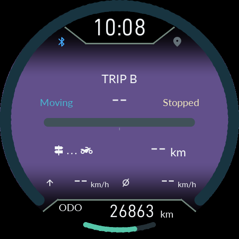

**ODO is the current odometer value received from the vehicle's instrument cluster.** Missing data shows `------`. There is no separate Noodoe odometer correction or saved-ODO selection.

Trip A/B, today, this ride, oil, belt and service records are retained separately. In **Maintenance**, check or change the replacement interval and distance since replacement. Reset or adjust these to match actual maintenance. This does not change the vehicle's original odometer.

Oil remaining changes to **yellow at 30% → red at 15% → flashing red at 5%**. This ride's maximum and average speed markers appear once their values exceed 5 km/h.

HOME AUTO prioritises **new notifications → playing music → other information**. A new notification or a manually chosen information view normally returns to the automatic priority after 20 seconds.

With the key OFF, the last ODO received during this boot stays on the device and phone dashboard. Turning the key ON requires a fresh vehicle reading. A restart clears this temporary ODO; it never restores an old saved reading. Trips and maintenance counters are preserved separately.

In 0.11.18, the last ODO also stays visible in **10-minute use after key OFF**. A brief receive error no longer clears a valid reading immediately. If communication remains lost with the key ON, the value becomes unknown. Trips and maintenance records are kept; the retained ODO never adds trip distance.

**SINCE REFUEL:** a fuel level at least two bars above the earlier level for three seconds starts a new record. A 2-bar tank refilled to alternating 4/5-bar readings is accepted. Missing or unknown readings wait for valid data. TRIP A/B and maintenance history are kept.

## 13. Music, calls and notifications

- **Music:** start playback on your phone and allow notification access. On the music page, short UP plays/pauses, short DOWN skips forward, and long UP goes to the previous track.
- **Phone page:** UP opens recent calls; DOWN opens the latest notification. Follow the hints in detailed screens. Closing a call popup and ending the actual call are different actions.
- **New notifications:** the top icon flashes for about two seconds. Rapid messages update to the latest content; Updating... may appear while it is prepared.
- **Quick replies:** slots 1–7 are saved text; 8 shares location, this ride and music; 9 shares location; 10 shares music. Slots 8–10 include a signature. Check the recipient and content before sending.
- **Dashboard blink alerts:** warnings and notifications briefly change the instrument cluster brightness. Disable **Settings → Display → Dash blink alerts** if unwanted.

## 14. Maps and zoom

Import your region's **.map file** in the app's map menu. Enable location permissions and start the riding connection. Without a map file, Noodoe shows a moving grid and track line.

| On the map page | Action |
|---|---|
| **Long UP** | Switch AUTO / MANUAL |
| **UP/DOWN in AUTO** | Adjust preference from −2 closer to +2 wider |
| **UP/DOWN in MANUAL** | Change zoom directly |
| **Long O** | Switch north-up / heading-up / compass |

New areas take some time to prepare. The current map feature shows the map, position and travelled track.

## 15. The app's Home, Customise and Device pages

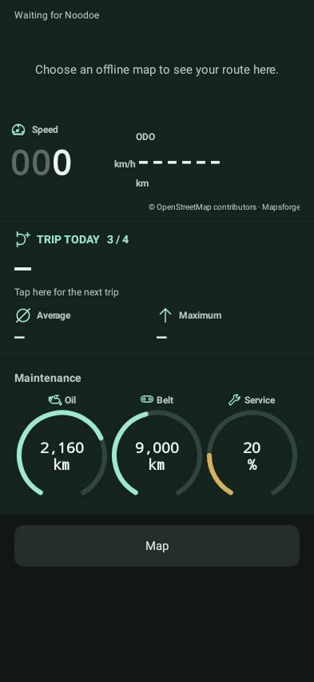

Swipe sideways or use the bottom buttons for **Device · Home · Customise**.

- **Home:** map, speed, ODO, trips and three maintenance rings showing oil/belt kilometres remaining and service percentage remaining. **Tap the trip readout itself** to cycle information. With stock Noodoe, the lower area shows stock information instead.
- **Customise:** background pictures, notification apps, popups, quick replies and favourite callers.
- **Device:** installation, updates, current status, language resources and the manual.

**UI test mode** lets you preview chosen speed, ODO and CFW/stock screens while disconnected. It does not change actual vehicle values. Turn test mode off before returning to a real connection.

**Bluetooth is off:** connection buttons stop and HOME asks you to enable Bluetooth. Open Bluetooth settings to turn it on. Automatic riding connection follows your existing setting; a manually paused connection stays paused. Installation does not start again by itself.

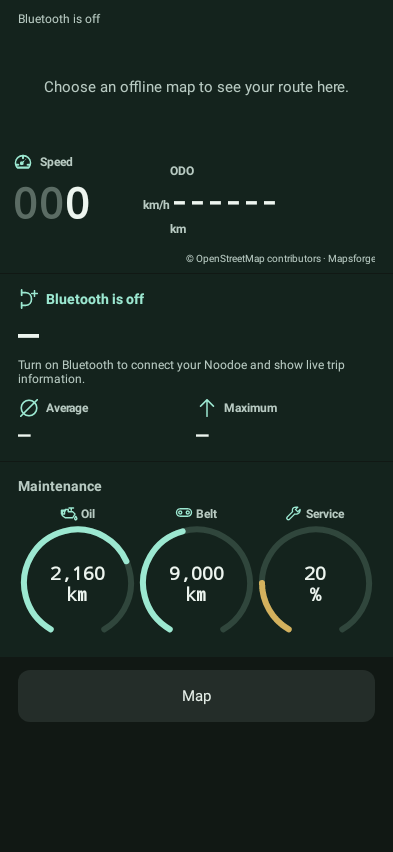

A fresh installation puts a black 480 × 480 picture with the centered NEWDOE wordmark in Background 1. Replace it with any photo to remove the wordmark completely. Keep-data reinstalls and normal updates retain your existing photos; Backgrounds 2 and 3 are unchanged.

## 16. Ignition-off and long parking

After key-off, **Ride Summary** appears before your chosen parking screen and sleep sequence. Holding O while turning the key off, then releasing it, allows up to ten minutes of ignition-off use.

Open **Settings → System → Power sequence → Long parking power off** and choose **Off / 2 days / 3 days / 7 days**. Two days is the default; an earlier user selection remains after updates.

After the chosen time shuts the unit down, phone-approach reconnection and welcome lights also stop. Turning the key on starts it from the startup screen again. Check this setting before extended parking. If the battery is already discharged or its voltage has dropped sharply, have the battery and vehicle checked first.

## 17. Still stuck? Send this information

Open **Having trouble? / Recovery and diagnostics → Save and share diagnostics**. Include the following in a [project support request](https://github.com/SerialSniffyHeck3r/noodoe_cfw/issues):

- Vehicle model/year, phone model and Android version.
- App version, device firmware version and selected ZIP filename.
- A photo of Noodoe's current screen and the exact error/code.
- Your last button press and what happened afterward.
- For languages: device language, English-only setting and resource status.

Do not clear app data before saving diagnostics. Keep another copy of any backups you already have.

[Back to top](#top) · [Downloads](https://github.com/SerialSniffyHeck3r/noodoe_cfw/releases/latest) · [한국어](Guide.md)
