

# NewDoe 그림 사용 설명서

**앱 0.15.4 / 본체 0.15.4 · 2026-11-10**  
[English](Guide.en.md) · [다운로드](https://github.com/SerialSniffyHeck3r/noodoe_cfw/releases/latest)

## 0.15.4 Hotfix 3 — 업데이트 준비·연결 상태 표시 (빌드 147)

Hotfix 3 APK를 기존 앱 위에 설치한 뒤 **현재 기기 상태 확인**을 누르세요. 연결 후에는 복구·폰트 확인, NOR 원본 확인, 저장된 언어 확인을 구분해 표시하고, 실제 기기 응답을 받을 때마다 응답 시간을 갱신합니다. 읽기 전용 확인 실패를 펌웨어 설치 실패로 표시하지 않습니다. 이전 미완료 작업이 있다면 그 결과는 여전히 확인해야 합니다.

완료된 구버전 설치 파일만 남아 있으면 **설치 계속 / 언어 확인**에서도 최신 패키지 준비로 안내합니다. 아직 진행 중인 설치는 원래 파일과 기록을 유지합니다. 준비 완료 후 언어와 업데이트 내용을 확인하고 직접 설치를 시작하세요. 최신 APK와 일치하지 않는 구버전 본체는 업데이트해야 주행 연동이 시작됩니다.

이미 본체가 0.15.4이면 APK만 갱신하세요. Hotfix 1·2 수정도 포함하며 펌웨어·Gate·NOR 배치는 바꾸지 않습니다. 계속 실패하면 기기를 초기화하지 말고 진단 ZIP을 저장하세요. 새 ZIP에는 앱 빌드, 두 번째 확인 단계 및 응답이 없던 명령 번호도 포함됩니다. 실차 Bluetooth 재시험은 아직 하지 않았습니다.

## 0.15.4 Hotfix 2 — 구버전 순정 폰트 식별

0.12.1 등 구버전에서 “The stock font profile is unknown; no write was started”가 나오면 Hotfix 2 APK(빌드 146)를 기존 앱 위에 설치하고 **현재 기기 상태 확인**부터 다시 진행하세요. 구버전이 A/B 정보를 제공하지 못할 때 앱이 기존 NOR 읽기 명령으로 순정 자원을 직접 확인합니다. 순정 파일과 FAT를 수정하거나 언어팩을 먼저 설치하지 않습니다. 실제 자원 손상·응답 유실·진행 중인 백업은 계속 차단됩니다.

새 앱은 내장 펌웨어와 일치해야 주행 연동을 시작합니다. 본체가 아직 0.12.1이면 상태 확인 후 표시되는 정상 업데이트를 완료하세요. 이미 본체 0.15.4이면 APK만 갱신하면 됩니다. 앱 데이터 삭제·재페어링·순정 복귀를 먼저 하지 마세요. 기존 Gate 호환성 검사는 유지되며, 별도의 Gate 불일치가 확인되면 앱의 해당 안내를 따르세요.

## 0.15.4 Hotfix 1 — 앱 알림 처리 패치 (빌드 145)

0.15.3에서 0.15.4로 업데이트한 뒤 본체는 정상인데 앱에 **CONTENT / 0x74 / IllegalArgumentException**이 표시되는 보고에 대응한 패치입니다. 알림 아이콘을 그리지 못할 때 기본 아이콘으로 대체하고 알림·주행 연결을 유지합니다. 새로운 앱 내부 오류에는 개인정보 대신 코드 위치도 표시합니다.

**본체가 이미 0.15.4로 정상 부팅했다면 Hotfix 1 APK만 기존 앱 위에 설치하고 다시 연결하세요.** 앱 데이터 삭제·재페어링·순정 복귀·펌웨어 재설치는 필요하지 않습니다. APK의 Android 빌드 번호는 145이며 내장 펌웨어와 설치 ZIP은 기존 0.15.4와 바이트 단위로 같습니다. 본체가 아직 0.15.3이면 패치 APK에서 기존 정상 업데이트 절차로 0.15.4를 설치합니다. 앱의 확정되지 않은 설치 상태를 임의로 성공 처리하지는 않습니다.

## 0.15.4 — 시계 음영과 초기 설정 개선

앱과 본체 펌웨어를 함께 업데이트하세요. 앱의 **앱에 포함된 패키지 사용**에서 실제 기기 상태와 설치 언어를 확인한 뒤 진행합니다. 기존 Gate와 NOR 파일 배치는 유지하며, 정상 기기는 Product 업데이트를 사용합니다. 기존 사용자를 자동 초기화하거나 초기 설정을 강제로 다시 실행하지 않습니다.

### 처음 설치했을 때

1. 초기 설정 실행이 예약되어 있으면 일반 키 ON 호 채움·축소 연출을 건너뛰고 첫 설정 화면으로 바로 시작합니다. 검은 화면 중앙에 **WELCOME! / NEWDOE**와 깜빡이는 **Press Any Key To Continue**가 나오면 위·아래·O 중 아무 버튼을 누르세요. 다음 **차량을 멈춰 주세요 / O를 눌러 계속하세요** 안내에서 정차 후 O를 누르면 설정을 시작합니다. 시간 경과로 자동 진행하지 않습니다.
2. **언어 → 일출·일몰 기준 지역 → 실제 연료 칸수 → 연료량 인식 사용 여부 → 단위 → 시간대 → 속도 호의 최대값** 순서입니다. 위·아래로 값을 고르고 O로 저장하며 진행합니다. 언어는 영어와 설치된 언어 중 고릅니다.
3. 연료 칸수는 원래 계기판의 0~5칸을 입력하세요. 시동 ON에서 안정된 UART 수신값과 비교합니다. 일치하면 연료량 인식 ON, 불일치하거나 지원되지 않는 값이면 OFF를 권장합니다. 위·아래로 권장값을 바꿀 수 있으며 O를 눌러야 저장합니다. 값이 오지 않거나 아직 안정되지 않았다면 기다리거나 **Skip**을 선택하세요. 수신 실패만으로 미지원이라고 단정하지 않습니다.
4. 저장을 마치면 본체가 재시작합니다. 저장 실패 때는 완료로 넘어가지 않으므로 표시를 확인하고 재시도하세요. 휴대폰이 연결돼 있으면 현재 단계의 설명과 조작법이 앱에 자동 표시됩니다. 이 안내는 본체의 설정이 진행되는 동안 닫을 수 없으며, 재연결하면 현재 단계로 돌아옵니다.
5. 나중에 **설정 → 시스템 → 초기 설정(재시작)**으로 다시 실행할 수 있습니다. 마법사와 무관한 설정은 유지합니다. 별도 **시스템 설정 초기화**는 확인 후 시스템 환경설정을 초기화하므로 두 기능을 구분하세요. 트립·정비·사진·페어링은 보존합니다.

| 첫 화면 | 연료 확인 단계 |
|---|---|
|  | 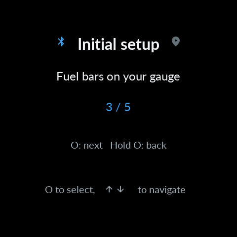 |

초기 설정 마법사에는 주행 중 설정 잠금이나 자동 종료가 없습니다. 차량이 움직여도 첫 화면과 현재 단계가 유지되며 버튼 조작이 가능합니다. 안내에 따라 차량을 멈추고 진행하세요. 일반 설정 메뉴에는 기존 주행 잠금과 자동 종료 규칙을 그대로 적용합니다.

설정 상단의 카테고리 호와 라이트 모드는 제거했습니다. 일반 설정의 측면 항목 위치 호는 유지하며 초기 설정에는 표시하지 않습니다.

### 날씨 사용

날씨는 기본 OFF입니다. 휴대폰 앱의 **날씨**에서 본인의 **OpenWeather One Call 사용이 가능한 API 키**를 저장하고 켜세요. 별도 서비스 계정·이용 조건 및 요금이 적용될 수 있으며, NewDoe가 공용 키를 제공하지 않습니다. 키가 없으면 날씨를 끈 채 다른 기능을 사용할 수 있습니다.

#### OpenWeather 등록부터 첫 표시까지

1. [OpenWeather 계정 만들기](https://home.openweathermap.org/users/sign_up)에서 본인 계정을 만들고 이메일을 인증합니다. 계정의 [API keys](https://home.openweathermap.org/api_keys)에서 본인 키를 확인합니다. 새 키는 활성화에 시간이 걸릴 수 있습니다. [공식 가입·키 안내](https://openweathermap.org/faq)
2. **One Call API 사용 권한**을 확인합니다. NewDoe는 `One Call 3.0`의 현재·시간별·일별 예보를 사용합니다. 일반 무료 계정의 키가 있다는 것만으로 One Call 가입이 완료된 것은 아닙니다. 제공 업체의 가입 화면에서 요금·결제수단·일일 호출 상한을 직접 확인하고 동의할 때만 진행하세요. 이 문서 작성 시 공식 안내에는 One Call의 하루 1,000회 무료 호출이 있으나, 초과 과금과 계정 조건은 제공 업체 기준입니다. [현재 공식 One Call 안내](https://openweathermap.org/api/one-call-3)
3. NewDoe 앱의 **날씨**를 열어 **OpenWeather API 키** 입력 칸에 키를 붙여 넣고 **키 저장**을 누릅니다. 키는 비밀번호처럼 가려지며, 저장 후 입력 칸이 비워지는 것은 정상입니다. 키를 Discord나 오류 사진에 공개하지 마세요. NewDoe 공용 키는 없습니다.
4. **날씨 사용**을 켜고, 휴대폰의 인터넷·위치 서비스와 NewDoe 위치 권한을 확인합니다. 날씨 위치는 휴대폰의 현재 GPS 위치이며, 초기 설정에서 고른 일출·일몰 기준 도시와 별개입니다.
5. 휴대폰과 본체를 연결하고 본체 **HOME → 위·아래 → Weather/날씨**로 이동합니다. 폰의 날씨 화면만 열어 두는 것으로는 조회하지 않습니다. 앱의 ‘본체 날씨 화면에서 조회’ 버튼도 조회 제한을 우회하지 않습니다.
6. 앱에 **예보 준비 완료**와 갱신 시각이 나오면 본체의 현재·최고·최저 온도와 두 예보 바를 확인합니다. 본체 단위 설정에 따라 온도를 변환하며 숫자 옆에는 도 기호만 표시합니다. 위의 시계와 ODO는 날씨 화면 밖의 기존 위치를 유지합니다.

#### 조회 시점과 오류 확인

첫 조회 뒤에는 본체 날씨 화면이 열려 있을 때에만 **마지막 조회로부터 1시간 또는 마지막 조회 위치로부터 30km** 조건으로 다시 요청합니다. 30km는 주행거리 누적값이 아니라 두 위치 사이의 거리입니다. 다른 화면에서는 새 요청을 하지 않으며, 화면 재진입만으로 제한을 초기화하지 않습니다. 실패한 요청에도 간격을 적용하므로 키 수정 후 즉시 다시 받지 않을 수 있습니다.

| 앱의 상태 | 확인할 것 |
|---|---|
| 키 필요 / 키 저장 오류 | 키 전체를 다시 확인하고 저장합니다. 키를 타인에게 보내지 않습니다. |
| 키 또는 One Call 가입 거부 | 키 활성화·오타·One Call 구독을 업체 계정에서 확인합니다. |
| 위치 대기 | GPS·위치 권한을 확인하고 새 위치가 들어올 때까지 기다립니다. |
| 조회 한도 | 업체의 한도·사용량을 확인합니다. 반복 누르기로 우회하지 않습니다. |
| 네트워크 / 데이터 오류 | 연결 상태를 확인합니다. 다음 요청도 화면·시간·거리 조건을 따릅니다. |
| 오래된 예보 / 본체 자료 없음 | 갱신 시각을 확인하고 본체 날씨 화면에서 다음 허용 조회를 기다립니다. |

예보는 휴대폰과 본체의 RAM에만 둡니다. 재부팅·앱 프로세스 종료 뒤에는 다시 받아야 하며, 본체 NOR에 주기적으로 저장하지 않습니다. 날씨 사용을 끄면 날씨 요청을 멈춥니다. 날씨는 선택 기능이므로 등록하지 않아도 나머지 기능을 사용할 수 있습니다.

연결된 본체의 HOME에서 위·아래로 **Weather**를 선택합니다. 웃는 해 또는 Meteocons 날씨 아이콘 옆에 현재 온도를 크게 표시하고, 그 아래에 선명한 빨강으로 최고 온도, 파랑으로 최저 온도를 표시합니다. 현재 온도는 세 자리 고정 폭이며 앞에 0을 붙이지 않습니다.

아래 화살표 바 두 줄은 **현재 시간대부터 +12시간까지**의 예보를 보여줍니다. 왼쪽이 현재, 오른쪽이 +12시간입니다.

- **윗줄 — 날씨 상태:** 맑음은 노랑, 구름 조금은 연한 노랑, 흐림은 흐린 흰색입니다. 이슬비·비·강한 비는 점점 짙은 하늘색, 안개는 밝은 바탕의 어두운 줄무늬, 소나기·뇌우·눈은 파랑입니다. 강수확률로 색을 덮어쓰지 않습니다.
- **아랫줄 — 실제 강수량(mm/h):** 비·눈이 없으면 흰색, 예보량이 많을수록 짙은 파랑입니다. 강수확률(%)이 아닙니다. 시간 사이의 색은 부드럽게 연결합니다. 확인할 수 없는 양은 짙은 회색입니다.
- 이 화면에서는 일반 HOME 하단 정보 줄을 숨깁니다. 상단 메뉴가 숨겨지고 TBT가 없으면 **Weather/날씨** 제목을 표시합니다. 시계·속도 호·ODO는 유지합니다.
- 자료가 없거나 오래되면 현재 예보처럼 표시하지 않으며, 누락된 온도는 `--`로 표시합니다.

| 맑음과 두 예보 바 | 영하 온도 표시 |
|---|---|
| 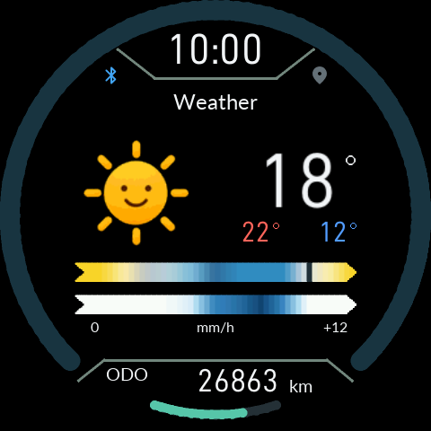 | 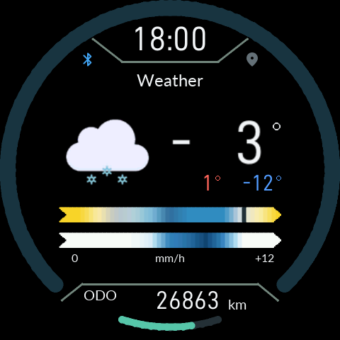 |

조회는 본체의 날씨 화면이 실제로 보이고 시동 ON 연결·위치·키가 준비된 경우에만 합니다. 첫 유효 조회 이후 **1시간 경과 또는 마지막 조회 위치에서30km 이동** 때 다시 조회합니다. 다른 화면에서는 조회하지 않으며 화면을 나가면 대기 작업도 중단합니다. 실패 후 화면을 반복해서 열어도 즉시 재조회하지 않습니다. 날씨는 폰과 본체 모두 RAM에만 보관하며 오래된 예보를 현재 정보로 표시하지 않습니다. 일출·일몰의 수동 기준 도시는 날씨 위치와 별개입니다.

### 연료 측정 오류 표시

지속된 연료 측정 오류는 GPS 위치에 **대각선이 그어진 붉은 연료 아이콘**으로 표시합니다. 깜빡이는 Fuel Measurement Error 문구와 전체 화면 애니메이션은 제거했습니다. 정상 연료 프레임이 돌아오거나 연료량 인식을 OFF로 하면 GPS 아이콘으로 돌아옵니다. 연료 부족·위험 수준 경고는 기존 동작을 유지합니다.

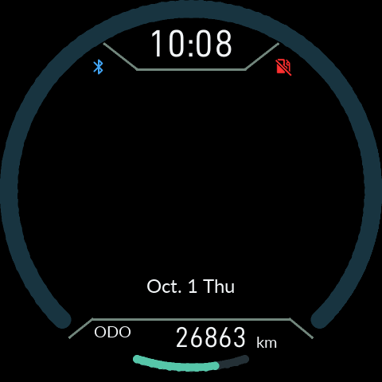

날씨 그림은 [Meteocons Fill](https://github.com/basmilius/meteocons)의 MIT 라이선스 자원을 사용합니다. 해 그림은 프로젝트에서 선택한 별도 생성 이미지입니다. 앱 날씨 화면에서 출처와 라이선스를 확인할 수 있습니다.

이전 버전 설명서에 보존된 날씨 그림은 [Twemoji](https://github.com/jdecked/twemoji), [CC BY4.0](https://creativecommons.org/licenses/by/4.0/) 기반이며 크기·팔레트와 일부 비 아이콘을 수정한 것입니다.

위 그림은 ARM/LVGL/EVE 소프트웨어 렌더링과 가상 날씨 자료입니다. 실제 지역 날씨나 실차 사진이 아닙니다. 이번 베타의 인증된 OpenWeather 실조회·실차 LCD·무선·소비전력은 확인하지 못했습니다. 기존 순정 복귀 구간의 전원 차단 제한도 그대로입니다.

## 0.15.1 — 연료량 인식과 앱·펌웨어 업데이트

앱에는 같은 버전의 A/B·언어별 펌웨어와 자원이 들어 있습니다. 구버전 기기는 연결 후 업데이트 안내가 표시됩니다. 안내의 **앱에 포함된 패키지 사용**을 누른 뒤, 확인된 기기 상태와 설치할 언어·작업을 검토하고 업데이트하세요. **현재 기기 상태 확인**은 별도로 사용할 수 있습니다. 주행 연동은 이 앱에 포함된 펌웨어의 정상 부팅 확정 후 시작합니다. 자동 설치·순정 복귀·초기화는 하지 않습니다. 중단된 설치는 기존 기기·파일 기록을 먼저 확인하며 새 APK의 파일로 임의 교체하지 않습니다.

<!-- FUEL_PAIR_0151_BEGIN -->
| 구버전 연결 시 업데이트 안내 | 연료량 인식 설정 |
|---|---|
| 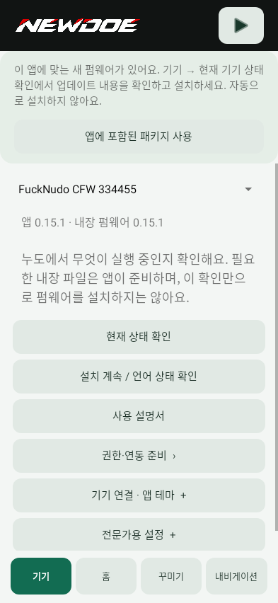 | 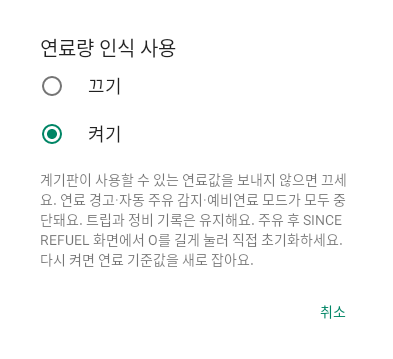 |

0.15.1 앱 화면을 에뮬레이션한 예시입니다. 기존 연료 알림 OFF 설정은 업데이트 후 연료량 인식 OFF로 이어집니다.
<!-- FUEL_PAIR_0151_END -->

Android 휴대폰과 차량 버튼만 준비하세요. 정상 설치에는 분해하거나 별도 장비를 연결할 필요가 없습니다. 아래에서 **[폰]은 휴대폰 앱**, **[누도]는 차량의 동그란 화면**을 뜻합니다. 화면 예시의 거리·진행량은 내 기기와 다를 수 있습니다.

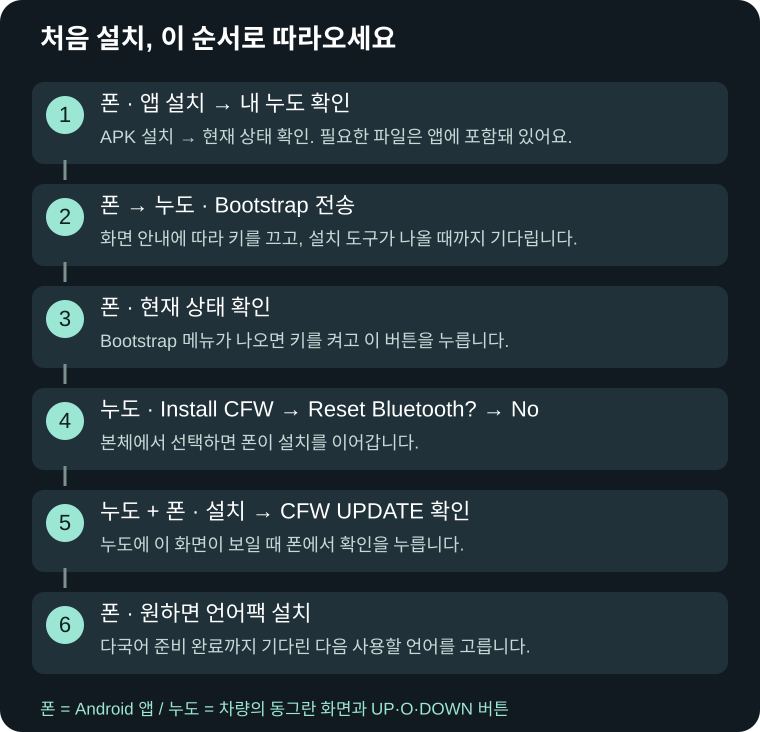

**지금 필요한 곳으로 바로 가세요.**

| 하고 싶은 일 | 안내 |
|---|---|
| 처음 설치하기 | [준비물](#prepare) → [사진 보며 처음부터 설치](#first-install) |
| 이미 쓰는 NewDoe 업데이트 | [업데이트](#update) |
| 한국어·일본어 등으로 바꾸기 | [시스템 언어 선택과 변경](#language) |
| 연결이 안 되거나 설치가 멈춤 | [연결 복구](#connection) · [화면별 문제 해결](#troubleshooting) |
| 폰 없이 순정으로 돌아가기 | [본체 복구 메뉴](#recovery) |
| 평소 사용하기 | [버튼](#controls) · [거리·정비](#vehicle) · [음악·전화](#media) · [지도](#map) |
| 앱·주차 설정 | [앱 화면](#dashboard) · [장기 주차](#parking) · [문의](#report) |

## 1. 내 누도에 설치할 수 있나요?

| 항목 | 지원 범위 |
|---|---|
| 휴대폰 | Android 6.0 이상. iPhone용 앱은 없습니다. |
| 누도 본체 | F4 계열 KYMCO Noodoe. AK550 외 모델도 앱에서 기기를 확인해 진행합니다. |
| 순정에서 처음 설치 | 순정 펌웨어 **5.14 또는 5.16** |
| 이미 CFW 사용 중 | [CFW 업데이트 안내](#update)를 따릅니다. |
| 기기 메뉴 언어 | B 기기는 9개 언어, A 기기는 영어·일본어·중국어 간체/번체 중 선택 |

본체를 뜯어 종류를 알아낼 필요는 없습니다. 앱에서 **현재 기기 확인**을 누르세요. 지원하지 않는다는 안내가 나오면 화면을 저장해 [문의](#report)하세요. 순정으로 돌아갈 때는 **5.16**이 설치됩니다.

## 2. 버튼과 전원부터 알아두세요

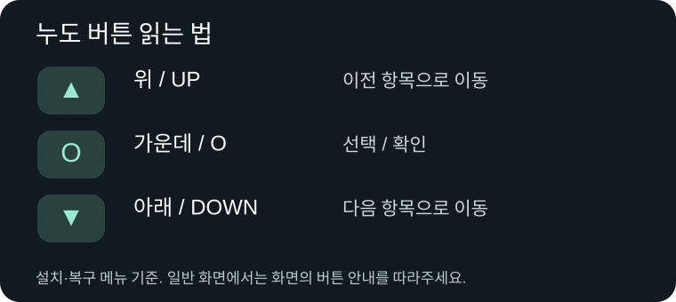

- **O**는 가운데 확인 버튼입니다. 숫자 0이 아닙니다.
- **짧게**는 눌렀다 바로 놓기, **길게**는 누른 채 유지하기입니다. ‘2초’나 ‘3초’ 안내가 있으면 그 시간만큼 유지하세요.
- **IGN ON**은 차량 키/전원 스위치를 켜기입니다. **엔진을 걸라는 뜻이 아닙니다.**
- **IGN OFF**는 키/전원 스위치를 끄기입니다. **배터리나 누도 전선을 빼라는 뜻이 아닙니다.**
- 버튼을 누도/일반 계기판으로 전환하는 스위치가 있다면 **누도 쪽**에 놓습니다.

설명서의 **Bootstrap**은 첫 설치 때 나오는 설치 도구, **CFW**는 평소 쓰는 NewDoe 펌웨어, **Recovery/Gate**는 본체 시작·복구 메뉴입니다.

## 3. 설치 전에 준비하기

### APK 하나만 받으세요

[다운로드 페이지](https://github.com/SerialSniffyHeck3r/noodoe_cfw/releases/latest)에서 **NewDoe-0.15.0.apk**를 받으세요. 언어별 누도용 펌웨어와 필요한 글꼴은 앱 안에 포함돼 있어요. 일반 설치에서는 ZIP을 따로 받거나 고르지 않습니다.

**앱과 본체 펌웨어는 0.15.0입니다.** 앱에서 시스템 언어를 고르면 기기에 맞는 펌웨어와 자원을 준비합니다. APK를 설치하는 것만으로 본체 펌웨어가 바뀌지는 않습니다.

### 출발 전이 아니라, 주차한 상태에서 시작하세요

1. 안전하게 주차하고 엔진을 끕니다. 차량과 휴대폰의 배터리가 충분한지 확인합니다.
2. 새 APK를 열어 설치합니다. 이미 NewDoe 앱이 있으면 **그 위에 업데이트**하세요. 앱이나 앱 데이터를 삭제하지 않습니다.
3. Android에서 설치 허용을 물으면 직접 받은 APK인지 확인하고 허용합니다. 설치가 끝나면 NewDoe를 엽니다.
4. Bluetooth를 켜고 차량 가까이에 폰을 둡니다. 설치 중에는 NewDoe 앱을 앞에 띄워 둡니다.
5. 다른 Noodoe 앱이 연결 중이라면 그 연결을 끕니다.

**설치·순정 복귀 중에는 배터리와 누도 전선을 연결한 채 유지하세요.** 스타터를 돌리거나 전선을 분리하지 마세요. 이미 심하게 방전된 차량은 먼저 충전·점검을 받으세요.

### 설치 전 다섯 안내를 확인하세요

각 카드의 **다음**은 3초 뒤 활성화됩니다. 시간이 지나도 자동으로 넘어가지 않습니다. 다섯 번째 안내의 키 OFF 허용은 **CFW 설치 프로세스가 시작된 뒤**를 뜻합니다. 순정에서 설치 도구를 처음 전송하는 동안에는 키 ON을 유지하세요. 키 OFF는 배터리·상시 전원을 끊어도 된다는 뜻이 아닙니다.

설치 버튼을 누르면 그림을 한 장씩 읽고 **확인했습니다**를 누릅니다. **취소**하면 설치를 시작하지 않습니다. 같은 설치가 Bootstrap으로 이어질 때는 반복하지 않지만, 다른 기기·파일이나 새 설치에서는 다시 확인합니다.

1. 배터리 단자와 누도 전선을 분리하지 마세요.
2. 키 OFF 상태에서 **UP + O**를 동시에 누르지 마세요.
3. 스타터 버튼을 누르지 마세요.
4. 배터리 전압이 **11.5V 이상**인지 직접 확인하세요. 앱이 전압을 측정하는 것은 아닙니다.
5. 가능한 단계에서는 키 OFF를 권장합니다. **순정에서 설치 도구를 처음 보낼 때는 키 ON이 필요합니다.** 이후에는 화면 안내를 따르세요.

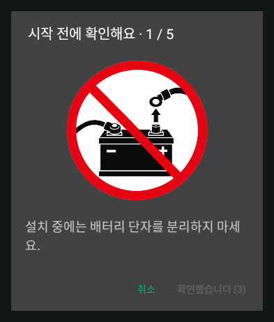
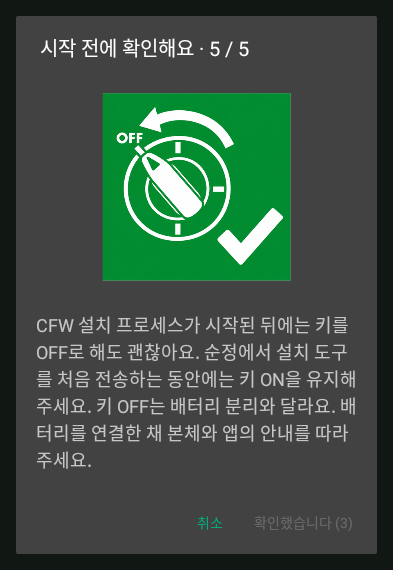

설치 중에는 진행 상태 아래에 다섯 그림이 계속 나옵니다. 다시 누르는 버튼이 아니라 주의사항을 알려주는 표시입니다.

### 순정에서 처음 설치한다면 마법사를 선택할 수 있어요

처음 앱을 열면 사용 경험을 고르고 버튼 안내를 볼 수 있어요. **기기/상태 → 현재 기기 상태 확인**을 누르세요. 실제 기기가 순정으로 확인되면 **설치합니다**로 바로 진행하거나 **단계별 안내로 설치**를 선택합니다. 잘 모르겠다면 단계별 안내를 사용하세요.

마법사는 순정에서 시작하는 설치에만 선택할 수 있습니다. 기존 CFW를 업데이트할 때는 일반 업데이트 화면을 사용합니다. 전송·검증이 시작되면 한 작업이 끝날 때까지 기다리세요. 안내 화면을 다시 여는 것만으로 설치가 시작되지는 않습니다.

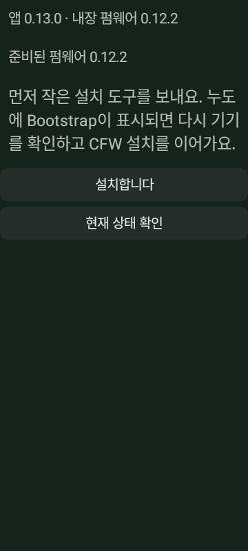

## 4. 순정에서 처음 설치하기

### ① 폰에서 내 누도를 고르기

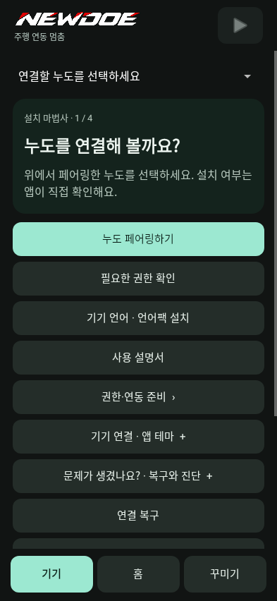

1. **[누도]** 키를 ON으로 켭니다. 엔진은 걸지 않습니다.
2. **[폰]** 앱의 **기기** 페이지로 갑니다. 좌우로 넘기거나 아래의 기기 버튼을 누릅니다.
3. 처음 연결한다면 **누도 페어링하기**를 눌러 Android Bluetooth 설정으로 갑니다. 순정 누도를 페어링 대기 상태로 만들고 내 Noodoe를 선택합니다. 이미 등록돼 있으면 다시 등록하지 않습니다.
4. NewDoe 앱으로 돌아와 내 기기를 선택합니다. 안 보이면 기기 목록을 새로고침합니다.
5. **권한·연동 준비**에서 Bluetooth/주변 기기 권한을 허용합니다. 음악·전화·위치 권한은 [설치 뒤 설정](#phone)에서 추가할 수 있습니다.
6. **현재 기기 확인**을 누릅니다. 앱이 **순정 Noodoe**라고 표시하는지 확인합니다.

### ② 내장 파일로 설치 도구 보내기

1. **[폰] 현재 기기 상태 확인**이 끝나면 **앱 버전 / 내장 펌웨어 / 준비된 펌웨어**를 볼 수 있습니다. 파일은 자동으로 준비됩니다.
2. 순정 기기라면 **설치합니다**를 누르거나 **단계별 안내로 설치**를 선택합니다.
3. 설치 전 주의 화면을 한 장씩 읽고 확인하세요. 취소하면 설치 명령을 보내지 않습니다.
4. 전송과 확인이 끝날 때까지 기다립니다. 처음 순정 전송 중에는 미리 키를 끄지 마세요.

### ③ Bootstrap 메뉴를 본 뒤 ‘현재 상태 확인’ 누르기

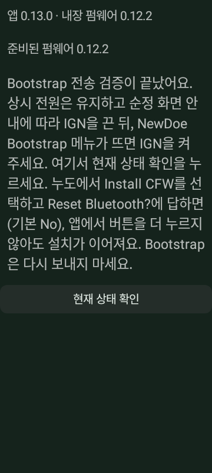

1. **[폰]** 위 안내가 나오면 순정 화면 안내에 따라 **키를 OFF**로 합니다. 배터리는 연결한 채 둡니다.
2. **[누도]** 설치가 끝나고 아래 **NewDoe Bootstrap** 메뉴가 나올 때까지 기다립니다. 중간의 **NOODOE INSTALLER** 화면은 아직 이 메뉴가 아닙니다.
3. Bootstrap 메뉴가 나오면 **키를 ON**으로 합니다.
4. **[폰] 현재 상태 확인**을 누릅니다. 이 버튼을 누르는 단계입니다. Bootstrap 파일을 다시 보내지 마세요.

처음 3초는 NEWDOE 워드마크만 표시합니다. 확인 작업은 뒤에서 계속됩니다. 이후 아직 진행 중이면 워드마크 위에 현재 확인 항목, 아래에 가로 막대가 나오고, 이미 끝났다면 바로 메뉴로 넘어갑니다.

| 먼저 잠깐 보이는 파일 확인 | 확인이 끝난 뒤 나오는 메뉴 |
|---|---|
| 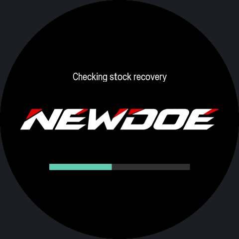 | 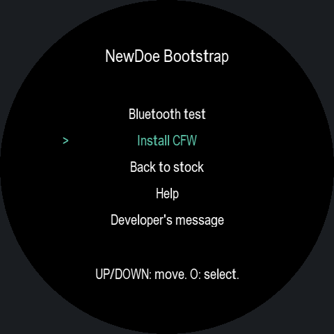 |

### ④ 누도에서 Install CFW 선택하기

1. **[누도]** UP/DOWN으로 **Install CFW**를 고르고 **O**를 누릅니다.
2. 아래 **Reset Bluetooth?** 질문이 나오면, 연결에 문제가 없을 때는 **기본 선택 No → O**를 누릅니다.
3. 이후 설치는 폰에서 이어집니다. 폰의 다른 설치 시작 버튼을 추가로 찾을 필요는 없습니다.

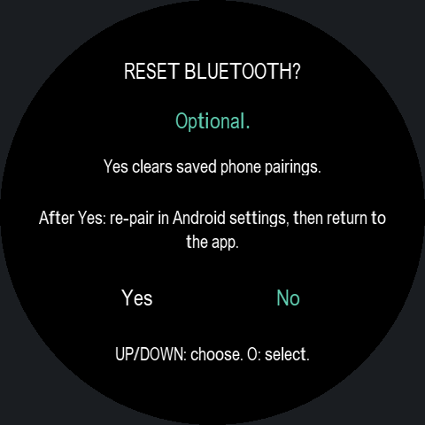

**Yes는 저장된 페어링을 지웁니다.** 실제 연결 문제가 있을 때만 선택하세요. ‘연결할 수 없음’이 나오면 [재페어링 순서](#connection)를 따릅니다. 이 질문에는 자동 선택 시간이 없습니다.

기존 CFW 데이터를 발견했다고 물으면, 기존 설정·트립·사진을 이어 쓰려는 경우 **보관 데이터 복원**을 선택합니다. **새로 시작**은 새 환경으로 시작하려는 경우에 고릅니다. 처음 설치라면 이 질문이 없을 수 있습니다.

### ⑤ 두 막대가 움직이면 기다리기

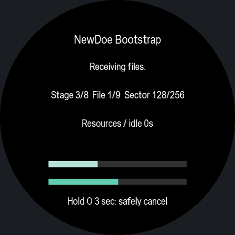

- **위의 연한 막대:** 설치 전체 진행입니다.
- **아래의 진한 막대:** 지금 하는 작업의 진행입니다. 다음 작업으로 넘어가면 다시 처음부터 찰 수 있습니다.
- 글씨는 받고 있는 파일이나 현재 작업을 알려줍니다. 숫자는 예시와 달라도 됩니다.

전원과 폰 연결을 유지하세요. 느리다는 이유로 강제로 껐다 켜지 마세요. 취소가 필요하면 화면 안내에 따라 **O를 새로 3초** 누르고, 멈췄다는 안내가 나올 때까지 기다립니다.

### ⑥ Everything is ready → 최종 설치

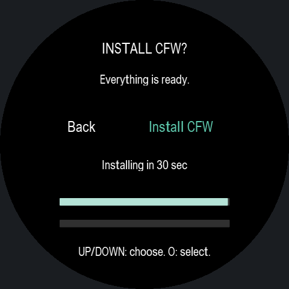

이제 파일 준비가 끝났습니다.

- 바로 설치: **Install CFW → O**.
- 그대로 기다리기: **30초 뒤 자동으로 설치**합니다.
- 돌아가기: UP/DOWN을 눌러 카운트다운을 멈춘 뒤 **Back → O**.

설치가 시작되면 본체가 다시 시작됩니다. 잠깐 연결이 끊어지거나 시작 화면이 보여도 앱을 닫지 마세요.

### ⑦ 누도의 CFW UPDATE를 보고 폰에서 확인하기

실제로 CFW UPDATE가 보이면 **CFW UPDATE가 보여요 · 계속**을 즉시 누를 수 있습니다. **아직 안 보여요**는 10초 뒤 활성화되며, 눌러도 설치 승인으로 처리되지 않습니다. 시간이 지났다는 이유만으로 기기가 정상 부팅했다고 판단하지 않습니다.

| 누도에서 이 화면을 확인 | 그다음 폰에서 확인 버튼 |
|---|---|
| 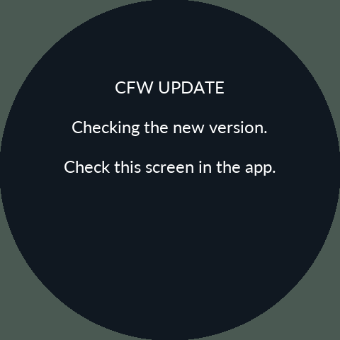 | 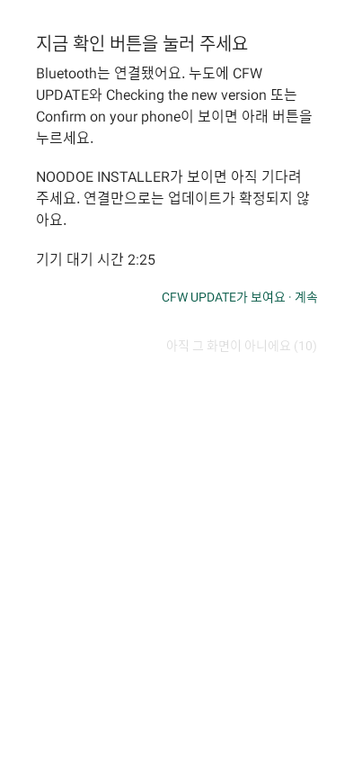 |

1. **[누도] CFW UPDATE**와 **Checking the new version** 또는 **Confirm on your phone**이 보이는지 확인합니다.
2. **[폰] CFW UPDATE가 보여요 · 계속**을 누릅니다. 아직 Bootstrap, NOODOE INSTALLER, 검은 화면이라면 **아직 그 화면이 아니에요**를 고르고 기다립니다.
3. 폰이 **설치 완료**를 알리고 누도 HOME이 나올 때까지 기다립니다.

**폰의 남은 시간 안에 확인하세요.** 확인하지 않으면 이전 버전이나 복구 화면으로 돌아갈 수 있습니다. 팝업을 닫는 것만으로는 설치 확인이 되지 않습니다.

### ⑧ 선택한 언어 확인하기

앱이 선택한 시스템 언어와 필요한 글꼴을 준비합니다. 완료 안내를 기다린 뒤 누도 메뉴를 확인하세요. 영어가 나오면 [언어 상태 확인](#language)을 참고하세요.

## 5. 이미 NewDoe를 쓰고 있다면

**기존 사용자는 기기 상태를 확인하고 원하는 시스템 언어를 고른 뒤 0.15.0으로 업데이트하세요.** 호환되는 Gate는 유지하고 정상적인 기존 B 글꼴을 재사용합니다.

1. 기존 앱 위에 `NewDoe-0.15.0.apk`를 설치합니다. 앱 데이터와 페어링은 유지하세요.
2. 주행 연동을 멈추고 상태 페이지에서 **현재 기기 상태 확인**을 누릅니다. 파일은 앱이 준비합니다.
3. **언어 설정 → 다른 언어 설치**를 고른 뒤 **업데이트합니다**를 누르고 안전 안내를 확인합니다.
4. 전원을 연결한 채 전송·검증·재시작이 끝날 때까지 기다립니다.
5. 누도의 **CFW UPDATE** 화면을 앱에서 확인합니다. 추가 글꼴 준비가 나오면 최종 설치 완료까지 기다립니다.

### 0.14.1에서 설정 저장·복원 오류로 업데이트가 막힌다면

본체 HOME이 열려도 설정 복원이 완료되지 않을 수 있습니다. **현재 기기 상태 확인**은 상태만 읽습니다. 이 버튼으로 설정 복원이나 설치를 다시 실행하지 않습니다.

1. 새 APK를 기존 앱 위에 설치합니다. 앱 데이터는 지우지 말고 **진단 자료 저장**으로 기록을 보관합니다.
2. 상태를 확인합니다. **펌웨어 부팅 확정**과 **설정 복원 미완료**가 따로 나오면 두 상태를 함께 확인하세요. 같은 작업의 **설치 계속**으로 복원을 다시 시도할 수 있지만, 0.14.1 설정 오류가 계속되면 다음 경로를 사용합니다.
3. 앱의 **데이터 보존 재설치** 안내를 엽니다. 폰이 실제로 연결되지 않으면 [본체 버튼으로 복구 메뉴](#recovery)를 열고 **Back to stock**을 선택합니다. **CFW 데이터 유지**를 사용하며 **완전 삭제**는 고르지 않습니다.
4. 순정 화면이 나온 뒤 앱에서 **본체에서 순정으로 돌아왔어요 · 확인**을 누릅니다. 앱이 실제 순정 상태를 확인하면 이전 작업 기록을 보관하고 재설치를 준비합니다.
5. 앱에서 원하는 설치 언어를 고르고 [처음 설치](#first-install)를 진행합니다. Bootstrap에서는 **보관 데이터 복원**을 선택합니다. 설정·TRIP·정비·사진·페어링을 보존하는 경로입니다.
6. 본체 화면과 앱의 최종 결과를 확인합니다. 필수 데이터 파일이 없거나 손상됐다는 안내가 나오면 자동 초기화하지 않습니다. 진단 자료를 저장하고 중단하세요.

**정상적으로 설정을 저장하고 업데이트 준비를 마치는 기기는 순정 복귀가 필요 없습니다.** 오류 메시지에서 확인하지 못했다고 표시한 데이터는 보존 완료로 판단하지 마세요. 취소해도 이미 완료된 단계가 되돌아가지는 않습니다.

### 앱에서 새 복구 시스템이 필요하다고 안내한다면

0.11.x나 다른 구형 Gate에서는 먼저 **순정 복귀 → CFW 데이터 유지**로 진행합니다. 순정 화면이 나오면 **본체에서 순정으로 돌아왔어요 · 확인**을 누르고 앱의 내장 파일로 [처음 설치](#first-install)를 진행하세요. **보관 데이터 복원**을 선택하고, 완전 삭제는 고르지 마세요.

설정·트립·정비 기록·사진은 유지됩니다. **순정 복귀·설치 중 전원을 분리하지 마세요. 구버전 순정 복귀 도중 전원이 끊기면 별도 장비를 이용한 수리가 필요할 수 있습니다.**

## 6. 시스템 언어 선택과 변경

**설치 전에 앱에서 언어를 고릅니다.** 영어 전용으로 설치하거나, 영어와 원하는 언어 하나를 함께 설치할 수 있습니다. 필요한 파일은 APK 안에 들어 있습니다.

### 처음 선택하거나 다른 언어로 바꾸기

1. 차량을 세우고 앱의 **현재 기기 상태 확인**을 누릅니다. 앱이 실제 기기의 A/B 자원을 확인합니다.
2. **언어 설정 → 다른 언어 설치**에서 원하는 언어를 고릅니다. 기기에 맞는 선택지만 표시됩니다.
3. **설치합니다 / 업데이트합니다**를 누르고 안전 안내를 확인합니다.
4. 전송·검증·재시작과 **CFW UPDATE** 확인을 마칩니다. 추가 글꼴 준비가 나오면 앱의 완료 안내까지 기다립니다.
5. 누도 메뉴의 언어를 확인합니다. 앱에는 **설치 언어**와 **표시 언어**가 따로 표시됩니다.

**언어만 바꾸려고 순정으로 복귀할 필요는 없습니다.** 정상적인 언어 변경은 펌웨어와 기본 자원을 함께 업데이트하며, 이미 정상인 추가 글꼴은 다시 보내지 않습니다.

| A 기기의 일본어 메뉴 | B 기기의 한국어 메뉴 |
|---|---|
| 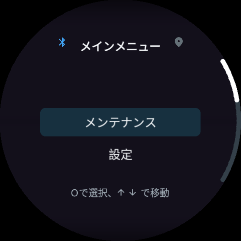 | 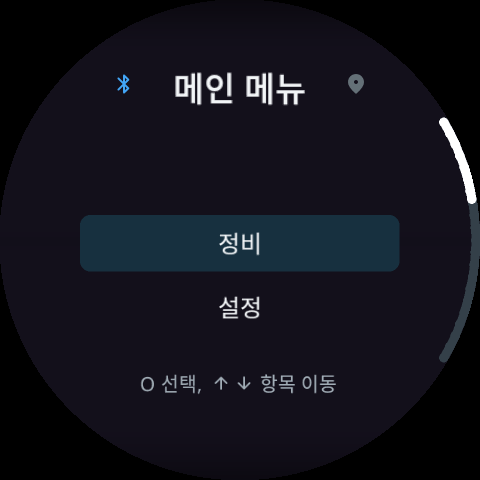 |

### 영어와 설치된 언어 사이에서 전환

앱의 **언어 설정**에서 앱 언어·설치된 메뉴 언어·실제 표시 언어·영어 전환·음악/알림 렌더링·추가 폰트 상태를 확인합니다. 다른 언어를 설치하려면 **기기 시스템 언어**에서 언어를 고르고 확인하세요. 기기 확인이 끝나면 **설치 계속 / 언어 상태 확인**으로 해당 언어의 펌웨어와 기본 자원을 함께 업데이트합니다. 앱 언어만 변경하면 본체 메뉴는 바뀌지 않습니다.

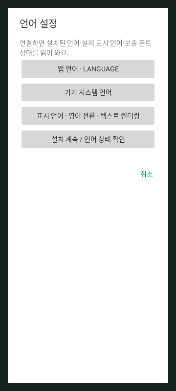

누도에서는 **설정 → 시스템 → 언어**를 엽니다. **Firmware**는 설치된 언어, **Language**는 실제 사용할 언어입니다. 영어 또는 설치된 언어를 선택하고 저장한 뒤 정차 상태에서 재시작합니다. 영어 전용 Product라면 영어만 선택할 수 있습니다.

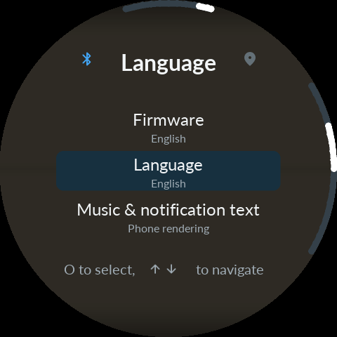

영어 전용 펌웨어를 골랐어도 외국어 음악·알림은 표시할 수 있습니다. 메뉴를 영어로 쓰기 위해 추가 글꼴 설치 공간을 확보할 필요는 없습니다.

### 고를 수 있는 언어

| 기기 자원 | 시스템 언어 선택 |
|---|---|
| A | English · 日本語 · 简体中文 · 繁體中文（台灣）· 繁體中文（香港） |
| B | English · Deutsch · Español · Français · Italiano · Ελληνικά · 한국어 · Tiếng Việt · 日本語 |

**앱 언어**는 휴대폰 화면만 바꿉니다. 본체 언어는 앱에서 선택해 설치하며, 이후 폰의 언어를 바꿔도 자동으로 바뀌지 않습니다. 기존의 ‘앱 언어 따르기’는 업데이트할 때 설치할 언어 하나로 정해집니다.

### 추가 글꼴 준비가 나올 때

정상적인 기존 B 언어팩은 글꼴 자원으로 계속 사용합니다. 파일을 정리한다는 이유로 순정 파일이나 기존 사진을 지우지 않습니다. 파일이 없거나 작으면 앱이 **폰트 준비용 펌웨어가 필요한 이유와 최종 펌웨어로 돌아오는 순서**를 먼저 설명합니다. 확인해야 시작됩니다. Bluetooth와 페어링·설정은 준비용에서도 그대로 사용합니다.

준비용에서는 **FONT PREPARATION** 화면만 표시하며 HOME·음악·지도 기능은 사용할 수 없습니다. 정차한 상태에서 앱으로 설치를 계속하세요. `Font preparation complete`는 글꼴 준비가 끝났다는 뜻이며, **선택한 최종 펌웨어까지 설치해야 주행 화면으로 돌아갑니다.** 연결 도움이 필요하면 대기 화면에서 위 버튼을 짧게 눌러 기존 페어링 도움말을 열 수 있습니다. 페어링을 자동으로 삭제하지 않습니다.

| 준비용에서 휴대폰 연결 대기 | 글꼴 공간 부족 |
|---|---|
| 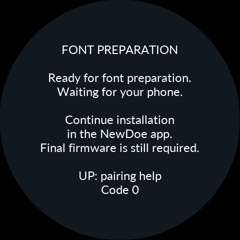 | 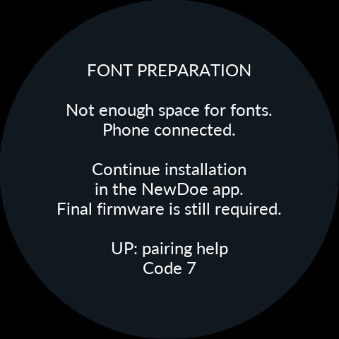 |

시동 OFF 대기 중에는 화면을 끄고 기존 절전 정책을 따릅니다. 글꼴 설치나 최종 펌웨어 전송이 진행되면 설치 화면으로 돌아옵니다. 기존 사진·트립·정비·설정·페어링 데이터는 유지합니다.

| 1. 준비용 펌웨어 전송 | 2. 저장 공간 검사 | 3. 글꼴 받기 |
|---|---|---|
| 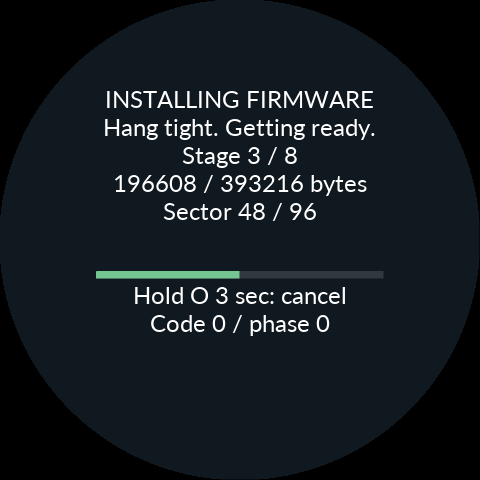 | 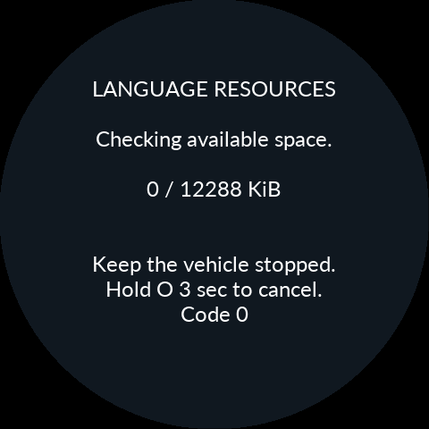 | 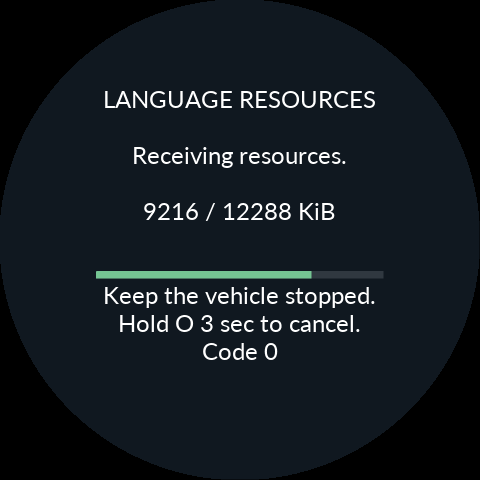 |

| 4. 기록한 글꼴 확인 | 5. 저장 완료 처리 | 6. 선택한 최종 펌웨어 설치 |
|---|---|---|
| 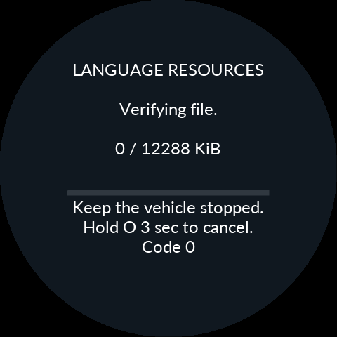 | 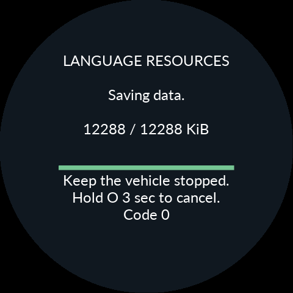 | 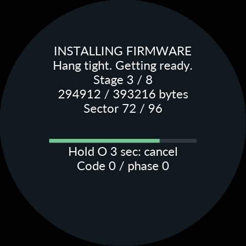 |

**CJ 공간이 부족하면 사용자가 선택하기 전까지 진행하지 않습니다.** 필요한 용량과 기기가 보고한 여유 용량을 확인하세요. 정확한 여유를 보고하지 못하는 경우에는 확인되지 않았다고 표시합니다.

- 선택한 메뉴가 CJ 없이 동작하면 **CJ 없이 계속 설치 / 취소**를 선택할 수 있습니다. CJ 없이 계속하면 미지원 음악·알림 문자는 휴대폰 렌더링이 필요하며, 휴대폰 렌더링을 쓸 수 없을 때 해당 문자가 표시되지 않을 수 있습니다.
- 필수 메뉴 글꼴이 부족하면 **사용 가능한 언어 다시 선택 / 취소**만 가능합니다. 앱이 영어로 몰래 바꾸거나 현재 언어의 설치를 완료로 처리하지 않습니다.
- 준비용 펌웨어에서 취소하면 **준비용이 남아 있습니다.** 취소는 완료된 작업을 되돌리지 않습니다. 앱 데이터와 설치 기록을 유지하고 나중에 재개하거나 다른 언어를 선택하세요.
- CJ를 생략하면 완료 화면과 언어 설정에 **설치 완료 — CJ 미설치**가 남습니다. 나중에 설치하려면 다시 용량 검사와 확인을 진행합니다.

CJ를 생략할 수 있는 경우 / 필수 글꼴이 없어 언어를 다시 선택해야 하는 경우

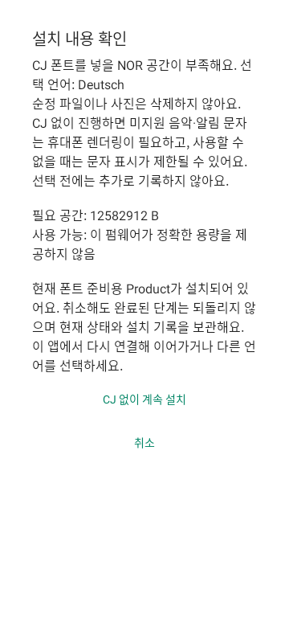 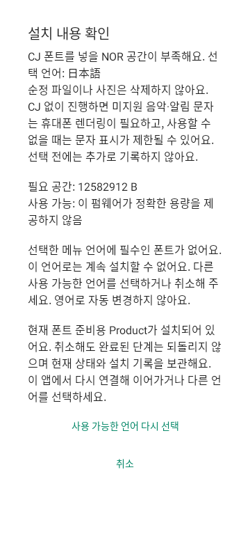

연결 끊김·시간 초과·저장소 손상은 공간 부족과 다른 문제입니다. 오류 화면의 단계와 코드를 확인하고 진단 자료를 저장하세요. 설치가 끊겼다면 같은 앱 데이터를 유지한 채 **현재 기기 상태 확인 → 설치 계속**으로 이어갑니다. 상태 확인만으로 다시 기록하지 않으며, 정상 부팅 때 글꼴 전체를 다시 해시하거나 재전송하지 않습니다.

| 음악·알림 표시 설정 | 표시 방식 |
|---|---|
| **휴대전화에서 렌더링** | 휴대폰 글꼴과 컬러 이모지를 사용합니다. |
| **기기 글꼴 사용** | 문자열 전체를 기기 글꼴로 표시할 수 있으면 기기에서 표시합니다. 지원하지 않는 글자가 하나라도 있으면 해당 제목·본문 전체를 휴대폰에서 그립니다. |

영어가 계속 나오면 **설치 언어 → 영어 전용 설정 → 재시작 여부 → 앱의 폰트 상태와 폴백 안내**를 확인하세요.

## 전문가용 설정과 중단된 설치

일반 설치는 **현재 기기 상태 확인 → 설치합니다 / 업데이트합니다**만 사용하세요. 수동 ZIP 설치, 진단, 복구, 백업은 **기기/상태 → 전문가용 설정**에 있습니다. ZIP 직접 설치를 누르면 주의 화면이 나오며, 파일을 선택한 뒤 실제 설치할 때도 주의사항을 확인합니다. ZIP 선택만으로 설치하지 않습니다. 기본 경로로 돌아가려면 **앱에 포함된 패키지 사용**을 누르세요.

앱 업데이트나 연결 끊김이 있었다면 기기 상태부터 확인하세요. 끝나지 않은 설치는 원래 파일과 작업 기록으로 이어갑니다. 새 앱에 다른 버전이 포함돼 있어도 진행 중인 작업을 새 파일로 바꾸지 않습니다. 파일이 없거나 손상됐다는 안내가 나오면 전문가용 설정에서 **처음 사용한 ZIP**을 다시 가져오세요. 다른 버전으로 대신 진행하지 마세요.

설치 파일과 기록은 앱 전용 저장소에 보관합니다. **앱 삭제·데이터 삭제를 하면 함께 사라집니다.** 먼저 전문가용 설정에서 **백업·작업 기록 저장**을 사용하세요. 공간이 부족하면 다른 불필요한 파일을 정리한 뒤 다시 시도하세요. 앱은 복구 자료나 진행 중인 파일을 임의로 삭제하지 않습니다. 복원 중 확인되지 않은 작업은 실제 기기 확인 없이 다시 보내지 않습니다.

## 7. 연결할 수 없다고 나올 때

### Bootstrap에서 ‘Couldn’t pair’가 뜨면

파일 기록 중이라면 먼저 끝날 때까지 기다립니다. Bootstrap 메뉴나 연결 대기 화면에서 아래를 진행하세요.

1. **[폰] 접속이 안 되나요? / Bootstrap 연결 도움말**을 엽니다.
2. **Bluetooth 설정 열기**를 누르고 Android에서 **내 Noodoe만 등록 해제**합니다. 앱 데이터는 지우지 않습니다.
3. **[누도]** 이미 **Reset Bluetooth? → Yes**를 골랐다면 화면 안내를 따릅니다. 아직 초기화하지 않았다면 연결 대기 화면의 **UP**으로 페어링 메뉴를 열고 해당 폰을 고릅니다. O를 놓았다가 **다시 2초** 눌러 삭제합니다. ALL은 모든 폰을 삭제합니다.
4. **PAIR YOUR PHONE**이 나오면 Android에서 Noodoe를 다시 검색하고 페어링합니다.
5. NewDoe 앱으로 돌아와 같은 기기를 고르고 **현재 상태 확인**을 누릅니다.
6. 누도에서 **Install CFW**를 선택합니다. 이어가기 화면이 보이면 **마지막 작업 상태 조회 → 검사 후 설치 이어가기**를 따릅니다.

### 일반 화면에서 연결이 끊기면

**0.14.1은 연결 중 갱신된 Bluetooth 인증키를 다음 연결에도 사용할 수 있도록 저장합니다.** 기존 앱 위에 새 APK를 설치하고 **현재 기기 상태 확인 → 업데이트**로 본체도 업데이트하세요. APK만 바꾸면 본체의 수정은 적용되지 않습니다.

앱 상단의 주행 연결이 일시정지돼 있지 않은지, Bluetooth·주변 기기 권한이 있는지 확인합니다. Android의 NewDoe 배터리 사용 설정에서 백그라운드 실행을 허용하세요. 앱을 강제 종료했다면 다시 열고 연결을 시작합니다. 카메라 등 다른 앱을 쓰다가 끊겼다면 NewDoe로 돌아와 연결 상태를 확인하세요.

이미 재페어링으로 연결을 복구했다면 그 연결로 본체를 업데이트하면 됩니다. 이후에도 연결할 수 없다면 재시작·재페어링 전에 앱의 진단 ZIP과 본체·앱 버전을 저장해 보내 주세요. 앱 데이터는 유지하세요. 설정 저장·복원 오류로 업데이트가 막히면 위의 [0.14.1 재설치 안내](#update)를 따르세요.

**복구 메뉴에는 Bluetooth가 없습니다.** 해골이나 Recovery 메뉴에서 폰 연결을 계속 시도하지 말고 [본체 버튼으로 복구](#recovery)하세요.

## 8. 이 화면에서는 무엇을 해야 하나요?

| 화면·문구 | 지금 할 일 |
|---|---|
| **NOODOE INSTALLER** | 본체 설치가 끝나 Bootstrap 또는 다음 화면이 나올 때까지 기다립니다. CFW UPDATE 확인을 누를 때가 아닙니다. |
| **100% / Verifying and saving** | 저장이 끝날 때까지 전원을 유지합니다. [완료까지 남은 과정](#language)을 보세요. |
| **CFW UPDATE** | 폰에서 ‘CFW UPDATE가 보여요 · 계속’을 누릅니다. |
| **Firmware installed / Language resources are incomplete** | 펌웨어는 설치됐습니다. 같은 기기로 연결해 **현재 기기 확인 → 설치 이어가기 / 언어 상태 확인**을 누릅니다. 바로 순정 복귀나 펌웨어 재설치를 하지 마세요. |
| **opcode 0xAA / socket closed / read -1** | 본체 재시작 여부를 보고 재연결합니다. 그다음 언어 자원 상태를 다시 확인합니다. 계속되면 오류와 진단을 저장합니다. |
| **설치 성공 또는 취소가 확인되지 않음** | 같은 기기·같은 ZIP으로 **현재 기기 확인 → 마지막 작업 상태 조회**를 진행합니다. |
| **Paused / Stage 6/8 / Code 6 / Phase 4** | 본체가 수동 재시작을 요청하는지 확인하고, 요청이 있으면 바로 아래 절차를 따릅니다. |
| **언어를 바꿨는데 영어** | [언어 설정 네 가지 확인](#language)을 따릅니다. |
| **ODO ------ / 속도 미수신** | 차량 키가 ON인지 확인합니다. 계속되면 차량 모델과 화면을 보내 주세요. |

### ‘Please manually reset’이 나오면

1. 화면의 코드와 문구를 사진으로 남깁니다.
2. 버튼을 모두 놓은 뒤 **UP + O를 함께 3초** 누르고 놓습니다.
3. 키가 OFF라면 화면이 꺼진 채일 수 있습니다. 버튼을 놓고 **키를 ON**으로 합니다.
4. 같은 기기와 ZIP으로 다시 상태를 확인합니다. CFW UPDATE면 폰에서 확인하고, 복구 메뉴면 다음 절차를 따릅니다.

이 조작은 **본체가 요청할 때** 하세요. 진행이 느리다는 이유로 기록 중인 본체를 강제로 끄지 않습니다.

## 9. 폰 없이 복구하거나 순정으로 돌아가기

### 복구 메뉴 열기

- 본체가 새로 시작하며 NewDoe 로고를 표시할 때 **DOWN을 약 1초** 누릅니다.
- CFW가 이미 실행 중이면 **키 OFF → O를 누르고 유지 → 누른 채 키 ON → 2초 이상 유지 → 복구 화면에서 놓기**를 사용합니다.
- 키 OFF에서 UP+O를 눌러 화면이 꺼졌다면 버튼을 놓고 키 ON으로 다시 시작할 수 있습니다.

| 오류가 있을 때 먼저 나오는 화면 | 버튼을 누르거나 30초 뒤 나오는 메뉴 |
|---|---|
| 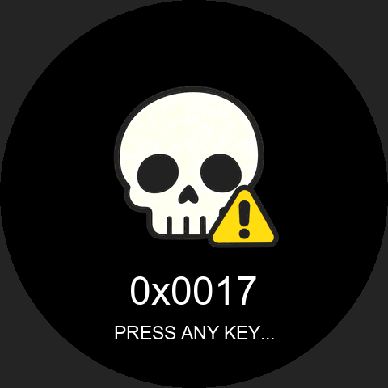 | 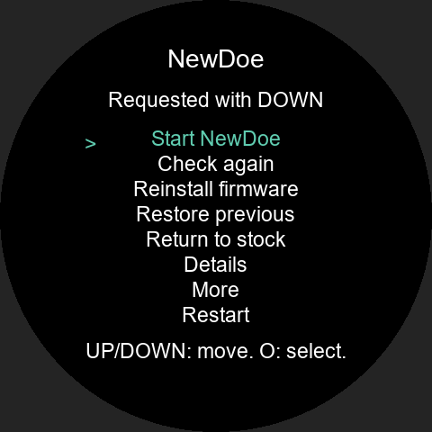 |

직접 들어갔다면 해골 없이 메뉴가 나올 수 있습니다. **UP/DOWN으로 이동, O로 선택**합니다. 회색 항목은 지금 사용할 수 없습니다. 화면 위의 사유·코드는 상황에 따라 달라집니다.

| 메뉴 | 하는 일 |
|---|---|
| **Start NewDoe** | 현재 펌웨어로 시작 |
| **Check again** | 복구할 수 있는 항목 다시 찾기 |
| **Reinstall firmware** | 보관된 설치 파일로 다시 설치 |
| **Restore previous** | 이전 펌웨어로 복구 |
| **Return to stock** | 순정 펌웨어로 복구 |
| **Try recovery anyway** | 일반 복구가 실패했을 때 다른 복구본 찾기 |
| **Details** | 오류와 상태 자세히 보기 |
| **More** | 도움말·계기판 값·간단한 게임 |
| **Restart** | 본체 다시 시작 |

### 순정으로 돌아가려면

1. **Return to stock → O**를 누릅니다.
2. 확인 화면의 내용을 읽고, **O를 놓았다가 새로 2초** 유지합니다.
3. 새 Gate에서는 배터리·UP + O·스타터 금지 그림이 순서대로 나옵니다. 매번 **O를 놓았다가 새로 눌러** 확인합니다. UP 또는 DOWN은 돌아가기입니다. 직접 선택한 강제 순정 복구에도 같은 안내가 나옵니다.
4. 순정 화면이 나올 때까지 전원을 유지합니다. **폰 연결은 필요하지 않습니다.** 이전 버전의 복구 메뉴에는 새 그림 세 장이 없을 수 있습니다.

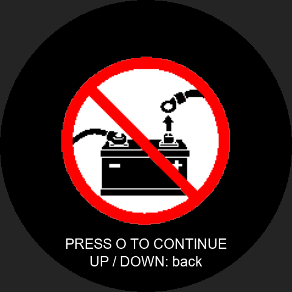

| 복구 승인 화면 예시 | 순정 복귀 진행 화면 |
|---|---|
| 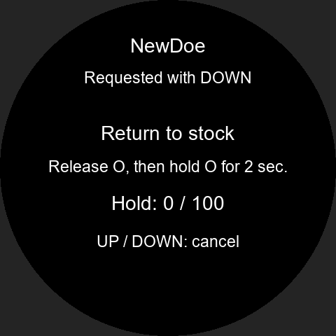 | 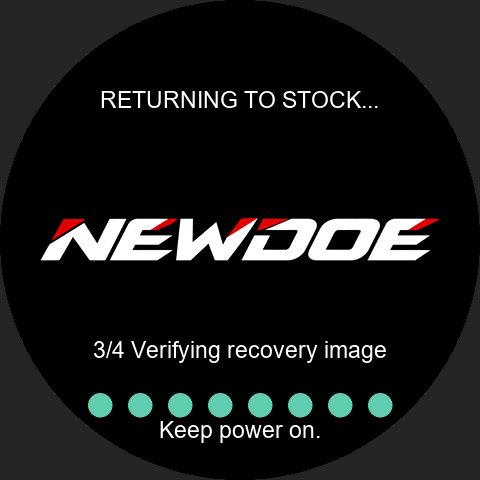 |

복구가 실패하면 **Check again**, 사용할 수 있다면 **Try recovery anyway**를 확인하세요. 더 진행할 수 없다는 화면에서는 **O**로 돌아갑니다. 반복해서 실패하면 코드와 화면을 [문의](#report)에 첨부하세요. 모든 복구본을 사용할 수 없다면 수리·분해 복구가 필요할 수 있습니다.

**Use recovery scratch**가 나오면 진행 중이던 언어·폰트 복구 데이터를 포기하고 복구 공간으로 쓰는 선택입니다. 해당 작업을 포기할 때만 승인하세요.

### 폰으로 순정 복귀하기

주행 연동을 중지하고 **순정으로 돌아가기 → CFW 데이터 유지**를 선택합니다. 본체가 순정으로 돌아온 다음 폰의 확인 버튼을 누릅니다. 나중에 재설치할 때 **보관 데이터 복원**을 고르면 기존 환경을 이어갑니다. **CFW 데이터까지 완전 삭제**는 기존 CFW 데이터를 지우려는 경우에만 선택하세요.

## 10. 설치 뒤, 폰 연결과 권한

앱에서 내 누도를 고르고 상단 **재생 버튼**으로 주행 연동을 시작합니다. 상단 **일시정지**는 누도 연결을 쉬는 버튼이며 음악 재생 버튼과 다릅니다.

| 권한·설정 | 필요한 기능 |
|---|---|
| Bluetooth / 주변 기기 | 누도 연결·설치 |
| 알림 접근 | 음악 정보와 선택한 앱의 알림 |
| 정밀 위치·백그라운드 위치 | GPS·지도, 화면을 꺼둔 동안 위치 전달 |
| 연락처·전화·최근 통화 | 발신자 이름과 통화 기능 |
| 앱 알림·백그라운드 실행 | 연결 상태 알림과 자동 재연결 |

**권한·연동 준비**에서 필요한 항목을 하나씩 켜세요. 전화번호를 제공하지 않는 통화는 **Unknown caller**로 나올 수 있습니다.

## 11. 본체 버튼으로 사용하기

| 일반 화면에서 | 동작 |
|---|---|
| **O 짧게** | HOME → 트립 → 음악 → 스마트폰 → 지도 순환 |
| **O + DOWN 짧게** | 빠른 밝기 설정 열기 |
| 빠른 설정에서 **UP / DOWN** | 밝기 조절 |
| 빠른 설정에서 **O 짧게 / 길게** | 닫기 / 메인 메뉴 열기 |
| 빠른 설정에서 **UP 길게** | 화면 표시 다시 시작 |
| 빠른 설정에서 **DOWN 길게** | Super Nite 저밝기 |

전화·알림·메뉴가 떠 있으면 그 화면의 버튼 안내를 따릅니다. 전체 설정은 주차 후 조작하세요.

상단 다섯 아이콘은 HOME에서 잠시 뒤 숨고 다른 일반 페이지에서는 유지됩니다. **GPS 회색**은 위치를 기다리는 상태이며, 위치가 들어오면 짧게 회색으로 깜빡입니다. **Bluetooth 노랑·빨강**은 폰 배터리 부족, **초록**은 충전 중 표시입니다.

## 12. 누적 거리·트립·정비

0.15.1부터 **오일 교환주기는 ODO 거리만** 사용합니다. 모든 정비 항목에서 시동 시간 계측·수명 반영을 제거했습니다. 기존 교환 후 거리는 유지하며 과거 시간값은 거리로 환산하지 않습니다. 시간 주기만 사용했다면 정비 설정에서 거리 주기를 지정하세요. 벨트·정기 점검의 날짜 기준과 주행시간·평균속도 통계는 유지됩니다.

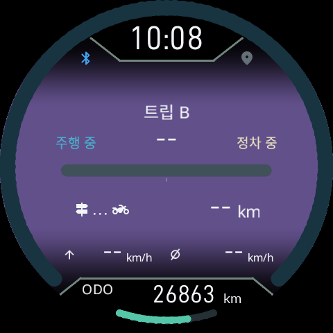

**ODO는 차량 계기판에서 받은 누적 거리**입니다. 값이 없으면 `------`로 표시합니다. 누도의 ODO를 따로 보정하거나 과거 값을 불러오는 메뉴는 없습니다.

트립 A/B·오늘·이번 주행·오일·벨트·정비 기록은 별도로 유지됩니다. **정비 메뉴**에서 교체 주기와 교체 후 주행거리를 확인하고, 실제 교체 기록에 맞게 초기화하거나 조정하세요. 이 조작은 차량 계기판의 원래 ODO를 바꾸지 않습니다.

오일의 남은 비율은 **30% 이하 노랑 → 15% 이하 빨강 → 5% 이하 빨강 점멸**입니다. 이번 주행의 최고·평균 속도가 5km/h를 넘으면 속도 링에 표시합니다.

HOME의 **위/아래** 순서는 **1줄 수동 → 1줄 AUTO → 2줄 AUTO → 속도 → 시계 → 지도**입니다. 마지막 보기는 안내 중 전체 TBT, 안내가 없으면 기존 큰 나침반을 표시합니다. **O 길게**로 하단 정보를 바꿉니다. 1줄 수동은 선택한 정보를 계속 유지하며, AUTO에서 직접 넘긴 정보는 20초 뒤 기존 알림·음악 우선순위로 돌아갑니다. 화면과 정보 선택은 주행 중 RAM에만 두고 **키 OFF 때** 저장합니다. 전원을 갑자기 분리하면 마지막 키 OFF 이후 선택은 저장되지 않을 수 있습니다.

**설정 → 화면 → 시계 스타일**에서 아날로그 또는 디지털을 선택합니다. HOME에는 선택한 시계 한 종류만 나옵니다. 디지털 시계에서는 상단 작은 시계만 숨깁니다. 사진의 검은 음영, 기존 바늘 길이·속도 호·ODO·하단 정보 위치는 유지합니다.

하단 순환에는 **일출 / 일몰**도 있습니다. 본체 **설정 → 표시 → 일출 / 일몰** 또는 폰의 **기기 설정 → 일출·일몰 기준 도시**에서 가까운 도시를 고르세요. 본체가 날짜·UTC 시차와 선택한 도시로 간단히 계산해 분 단위로 표시합니다. GPS는 기준 도시를 자동 변경하지 않습니다. 여행 시 도시와 UTC 시차를 확인하고, 서머타임도 시차에 반영하세요. 기존에 저장한 위치는 **이전에 저장한 위치**로 재사용할 수 있습니다. 저장 위치가 없는 새 설치에서는 도시를 직접 선택해야 하며, 위치·날짜를 모르면 `--:-- / --:--`입니다. 산·건물·고도·날씨는 반영하지 않는 대략적인 시각입니다.

| 아날로그 시계 | 디지털 시계 |
|---|---|
| 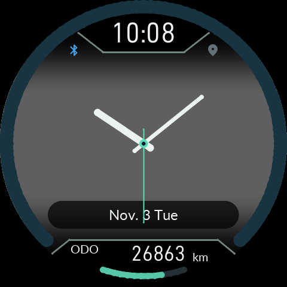 | 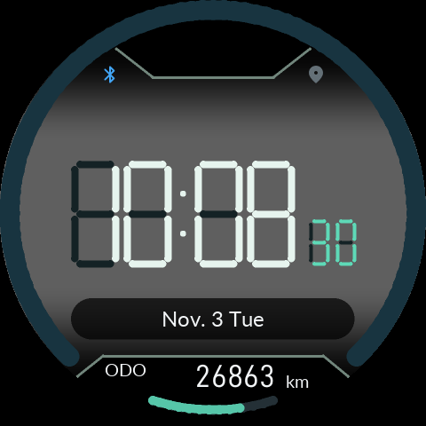 |

키 OFF에서는 이번 부팅 중 마지막으로 받은 ODO를 본체와 폰 대시보드에 유지합니다. 키를 다시 ON으로 하면 새 차량 값을 받아야 합니다. 재부팅하면 임시 ODO는 사라지며, 예전에 저장한 ODO를 복원하지 않습니다. 트립·정비 카운터는 별도로 보존합니다.

0.12.1에서는 **키 OFF 후 10분간 사용**하는 모드에서도 마지막 ODO를 유지합니다. 잠깐의 수신 오류로 정상값이 즉시 사라지지 않으며, 키 ON에서 통신이 계속 끊기면 알 수 없음으로 표시합니다. 트립과 정비 기록은 그대로 유지하며, 보관한 ODO로 주행거리를 늘리지 않습니다.

**SINCE REFUEL:** 연료량 인식이 ON일 때, 이전보다 두 칸 이상 높은 연료 상태가 3초간 이어지면 주유 후 기록을 새로 시작합니다. 2칸에서 주유한 뒤 4·5칸이 오가도 감지합니다. 수신이 끊겼거나 연료값이 불명확하면 확정될 때까지 기다립니다. TRIP A/B와 정비 기록은 지우지 않습니다.

주유한 뒤 키를 켜고 정상 연료값이 몇 차례 수신될 때까지 기다리세요. 두 칸 이상 늘어난 상태가 안정적으로 유지되면 주유로 기록합니다. 수신이 빠진 것만으로 주유로 판단하지 않습니다. 키 OFF 주행 요약의 오일 비율은 이번 부팅에서 마지막으로 받은 ODO로 계산합니다.

**설정 → 차량 → 연료량 인식 사용(Fuel recognition)**을 OFF로 설정하면 연료 경고, 자동 주유 감지, 예비연료 모드를 모두 중단합니다. 계기판이 유효한 연료값을 보내지 않는 차량에서 사용하세요. **SINCE REFUEL 화면에서 O를 길게 누르면** 주유 후 거리를 0부터 직접 시작합니다. 아직 `--`여도 사용할 수 있으며 다른 트립과 정비 기록은 유지됩니다. 주유할 때마다 직접 초기화하세요. 다시 ON으로 켜면 새 연료 기준값을 잡으며, OFF 이전 값과 비교해 주유로 처리하지 않습니다.

문제 상황을 전달할 때는 **진단 설정 → Fuel RAW P2 / P3**와 **UART RX first 16 bytes**를 촬영해 주세요. 차량 계기판이 실제로 보낸 값을 확인하는 항목입니다. 연료량 인식을 꺼도 이 정보는 확인할 수 있습니다.

## 13. 음악·전화·알림

- **음악:** 폰에서 음악을 재생하고 알림 접근을 허용합니다. 음악 페이지에서 UP 짧게는 재생/일시정지, DOWN 짧게는 다음 곡, UP 길게는 이전 곡입니다.
- **볼륨:** 음악 페이지에서 O를 길게 누르면 볼륨 팝업이 열립니다. UP은 미디어 볼륨 한 단계 올리기, DOWN은 내리기, O 짧게는 팝업 닫기입니다. 전화·경고 화면이 우선하며 폰이 연결돼 있어야 합니다.

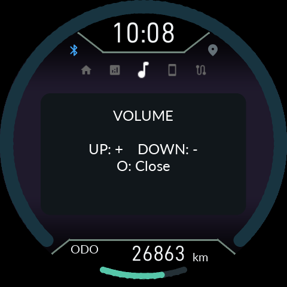

- **스마트폰 페이지:** UP으로 최근 전화, DOWN으로 최신 알림을 엽니다. 상세 화면에서는 화면의 버튼 안내를 따릅니다. 전화 팝업 닫기와 실제 통화 종료는 다른 조작입니다.
- **새 알림:** 상단 아이콘이 약 2초 깜빡입니다. 여러 메시지가 이어지면 최신 내용을 표시하며, 준비 중에는 Updating...이 보일 수 있습니다.
- **빠른 답장:** 1–7번은 저장 문구, 8번은 위치+이번 주행 정보+음악, 9번은 위치, 10번은 음악입니다. 8–10번에는 서명이 붙습니다. 상대와 전송할 내용을 확인하고 보내세요.
- **계기판 깜빡임:** 알림·경고 때 계기판 밝기가 잠시 변합니다. 원하지 않으면 설정 → Display → **Dash blink alerts**를 끕니다.

## 14. 지도와 축척

앱의 지도 메뉴에서 사용할 지역의 **.map 파일**을 가져옵니다. GPS·위치 권한을 켜고 주행 연결을 시작하세요. 지도 파일이 없으면 이동 격자와 궤적 선으로 표시합니다.

| 지도에서 | 조작 |
|---|---|
| **UP 길게** | AUTO / MANUAL 전환 |
| AUTO에서 **UP/DOWN** | −2 가까이 ~ +2 넓게 보기 선호도 |
| MANUAL에서 **UP/DOWN** | 축척 직접 변경 |
| **O 길게** | 북쪽 위 / 진행 방향 위 / 나침반 전환 |

처음 보는 지역은 지도를 준비하는 시간이 필요합니다. 안내 OFF에서는 지도·위치·주행 궤적만 표시합니다.

안내를 켜지 않았을 때는 기존처럼 지도·현재 위치·주행 궤적을 표시합니다. 별도의 목적지 설정은 필요하지 않으며, 트립과 ODO는 그대로 사용할 수 있습니다.

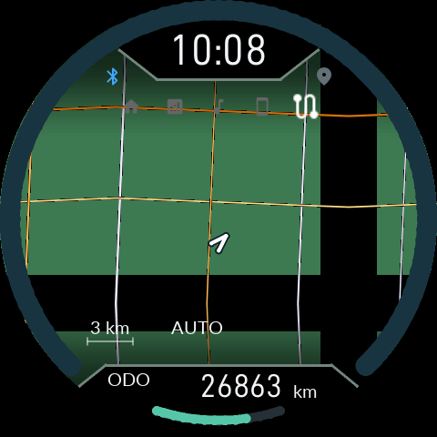

### 안내 중의 HOME·지도·음악

앱 하단은 **기기 / 홈 / 꾸미기 / 내비** 네 탭입니다. 이번 빌드의 자체 오프라인 안내는 **BRouter만** 사용합니다. 휴대폰이 경로를 계산하고, 본체에는 TBT와 지도 위 경로를 표시합니다.

**내비 → BRouter 경로 파일 → 다운로드**에서 공식 `.rd5` 파일을 받은 뒤 **.rd5 파일 가져오기**로 넣으세요. 서울은 `E125_N35.rd5`이며 필요한 주변 구역도 함께 받으세요. 표시용 Mapsforge `.map` 지도는 기존 지도 화면에서 별도로 받습니다. 지도에서 목적지를 길게 누르거나 즐겨찾기·최근 목적지를 선택해 안내를 시작합니다. 주소·상호 검색과 Valhalla 국가 팩 설치는 이번 빌드에 없습니다.

기존 다운로드 지도·국가 팩 파일과 저장된 목적지는 삭제하지 않습니다. 저장된 목적지는 사용자가 안내 시작을 누르면 BRouter로 새로 계산합니다. 도로명 자리에는 **BRouter 모드**를 표시하며 회전교차로 출구 번호는 함께 표시합니다. Google Maps·OsmAnd 외부 TBT는 계속 해당 앱이 제공한 도로명을 사용합니다.

안내 중 MAP과 HOME 지도에는 **검정·흰색 테두리를 가진 보라색 경로**와 목적지까지의 남은 거리가 표시됩니다. 현재 위치가 경로 위에 그려집니다. 목적지 거리도 하단 순환에 참여합니다. 안내 OFF에서는 안내 경로·목적지 항목이 사라지고 기존 지도·궤적 동작으로 돌아갑니다.

HOME 수동/AUTO/2줄 AUTO/지도와 음악 화면의 위쪽에는 **왼쪽 화살표 + 오른쪽 거리**의 작은 알약 모양 안내가 나옵니다. 속도·시계·전체 TBT 보기에는 작은 안내를 겹치지 않습니다. 전체 TBT는 왼쪽 큰 화살표, 오른쪽 거리와 BRouter 모드 문구(외부 TBT는 도로명)를 표시하며 별도의 배경 상자는 없습니다. 실제 안내가 없으면 어느 팝업도 표시하지 않습니다. 안내를 시작했다고 화면을 자동으로 넘기지 않습니다.

내비 탭의 **자체 안내 거리 100m 올림**은 기본 OFF입니다. 켜면 100m 이상인 자체 미터 안내를 다음 100m로 올립니다. 100m 미만, 목적지 잔여거리, mi/ft, Google Maps·OsmAnd의 외부 TBT 거리는 바꾸지 않습니다. 외부 TBT는 실험 기능이며 기존 우선순위를 유지합니다. 오래된 GPS·연결 단절 상태에서는 `--`로 대기하고 경로를 흐리게 표시합니다.

안내 중에는 모든 주행 페이지의 메뉴가 5초 뒤 사라진 다음 미니 안내가 나타납니다. 메뉴 조작 시 역순으로 전환합니다. 안내가 없으면 기존 메뉴 정책을 유지합니다. 최근 5초 차량 평균 속도로 회전까지 7초 이하가 남으면 미니 윤곽선을 2Hz로 강조하고 전체 TBT 글자를 노란색으로 번갈아 표시합니다. 속도나 안내가 없거나 오래되면 강조하지 않습니다.

| 미니 안내 | 전체 TBT | 서울 경로 예시 |
|---|---|---|
| 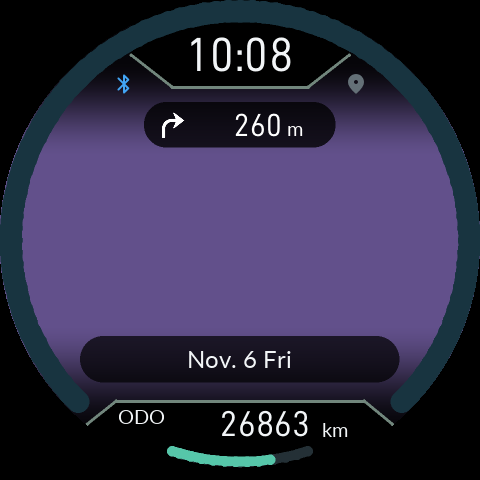 | 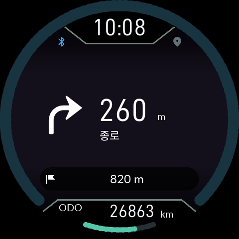 | 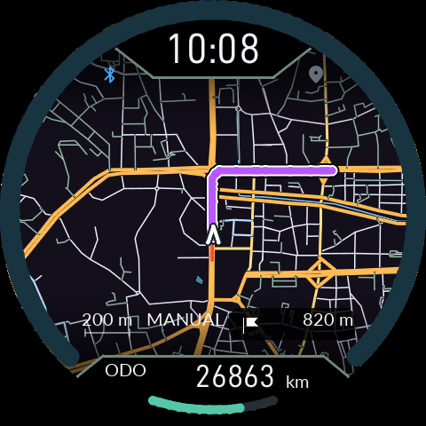 |

큰 TBT 거리는 `000 m / 00.0 km / 000 km` 폭의 왼쪽에 고정됩니다. 선행 0을 붙이지 않으며 숫자와 단위는 각각 고정 위치를 유지합니다.

위 이미지는 실제 LVGL/EVE 코드의 PC 렌더링입니다. 차량 LCD 사진은 아닙니다.

앱 테마의 **배경화면** 모드는 Android 시스템 배경화면을 투명 창 뒤로 표시합니다. 앱 배경 음영과 비네팅을 조절할 수 있으며, 문자 대비를 위한 최소 음영은 유지합니다.

### 궤적 색상 바꾸기

누도에서 **설정 → 화면 → 궤적 색상(Trail color)** 을 여세요. 휴대폰에서도 **기기의 모든 설정 → 궤적 색상** 에서 바꿀 수 있어요. 빨강·주황·노랑·초록·청록·파랑·하양 중 하나를 고르거나 **속도에 따라(By speed)** 를 선택하세요. 기본값은 기존 빨강이며, 적용하면 재부팅 없이 바뀝니다.

속도 모드는 그 구간을 지날 때의 계기판 속도를 기억합니다. 낮은 속도는 파랑, 속도가 높아지면 청록·초록·노랑·주황을 거쳐 빨강이 됩니다. **설정 → 차량 → 호 최대값(Ring maximum)** 이 빨강의 기준입니다. 예를 들어 최댓값이 200 km/h이면 100 km/h는 초록, 150 km/h는 노랑, 200 km/h 이상은 빨강입니다. 단위를 mph로 바꿔도 같은 실제 속도에는 같은 색이 표시됩니다. 속도를 받지 못한 구간은 회색입니다.

궤적 색상 설정은 저장되지만 주행 궤적은 기존처럼 현재 세션의 기록입니다.

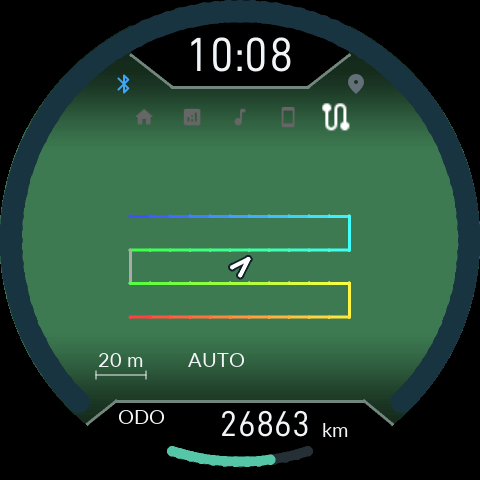

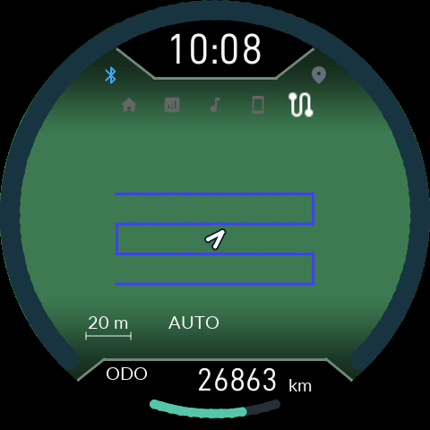

## 15. 폰의 홈·꾸미기·기기 화면

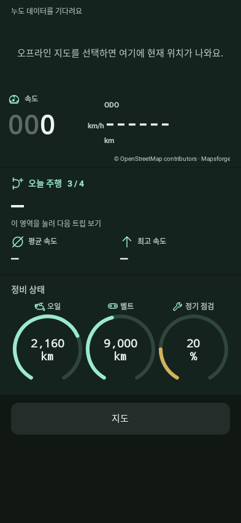

**기기 · 홈 · 꾸미기**는 좌우로 넘기거나 아래 버튼으로 이동합니다.

- **홈:** 지도·속도·ODO, 트립, 오일·벨트의 남은 km와 정기 점검의 남은 %를 원형 호 세 개로 봅니다. **트립 표시 영역 자체를 눌러** 다음 정보로 넘깁니다. 순정 누도에 연결하면 아래 영역은 순정 정보로 바뀝니다.
- **꾸미기:** 배경 사진·알림 앱·팝업·빠른 답장·전화 즐겨찾기를 고릅니다.
- **기기:** 설치·업데이트·현재 상태·시스템 언어·설명서를 엽니다.

**UI 테스트 모드**에서는 연결하지 않은 상태로 원하는 속도·ODO·CFW/순정 화면을 미리 볼 수 있습니다. 실제 차량 값은 바뀌지 않습니다. 사용을 마치면 테스트 모드를 끄고 연결하세요.

**Bluetooth가 꺼져 있어요:** 연결 버튼을 잠그고 HOME에서도 켜 달라는 안내를 표시합니다. Bluetooth 설정 열기로 켜세요. 기존 자동 주행 연결 설정에 따라 재연결하며, 직접 일시정지했다면 그 상태를 유지합니다. 설치를 임의로 다시 시작하지는 않습니다.

처음 새로 설치하면 배경 1에 검은 480 × 480 사진과 중앙 NEWDOE 워드마크가 들어갑니다. 다른 사진으로 바꾸면 워드마크도 완전히 사라집니다. 데이터 보존 재설치·일반 업데이트에서는 기존 사진을 유지하고, 배경 2·3은 바꾸지 않습니다.

## 16. 키를 끈 뒤와 장기 주차

키를 끄면 **Ride Summary**를 보여준 뒤 설정한 주차 화면·절전 순서로 넘어갑니다. O를 누른 채 키를 끄고 놓으면 키 OFF 후 최대 10분 동안 사용할 수 있습니다.

**설정 → 시스템 → 전원 순서 → 장기 주차 전원 끄기**에서 **끄기 / 2일 / 3일 / 7일**을 고릅니다. 기본값은 2일이며, 이전에 바꾼 값은 업데이트해도 유지됩니다.

설정한 시간이 지나 전원이 종료되면 폰 접근에 따른 재연결·웰컴 라이트도 멈춥니다. 다시 키를 켜면 시작 화면부터 켜집니다. 오랫동안 세워둘 때 이 설정을 확인하세요. 배터리가 이미 방전됐거나 전압이 크게 낮아졌다면 먼저 배터리·차량 점검을 받으세요.

### NewDoe 사진과 순정 사진 고르기

누도에서는 **설정 → 화면 → 사진 출처**를 엽니다. 폰에서는 주행 연결 후 **기기 설정 → 사진 출처**를 엽니다.

1. CFW 전용 사진 세 장을 쓰려면 **NewDoe**, 순정 앨범에 이미 있는 사진을 쓰려면 **KYMCO**를 고릅니다.
2. **사진**에서 **1·2·3번** 중 하나를 고르고 적용합니다. 번호는 선택한 출처 안의 슬롯 번호입니다. **키 OFF 사진**도 같은 출처를 사용합니다.
3. 선택은 누도에 저장됩니다. 폰과 누도 설정은 같은 값을 바꿉니다.

순정 앨범은 읽기만 하며 덮어쓰기·삭제·자동 수리를 하지 않습니다. 새 사진을 업로드하면 언제나 **NewDoe 슬롯**에 저장됩니다. KYMCO 사진을 사용 중이었다면 NewDoe로 바꿔서 올린 사진을 선택하세요. 새로 설치할 때는 NewDoe 1번에 NEWDOE 워드마크가 들어가며, 업데이트·데이터 보존 재설치는 기존 사진을 유지합니다.

**빈 슬롯**은 해당 순정 슬롯에 JPEG가 없다는 뜻입니다. **읽기 오류**는 파일·폴더를 읽을 수 없거나 JPEG가 손상됐거나 지원하지 않는 형식·크기라는 뜻입니다. 오류에 슬롯 번호가 함께 표시됩니다. 실패한 슬롯 선택은 저장되지 않으므로 다른 슬롯을 고르거나 NewDoe로 돌아가세요. 순정 파일은 바뀌지 않습니다. 아직 사진을 불러오는 중이라면 잠시 기다린 뒤 다시 선택하세요.

처음 설치 중 사진 진행률이 끝까지 찬 뒤 **0x00050005 / CFWPIC.DAT**에서 멈췄다면 **현재 기기 확인**부터 진행하세요. 이 문제는 내장 펌웨어 패키지 0.12.2에서 수정됐습니다. 이전 Bootstrap에서 같은 오류가 반복된다면 상태 확인 후 순정으로 돌아가 내장 파일로 재설치하세요. 순정 앨범을 지우거나 앱 데이터를 초기화하지 마세요.

## 17. 해결되지 않으면 이렇게 보내 주세요

앱의 **문제가 생겼나요? · 복구와 진단 → 진단 자료 저장·공유**를 엽니다. [프로젝트 문의](https://github.com/SerialSniffyHeck3r/noodoe_cfw/issues)에 아래를 함께 남겨 주세요.

- 차량 모델·연식, 휴대폰 모델과 Android 버전.
- 앱 버전, 누도 펌웨어 버전, 앱에 표시된 준비된 펌웨어 버전. ZIP을 직접 골랐다면 파일 이름도 적어 주세요.
- 현재 누도 화면 사진과 오류 문구·코드.
- 마지막에 누른 버튼과 그 뒤 달라진 점.
- 언어 문제라면 설치 언어·표시 언어·영어 전용 설정·폰트 상태.

진단을 남기기 전 앱 데이터를 삭제하지 마세요. 보관한 백업 파일은 다른 저장장치에도 복사해 두면 좋습니다.

[처음으로](#top) · [다운로드](https://github.com/SerialSniffyHeck3r/noodoe_cfw/releases/latest) · [English](Guide.en.md)

## 오프라인 내비게이션 — BRouter

이번 빌드는 BRouter만 포함하며, Valhalla 네이티브 엔진·국가 팩 설치·차량 분류 선택은 제외합니다. 기존 데이터는 보존합니다.

1. **BRouter 경로 파일 → 다운로드**에서 [공식 경로 파일](https://brouter.de/brouter/segments4/)을 받습니다. 파일 하나는 위도·경도 5° 구역입니다. 서울은 `E125_N35.rd5`이며, 여러 구역을 지나는 경로는 주변 파일도 필요합니다. 원래 파일명을 유지하고 가능하면 같은 날짜 자료를 사용하세요.
2. **.rd5 파일 가져오기**에서 필요한 파일을 선택합니다. 같은 구역의 기존 파일은 새 파일 검증 후 교체하며, 실패 시 이전 파일을 유지합니다. 중단되면 다시 선택하세요.
3. 표시용 Mapsforge `.map`은 기존 지도 화면에서 받습니다. `.rd5`에는 표시용 지도나 주소 검색 데이터가 없습니다.
4. 지도에서 길게 눌러 목적지를 고르거나 즐겨찾기·최근 목적지를 사용합니다. 본체와 연결하고 GPS 위치가 들어오면 안내를 시작할 수 있습니다.
5. 본체는 화살표·회전까지 거리·목적지 잔여거리와 보라색 경로를 표시합니다. 도로명 대신 **BRouter 모드**가 나오며, 회전교차로 출구 번호는 유지합니다. 이탈하면 폰에서 재탐색합니다.
6. 재개는 자동 실행되지 않습니다. 저장된 목적지를 확인하고 안내 시작을 누르면 BRouter로 새로 계산합니다. 기존 Google Maps·OsmAnd 외부 TBT의 우선순위와 도로명 표시는 유지합니다.

안내는 Android 8.0 이상에서 사용합니다. 기본 오토바이 프로필은 OSM 통행·일방통행·회전 제한을 사용합니다. 국가·배기량별 특수 규칙은 별도로 검증하지 않았으므로 도로 표지를 따르세요. 음성·과속카메라·차선 안내는 포함하지 않습니다. 본체 Bluetooth·NDCP·Gate·NOR 구조는 변경하지 않습니다.

### BRouter 처음 준비하기 — 지도와 경로 파일은 별개

1. 휴대폰을 인터넷에 연결해 앱 **내비 → BRouter 경로 파일 → 다운로드**를 엽니다. 연결되는 [BRouter 공식 파일 배포처](https://brouter.de/brouter/segments4/)에서 주행 구역의 `.rd5`를 받습니다. NewDoe용 국가 ZIP이나 API 키는 필요하지 않습니다. 서울 근거리는 `E125_N35.rd5` 구역에 들어갑니다. 구역 경계를 넘는 경로는 인접 파일도 필요합니다.
2. 파일명을 바꾸지 말고 **.rd5 파일 가져오기**에서 받은 파일을 선택합니다. 여러 개를 선택할 수 있습니다. 목록·용량을 확인한 뒤 가져오기를 누르고 **가져오기·검증 완료**를 기다립니다. 다운로드 폴더에 두기만 하면 NewDoe에 등록되지 않습니다. 가져온 앱 전용 사본만 안내에 사용합니다.
3. **표시용 지도**는 별도입니다. 기존 지도 화면에서 해당 지역의 Mapsforge `.map`을 받아 선택하세요. `.map`은 보이는 도로 지도이고 `.rd5`는 길찾기 데이터이므로 서로 대신할 수 없습니다. [BRouter 공식 오프라인 설명](https://brouter.de/brouter/offline.html)
4. 정차 상태에서 **내비 → 지도에서 목적지 선택**으로 지도를 열고 도로 근처의 목적지를 길게 누릅니다. 확인 창에서 위치를 확인하고 **안내 시작**을 누릅니다. 즐겨찾기 또는 최근 목적지에서도 고를 수 있습니다. 이번 빌드에는 주소·상호 검색이 없습니다.
5. 실제 GPS가 확보되면 폰에서 경로를 계산합니다. 근거리 첫 시험은 출발지와 도착지가 같은 `.rd5` 구역이고 도로 위에 있는 곳으로 고르세요. 인터넷을 끊어도 가져온 데이터로 계산할 수 있지만, 위치 수신과 본체 Bluetooth 연결은 계속 필요합니다.
6. 본체 **MAP/HOME 지도**에는 검정·흰 윤곽선의 보라색 경로가 표시됩니다. **HOME TBT**에는 왼쪽 화살표, 오른쪽 다음 회전까지 거리, 아래 **BRouter 모드** 문구가 나옵니다. 목적지 잔여거리는 목적지 아이콘과 HOME 하단 순환 항목에서 구분해 표시합니다. 안내 시작만으로 화면을 강제로 넘기지 않습니다.
7. 작은 TBT는 HOME 정보/지도와 음악에 표시됩니다. 안내 중 상단 메뉴는 5초 후 숨고 작은 TBT가 나타납니다. 속도·시계·전체 TBT에는 겹쳐 표시하지 않습니다. 길을 벗어나면 폰이 재탐색하며, 위치·연결이 오래되면 최신 안내처럼 표시하지 않습니다.
8. 종료는 앱 **안내 종료**입니다. 앱 재실행 후에는 **안내 재개**에서 저장된 목적지를 확인하고 다시 시작합니다. 다른 차량에 저장된 목적지를 조용히 적용하지 않습니다. 경로 파일 갱신은 먼저 안내를 종료하고 새 `.rd5`를 가져오세요. 오류가 나면 실패한 파일은 기존 파일을 유지하며, 부분 성공 목록을 확인한 뒤 빠진 파일만 다시 고릅니다.

**Google Maps / OsmAnd 외부 TBT (실험적):** 내비에서 외부 TBT를 켜고 **알림 접근 권한**에서 NewDoe를 허용합니다. 해당 앱에서 실제 길 안내를 시작하고 안내 알림이 나오는지 확인하세요. 앱을 단순히 열거나 목적지만 검색한 상태는 안내 수신이 아닙니다. 지원 안내를 받으면 자체 BRouter 안내보다 우선하며, 외부 TBT 사용 중에는 자체 경로 안내를 시작할 수 없습니다. 외부 TBT는 그 앱이 제공한 도로명을 표시하지만 전체 경로선을 가져오는 기능은 아닙니다. 알림 형식·언어·앱 버전에 따라 인식되지 않을 수 있고, 해당 지역에서 원본 앱의 길 안내가 제공되지 않으면 NewDoe가 대신 만들지 않습니다.

| 문제 | 조치 |
|---|---|
| 경로 파일 없음 / 구역 누락 | 출발지·목적지와 중간 경로가 지나는 `.rd5`를 가져옵니다. |
| 지도만 보이고 길찾기 실패 | `.map`과 `.rd5`가 모두 준비됐는지 구분해서 확인합니다. |
| GPS 대기 | 휴대폰 위치 권한·위치 서비스를 확인합니다. 가짜 위치로 주행 안내를 검증하지 않습니다. |
| 경로 없음 | 목적지를 실제 도로 가까이 다시 지정하고 데이터 구역을 확인합니다. |
| 외부 TBT 대기 | Google Maps/OsmAnd의 실제 안내 알림과 NewDoe 알림 접근 권한을 확인합니다. |
| 본체 안내 대기 / 연결 끊김 | 기존 연결 절차로 다시 연결하고 폰 안내 상태를 확인합니다. 자동 재페어링·초기화는 하지 않습니다. |

기본 오토바이 프로필의 OSM 통행·일방통행·회전 제한을 사용합니다. 국가·배기량별 특수 규칙을 모두 검증한 차량 내비게이션은 아닙니다. 실제 도로 표지를 따르세요. 음성·과속카메라·차선 안내와 Valhalla 국가 팩은 이번 빌드에 없습니다.

### 시계와 키 OFF 속도 표시

아날로그·디지털 시계 모두 사진에 검은 음영을 적용합니다. 시계 바늘·숫자, 속도 호, ODO와 하단 정보 줄은 어두워지지 않습니다. 시계 종류는 표시 설정에서 선택합니다. 키 OFF로 정차 사용 중인 디지털 속도 칸은 `--- km/h`(마일 단위는 `--- mph`)이며 마지막 주행 속도를 현재값처럼 남기지 않습니다. 날씨 온도 옆의 시간대별 위·아래 삼각형은 표시하지 않습니다.

| Welcome | O 확인 / Confirm with O | 키 OFF / Key OFF |
| --- | --- | --- |
|  |  |  |

