

# NewDoe 그림 사용 설명서

**앱·본체 0.11.16 / B 언어팩 0.11.2 · 2026-10-20**  
[English](Guide.en.md) · [다운로드](https://github.com/SerialSniffyHeck3r/noodoe_cfw/releases/latest)

Android 휴대폰과 차량 버튼만 준비하세요. 정상 설치에는 분해하거나 별도 장비를 연결할 필요가 없습니다. 아래에서 **[폰]은 휴대폰 앱**, **[누도]는 차량의 동그란 화면**을 뜻합니다. 화면 예시의 거리·진행량은 내 기기와 다를 수 있습니다.

**지금 필요한 곳으로 바로 가세요.**

| 하고 싶은 일 | 안내 |
|---|---|
| 처음 설치하기 | [준비물](#prepare) → [사진 보며 처음부터 설치](#first-install) |
| 이미 쓰는 NewDoe 업데이트 | [업데이트](#update) |
| 한국어·일본어 등으로 바꾸기 | [언어팩 설치와 언어 설정](#language) |
| 연결이 안 되거나 설치가 멈춤 | [연결 복구](#connection) · [화면별 문제 해결](#troubleshooting) |
| 폰 없이 순정으로 돌아가기 | [본체 복구 메뉴](#recovery) |
| 평소 사용하기 | [버튼](#controls) · [거리·정비](#vehicle) · [음악·전화](#media) · [지도](#map) |
| 앱·주차 설정 | [앱 화면](#dashboard) · [장기 주차](#parking) · [문의](#report) |

## 1. 내 누도에 설치할 수 있나요?

| 항목 | 지원 범위 |
|---|---|
| 휴대폰 | Android 6.0 이상. iPhone용 앱은 없습니다. |
| 누도 본체 | F4 계열 KYMCO Noodoe. AK550 외 모델도 앱에서 기기를 확인해 진행합니다. |
| 순정에서 처음 설치 | 순정 펌웨어 **5.14 또는 5.16** |
| 이미 CFW 사용 중 | [CFW 업데이트 안내](#update)를 따릅니다. |
| 기기 메뉴 언어 | B 언어팩 기기는 9개 언어, A 언어팩 기기는 영어 |

본체를 뜯어 종류를 알아낼 필요는 없습니다. 앱에서 **현재 기기 확인**을 누르세요. 지원하지 않는다는 안내가 나오면 화면을 저장해 [문의](#report)하세요. 순정으로 돌아갈 때는 **5.16**이 설치됩니다.

## 2. 버튼과 전원부터 알아두세요

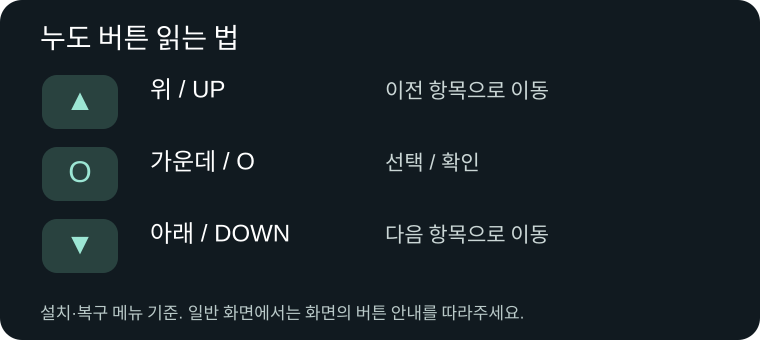

- **O**는 가운데 확인 버튼입니다. 숫자 0이 아닙니다.
- **짧게**는 눌렀다 바로 놓기, **길게**는 누른 채 유지하기입니다. ‘2초’나 ‘3초’ 안내가 있으면 그 시간만큼 유지하세요.
- **IGN ON**은 차량 키/전원 스위치를 켜기입니다. **엔진을 걸라는 뜻이 아닙니다.**
- **IGN OFF**는 키/전원 스위치를 끄기입니다. **배터리나 누도 전선을 빼라는 뜻이 아닙니다.**
- 버튼을 누도/일반 계기판으로 전환하는 스위치가 있다면 **누도 쪽**에 놓습니다.

설명서의 **Bootstrap**은 첫 설치 때 나오는 설치 도구, **CFW**는 평소 쓰는 NewDoe 펌웨어, **Recovery/Gate**는 본체 시작·복구 메뉴입니다.

## 3. 설치 전에 준비하기

### 받을 파일은 세 가지입니다

[다운로드 페이지](https://github.com/SerialSniffyHeck3r/noodoe_cfw/releases/latest)를 휴대폰에서 엽니다.

| 파일 | 어디에 쓰나요? |
|---|---|
| **NewDoe-0.11.16.apk** | 휴대폰에 설치하는 앱 |
| **NewDoe-CFW-0.11.16.zip** | 누도에 설치할 펌웨어. 앱에서 이 ZIP을 선택합니다. |
| **NewDoe-LANGUAGE-B-0.11.2.zip** | 한국어 등 메뉴를 쓸 때 설치하는 언어팩. 앱의 다운로드 안내를 사용해도 됩니다. |

**ZIP은 압축을 풀지 마세요.** APK를 설치하는 것만으로 누도의 펌웨어가 바뀌지는 않습니다. 언어팩의 번호가 0.11.2인 것은 정상입니다.

### 출발 전이 아니라, 주차한 상태에서 시작하세요

1. 안전하게 주차하고 엔진을 끕니다. 차량과 휴대폰의 배터리가 충분한지 확인합니다.
2. 새 APK를 열어 설치합니다. 이미 NewDoe 앱이 있으면 **그 위에 업데이트**하세요. 앱이나 앱 데이터를 삭제하지 않습니다.
3. Android에서 설치 허용을 물으면 직접 받은 APK인지 확인하고 허용합니다. 설치가 끝나면 NewDoe를 엽니다.
4. Bluetooth를 켜고 차량 가까이에 폰을 둡니다. 설치 중에는 NewDoe 앱을 앞에 띄워 둡니다.
5. 다른 Noodoe 앱이 연결 중이라면 그 연결을 끕니다.

**설치·순정 복귀 중에는 배터리와 누도 전선을 연결한 채 유지하세요.** 스타터를 돌리거나 전선을 분리하지 마세요. 이미 심하게 방전된 차량은 먼저 충전·점검을 받으세요.

### 설치 전 다섯 안내를 확인하세요

설치 버튼을 누르면 그림을 한 장씩 읽고 **확인했습니다**를 누릅니다. **취소**하면 설치를 시작하지 않습니다. 같은 설치가 Bootstrap으로 이어질 때는 반복하지 않지만, 다른 기기·파일이나 새 설치에서는 다시 확인합니다.

1. 배터리 단자와 누도 전선을 분리하지 마세요.
2. 키 OFF 상태에서 **UP + O**를 동시에 누르지 마세요.
3. 스타터 버튼을 누르지 마세요.
4. 배터리 전압이 **11.5V 이상**인지 직접 확인하세요. 앱이 전압을 측정하는 것은 아닙니다.
5. 가능한 단계에서는 키 OFF를 권장합니다. **순정에서 설치 도구를 처음 보낼 때는 키 ON이 필요합니다.** 이후에는 화면 안내를 따르세요.

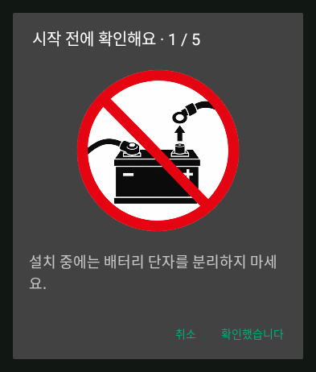
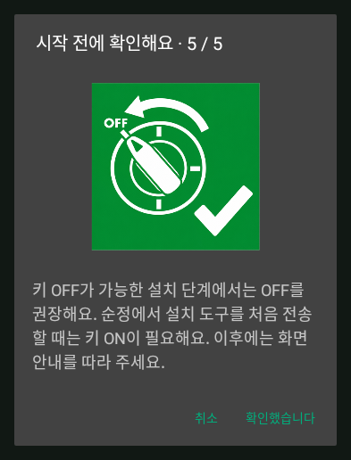

설치 중에는 진행 상태 아래에 다섯 그림이 계속 나옵니다. 다시 누르는 버튼이 아니라 주의사항을 알려주는 표시입니다.

### 앱 첫 실행과 설치 마법사

처음 앱을 열면 사용해 본 적이 있는지 고릅니다. 처음이라면 그림 설명서에서 버튼부터 확인하세요. 지금 누도에서 실행 중인 펌웨어를 고른 뒤 **설치 마법사** 또는 **홈으로 가기**를 선택합니다. 이 답으로 기기에 보낼 펌웨어를 결정하지 않습니다. **현재 기기 확인**으로 실제 상태를 읽습니다.

**기기/상태 페이지 → 설치 마법사**에서 나중에 다시 열 수도 있습니다. **다음**은 기기 선택·ZIP 선택·전송·다시 켜진 기기 확인 사이에 나옵니다. 전송이나 검증이 시작됐다면 끝날 때까지 기다리세요. 도중에 다른 다음 버튼을 찾을 필요가 없습니다. 기존 기기 페이지를 그대로 사용해도 됩니다.

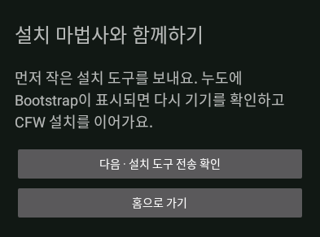

## 4. 순정에서 처음 설치하기

### ① 폰에서 내 누도를 고르기

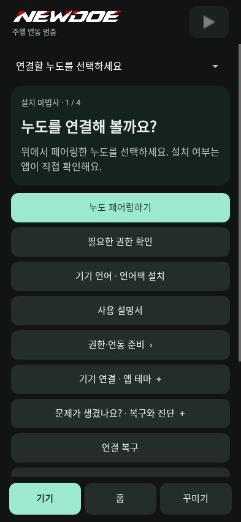

1. **[누도]** 키를 ON으로 켭니다. 엔진은 걸지 않습니다.
2. **[폰]** 앱의 **기기** 페이지로 갑니다. 좌우로 넘기거나 아래의 기기 버튼을 누릅니다.
3. 처음 연결한다면 **누도 페어링하기**를 눌러 Android Bluetooth 설정으로 갑니다. 순정 누도를 페어링 대기 상태로 만들고 내 Noodoe를 선택합니다. 이미 등록돼 있으면 다시 등록하지 않습니다.
4. NewDoe 앱으로 돌아와 내 기기를 선택합니다. 안 보이면 기기 목록을 새로고침합니다.
5. **권한·연동 준비**에서 Bluetooth/주변 기기 권한을 허용합니다. 음악·전화·위치 권한은 [설치 뒤 설정](#phone)에서 추가할 수 있습니다.
6. **현재 기기 확인**을 누릅니다. 앱이 **순정 Noodoe**라고 표시하는지 확인합니다.

### ② CFW ZIP을 고르고 설치 도구 보내기

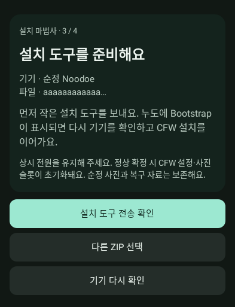

1. **[폰] 설치 ZIP 선택**을 누릅니다.
2. 다운로드 폴더에서 **NewDoe-CFW-0.11.16.zip** 자체를 고릅니다. 언어 ZIP과 혼동하지 마세요.
3. 위와 같은 **설치 도구를 준비해요** 화면에서 **설치 도구 전송 확인**을 누릅니다.
4. 전송과 확인이 끝날 때까지 기다립니다. 전송 도중 미리 키를 끄지 않습니다.

### ③ Bootstrap 메뉴를 본 뒤 ‘현재 상태 확인’ 누르기

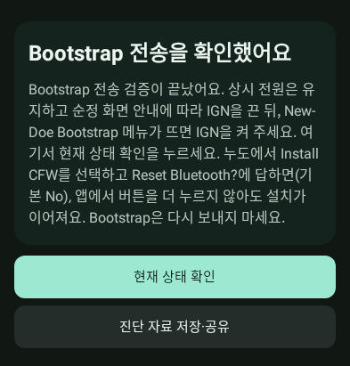

1. **[폰]** 위 안내가 나오면 순정 화면 안내에 따라 **키를 OFF**로 합니다. 배터리는 연결한 채 둡니다.
2. **[누도]** 설치가 끝나고 아래 **NewDoe Bootstrap** 메뉴가 나올 때까지 기다립니다. 중간의 **NOODOE INSTALLER** 화면은 아직 이 메뉴가 아닙니다.
3. Bootstrap 메뉴가 나오면 **키를 ON**으로 합니다.
4. **[폰] 현재 상태 확인**을 누릅니다. 이 버튼을 누르는 단계입니다. Bootstrap 파일을 다시 보내지 마세요.

처음 3초는 NEWDOE 워드마크만 표시합니다. 확인 작업은 뒤에서 계속됩니다. 이후 아직 진행 중이면 워드마크 위에 현재 확인 항목, 아래에 가로 막대가 나오고, 이미 끝났다면 바로 메뉴로 넘어갑니다.

| 먼저 잠깐 보이는 파일 확인 | 확인이 끝난 뒤 나오는 메뉴 |
|---|---|
|  |  |

### ④ 누도에서 Install CFW 선택하기

1. **[누도]** UP/DOWN으로 **Install CFW**를 고르고 **O**를 누릅니다.
2. 아래 **Reset Bluetooth?** 질문이 나오면, 연결에 문제가 없을 때는 **기본 선택 No → O**를 누릅니다.
3. 이후 설치는 폰에서 이어집니다. 폰의 다른 설치 시작 버튼을 추가로 찾을 필요는 없습니다.

**Yes는 저장된 페어링을 지웁니다.** 실제 연결 문제가 있을 때만 선택하세요. ‘연결할 수 없음’이 나오면 [재페어링 순서](#connection)를 따릅니다. 이 질문에는 자동 선택 시간이 없습니다.

기존 CFW 데이터를 발견했다고 물으면, 기존 설정·트립·사진을 이어 쓰려는 경우 **보관 데이터 복원**을 선택합니다. **새로 시작**은 새 환경으로 시작하려는 경우에 고릅니다. 처음 설치라면 이 질문이 없을 수 있습니다.

### ⑤ 두 막대가 움직이면 기다리기

- **위의 연한 막대:** 설치 전체 진행입니다.
- **아래의 진한 막대:** 지금 하는 작업의 진행입니다. 다음 작업으로 넘어가면 다시 처음부터 찰 수 있습니다.
- 글씨는 받고 있는 파일이나 현재 작업을 알려줍니다. 숫자는 예시와 달라도 됩니다.

전원과 폰 연결을 유지하세요. 느리다는 이유로 강제로 껐다 켜지 마세요. 취소가 필요하면 화면 안내에 따라 **O를 새로 3초** 누르고, 멈췄다는 안내가 나올 때까지 기다립니다.

### ⑥ Everything is ready → 최종 설치

이제 파일 준비가 끝났습니다.

- 바로 설치: **Install CFW → O**.
- 그대로 기다리기: **30초 뒤 자동으로 설치**합니다.
- 돌아가기: UP/DOWN을 눌러 카운트다운을 멈춘 뒤 **Back → O**.

설치가 시작되면 본체가 다시 시작됩니다. 잠깐 연결이 끊어지거나 시작 화면이 보여도 앱을 닫지 마세요.

### ⑦ 누도의 CFW UPDATE를 보고 폰에서 확인하기

| 누도에서 이 화면을 확인 | 그다음 폰에서 확인 버튼 |
|---|---|
|  | 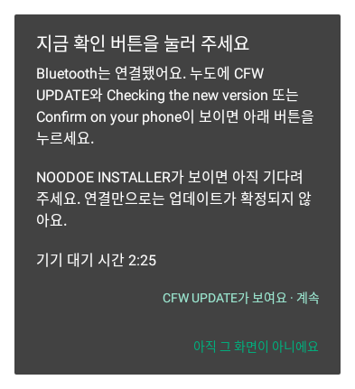 |

1. **[누도] CFW UPDATE**와 **Checking the new version** 또는 **Confirm on your phone**이 보이는지 확인합니다.
2. **[폰] CFW UPDATE가 보여요 · 계속**을 누릅니다. 아직 Bootstrap, NOODOE INSTALLER, 검은 화면이라면 **아직 그 화면이 아니에요**를 고르고 기다립니다.
3. 폰이 **설치 완료**를 알리고 누도 HOME이 나올 때까지 기다립니다.

**폰의 남은 시간 안에 확인하세요.** 확인하지 않으면 이전 버전이나 복구 화면으로 돌아갈 수 있습니다. 팝업을 닫는 것만으로는 설치 확인이 되지 않습니다.

### ⑧ 언어팩은 설치 완료 뒤 선택하기

펌웨어 설치가 완료되면 앱이 언어팩 설치 여부를 묻습니다. 한국어 등으로 쓰려면 **설치**, 영어로 먼저 쓰려면 **나중에**를 고릅니다. 언어팩은 나중에도 설치할 수 있습니다. 다음 [언어팩 안내](#language)를 이어서 보세요.

## 5. 이미 NewDoe를 쓰고 있다면

**0.11.16으로 처음 넘어온다면 아래의 순정 복귀 후 재설치 안내부터 확인하세요.**

### 일반 업데이트

1. 새 APK를 기존 앱 위에 설치합니다.
2. 차량을 세우고 앱 상단의 **일시정지**로 주행 연동을 중지합니다.
3. **기기** 페이지에서 내 누도와 새 **CFW ZIP**을 고릅니다.
4. **CFW 업데이트 / 이어가기**를 누르고 전송·설치·재시작을 기다립니다.
5. [⑦의 CFW UPDATE 확인](#confirm-update)을 마칩니다.
6. 언어팩 안내가 나오면 필요한 경우에만 설치합니다. **이미 정상 설치된 B 0.11.2 팩은 다시 보낼 필요가 없습니다.**

일반 업데이트에서는 설정·밝기·사진·트립·정비 기록을 이어 씁니다. 연결이 끊기면 같은 기기와 같은 ZIP으로 다시 확인하세요. 앱 데이터를 지우지 않습니다.

### 앱이 ‘순정 복귀 후 재설치’를 안내한다면

**0.11.16은 복구 메뉴도 바뀝니다. 이전 버전에서 처음 넘어올 때는 CFW 데이터를 보관한 채 순정으로 복귀한 뒤 재설치하세요.** 0.11.15에서도 이 과정이 필요합니다. 이 복구 메뉴가 설치된 뒤 같은 Gate를 사용하는 Product 업데이트는 위의 일반 CFW 업데이트로 진행합니다. 앱이 필요한 경로를 확인해 안내합니다.

1. **CFW 데이터 유지**를 선택해 순정으로 돌아갑니다. **완전 삭제**를 고르지 않습니다.
2. 본체가 순정 화면으로 돌아오면 폰에서 **본체에서 순정으로 돌아왔어요 · 확인**을 누릅니다.
3. 새 ZIP으로 [처음 설치](#first-install)를 진행하고 **보관 데이터 복원**을 선택합니다.

**순정으로 돌아가는 중에는 전원을 끊지 마세요.** 특히 구버전에서는 이때 전원이 끊기면 별도 수리가 필요할 수 있습니다.

## 6. 언어팩 설치와 언어 변경

**펌웨어 설치와 언어팩 설치는 따로 완료됩니다.** 먼저 CFW UPDATE 확인을 끝내고 아래 단계를 진행하세요.

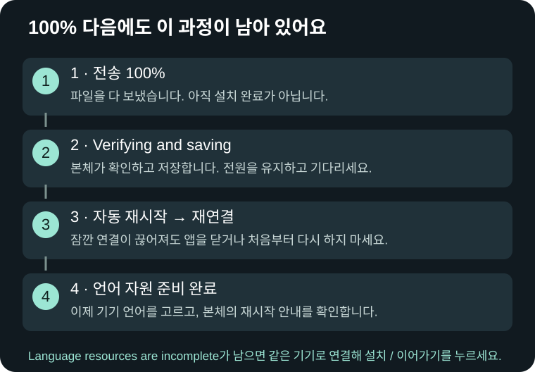

### 언어팩 설치 / 이전 팩 업데이트

1. 설치 직후 질문에서 **설치**를 고르거나, 앱의 **기기 언어 · 언어팩 설치 → 언어 자원 설치 / 이어가기**를 엽니다.
2. 앱의 다운로드 안내를 따릅니다. 수동으로 고르면 **NewDoe-LANGUAGE-B-0.11.2.zip**입니다.
3. 이미 같은 팩이 정상 설치돼 있으면 재전송 없이 확인합니다. 이전 팩이면 갱신 안내를 따릅니다.
4. **100% → Verifying and saving → 자동 재시작 → 재연결 → 언어 자원 준비 완료**까지 기다립니다.

키를 ON/OFF로 바꿔도 이 작업은 계속됩니다. 차량은 세워 두고 **배터리와 누도 전원은 연결한 채** 유지하세요. 사용자가 문구 파일과 글꼴 파일을 각각 보낼 필요는 없습니다.

**폰트 복구를 물어본다면:** ‘폰트 복구 후 계속’은 필요한 순정 글꼴을 복원한 뒤 진행합니다. ‘영어로 계속’은 글꼴을 복구하지 않고 영어로 사용합니다. 이 질문이 없으면 그대로 진행하면 됩니다.

### 한국어로 바꾸기

1. **[누도] O + DOWN**으로 빠른 설정을 열고, **O를 길게** 눌러 메인 메뉴를 엽니다.
2. **설정 → 시스템 → 언어**에서 **한국어**를 고릅니다. **English only / 영어 전용**이 켜져 있으면 끕니다. 폰의 **기기의 현재 설정 보기 / 변경**에서도 바꿀 수 있습니다.
3. **[누도] 재시작 안내**가 나오면 재시작을 확인합니다. ‘나중에’를 고르면 다음 재시작에 바뀝니다.
4. 아래 파란 준비 화면을 기다립니다. HOME이 열리면 설정 메뉴에서 언어를 확인합니다.

| 언어 변경 후 준비 중 | 준비가 끝난 한국어 메뉴 |
|---|---|
|  |  |

언어 변경이나 언어팩 갱신 뒤에는 이 준비 화면이 나옵니다. **같은 언어를 계속 쓸 때마다 언어팩을 다시 설치하지 않습니다.** 앱의 다른 버튼을 눌러 활성화하거나 키를 오랫동안 꺼둘 필요도 없습니다.

### 고를 수 있는 언어

B 기기는 **English · Deutsch · Español · Français · Italiano · Ελληνικά · 한국어 · Tiếng Việt · 日本語**를 지원합니다. 모든 메뉴 언어가 한 팩에 들어 있으므로 언어를 바꿀 때 재전송하지 않습니다. A 기기는 영어 메뉴를 사용합니다.

**앱 언어**는 폰 화면의 언어, **기기 언어**는 누도 메뉴의 언어입니다. 본체에서 **앱 언어 따르기**를 선택할 수도 있습니다. 직접 고른 기기 언어는 재연결해도 유지됩니다. 앱의 중국어 간체·번체는 본체 메뉴에서 영어로 표시됩니다.

| 음악·알림 표시 설정 | 어느 쪽을 고르면 되나요? |
|---|---|
| **휴대전화에서 렌더링** — 기본 | 다양한 글자와 컬러 이모지를 쓰고 싶을 때. 표시까지 조금 기다릴 수 있습니다. |
| **기기 글꼴 사용** | 빠른 텍스트 표시를 원할 때. 단색 이모지를 사용하며 없는 글자는 □로 나올 수 있습니다. |

영어가 계속 나오면 **영어 전용이 꺼졌는지 → 기기 언어를 바꿨는지 → 재시작을 확인했는지 → 언어팩 준비 완료인지** 순서로 확인하세요.

## 7. 연결할 수 없다고 나올 때

### Bootstrap에서 ‘Couldn’t pair’가 뜨면

파일 기록 중이라면 먼저 끝날 때까지 기다립니다. Bootstrap 메뉴나 연결 대기 화면에서 아래를 진행하세요.

1. **[폰] 접속이 안 되나요? / Bootstrap 연결 도움말**을 엽니다.
2. **Bluetooth 설정 열기**를 누르고 Android에서 **내 Noodoe만 등록 해제**합니다. 앱 데이터는 지우지 않습니다.
3. **[누도]** 이미 **Reset Bluetooth? → Yes**를 골랐다면 화면 안내를 따릅니다. 아직 초기화하지 않았다면 연결 대기 화면의 **UP**으로 페어링 메뉴를 열고 해당 폰을 고릅니다. O를 놓았다가 **다시 2초** 눌러 삭제합니다. ALL은 모든 폰을 삭제합니다.
4. **PAIR YOUR PHONE**이 나오면 Android에서 Noodoe를 다시 검색하고 페어링합니다.
5. NewDoe 앱으로 돌아와 같은 기기를 고르고 **현재 상태 확인**을 누릅니다.
6. 누도에서 **Install CFW**를 선택합니다. 이어가기 화면이 보이면 **마지막 작업 상태 조회 → 검사 후 설치 이어가기**를 따릅니다.

### 일반 화면에서 연결이 끊기면

앱 상단의 주행 연결이 일시정지돼 있지 않은지, Bluetooth·주변 기기 권한이 있는지 확인합니다. Android의 NewDoe 배터리 사용 설정에서 백그라운드 실행을 허용하세요. 앱을 강제 종료했다면 다시 열고 연결을 시작합니다. 카메라 등 다른 앱을 쓰다가 끊겼다면 NewDoe로 돌아와 연결 상태를 확인하세요.

**복구 메뉴에는 Bluetooth가 없습니다.** 해골이나 Recovery 메뉴에서 폰 연결을 계속 시도하지 말고 [본체 버튼으로 복구](#recovery)하세요.

## 8. 이 화면에서는 무엇을 해야 하나요?

| 화면·문구 | 지금 할 일 |
|---|---|
| **NOODOE INSTALLER** | 본체 설치가 끝나 Bootstrap 또는 다음 화면이 나올 때까지 기다립니다. CFW UPDATE 확인을 누를 때가 아닙니다. |
| **100% / Verifying and saving** | 저장이 끝날 때까지 전원을 유지합니다. [완료까지 남은 과정](#language)을 보세요. |
| **CFW UPDATE** | 폰에서 ‘CFW UPDATE가 보여요 · 계속’을 누릅니다. |
| **Firmware installed / Language resources are incomplete** | 펌웨어는 설치됐습니다. 같은 기기로 연결해 **언어 자원 설치 / 이어가기**를 누릅니다. 바로 순정 복귀나 펌웨어 재설치를 하지 마세요. |
| **opcode 0xAA / socket closed / read -1** | 본체 재시작 여부를 보고 재연결합니다. 그다음 언어 자원 상태를 다시 확인합니다. 계속되면 오류와 진단을 저장합니다. |
| **설치 성공 또는 취소가 확인되지 않음** | 같은 기기·같은 ZIP으로 **현재 기기 확인 → 마지막 작업 상태 조회**를 진행합니다. |
| **Paused / Stage 6/8 / Code 6 / Phase 4** | 본체가 수동 재시작을 요청하는지 확인하고, 요청이 있으면 바로 아래 절차를 따릅니다. |
| **언어를 바꿨는데 영어** | [언어 설정 네 가지 확인](#language)을 따릅니다. |
| **ODO ------ / 속도 미수신** | 차량 키가 ON인지 확인합니다. 계속되면 차량 모델과 화면을 보내 주세요. |

### ‘Please manually reset’이 나오면

1. 화면의 코드와 문구를 사진으로 남깁니다.
2. 버튼을 모두 놓은 뒤 **UP + O를 함께 3초** 누르고 놓습니다.
3. 키가 OFF라면 화면이 꺼진 채일 수 있습니다. 버튼을 놓고 **키를 ON**으로 합니다.
4. 같은 기기와 ZIP으로 다시 상태를 확인합니다. CFW UPDATE면 폰에서 확인하고, 복구 메뉴면 다음 절차를 따릅니다.

이 조작은 **본체가 요청할 때** 하세요. 진행이 느리다는 이유로 기록 중인 본체를 강제로 끄지 않습니다.

## 9. 폰 없이 복구하거나 순정으로 돌아가기

### 복구 메뉴 열기

- 본체가 새로 시작하며 NewDoe 로고를 표시할 때 **DOWN을 약 1초** 누릅니다.
- CFW가 이미 실행 중이면 **키 OFF → O를 누르고 유지 → 누른 채 키 ON → 2초 이상 유지 → 복구 화면에서 놓기**를 사용합니다.
- 키 OFF에서 UP+O를 눌러 화면이 꺼졌다면 버튼을 놓고 키 ON으로 다시 시작할 수 있습니다.

| 오류가 있을 때 먼저 나오는 화면 | 버튼을 누르거나 30초 뒤 나오는 메뉴 |
|---|---|
|  |  |

직접 들어갔다면 해골 없이 메뉴가 나올 수 있습니다. **UP/DOWN으로 이동, O로 선택**합니다. 회색 항목은 지금 사용할 수 없습니다. 화면 위의 사유·코드는 상황에 따라 달라집니다.

| 메뉴 | 하는 일 |
|---|---|
| **Start NewDoe** | 현재 펌웨어로 시작 |
| **Check again** | 복구할 수 있는 항목 다시 찾기 |
| **Reinstall firmware** | 보관된 설치 파일로 다시 설치 |
| **Restore previous** | 이전 펌웨어로 복구 |
| **Return to stock** | 순정 펌웨어로 복구 |
| **Try recovery anyway** | 일반 복구가 실패했을 때 다른 복구본 찾기 |
| **Details** | 오류와 상태 자세히 보기 |
| **More** | 도움말·계기판 값·간단한 게임 |
| **Restart** | 본체 다시 시작 |

### 순정으로 돌아가려면

1. **Return to stock → O**를 누릅니다.
2. 확인 화면의 내용을 읽고, **O를 놓았다가 새로 2초** 유지합니다.
3. 새 Gate에서는 배터리·UP + O·스타터 금지 그림이 순서대로 나옵니다. 매번 **O를 놓았다가 새로 눌러** 확인합니다. UP 또는 DOWN은 돌아가기입니다. 직접 선택한 강제 순정 복구에도 같은 안내가 나옵니다.
4. 순정 화면이 나올 때까지 전원을 유지합니다. **폰 연결은 필요하지 않습니다.** 이전 버전의 복구 메뉴에는 새 그림 세 장이 없을 수 있습니다.

| 복구 승인 화면 예시 | 순정 복귀 진행 화면 |
|---|---|
|  |  |

복구가 실패하면 **Check again**, 사용할 수 있다면 **Try recovery anyway**를 확인하세요. 더 진행할 수 없다는 화면에서는 **O**로 돌아갑니다. 반복해서 실패하면 코드와 화면을 [문의](#report)에 첨부하세요. 모든 복구본을 사용할 수 없다면 수리·분해 복구가 필요할 수 있습니다.

**Use recovery scratch**가 나오면 진행 중이던 언어·폰트 복구 데이터를 포기하고 복구 공간으로 쓰는 선택입니다. 해당 작업을 포기할 때만 승인하세요.

### 폰으로 순정 복귀하기

주행 연동을 중지하고 **순정으로 돌아가기 → CFW 데이터 유지**를 선택합니다. 본체가 순정으로 돌아온 다음 폰의 확인 버튼을 누릅니다. 나중에 재설치할 때 **보관 데이터 복원**을 고르면 기존 환경을 이어갑니다. **CFW 데이터까지 완전 삭제**는 기존 CFW 데이터를 지우려는 경우에만 선택하세요.

## 10. 설치 뒤, 폰 연결과 권한

앱에서 내 누도를 고르고 상단 **재생 버튼**으로 주행 연동을 시작합니다. 상단 **일시정지**는 누도 연결을 쉬는 버튼이며 음악 재생 버튼과 다릅니다.

| 권한·설정 | 필요한 기능 |
|---|---|
| Bluetooth / 주변 기기 | 누도 연결·설치 |
| 알림 접근 | 음악 정보와 선택한 앱의 알림 |
| 정밀 위치·백그라운드 위치 | GPS·지도, 화면을 꺼둔 동안 위치 전달 |
| 연락처·전화·최근 통화 | 발신자 이름과 통화 기능 |
| 앱 알림·백그라운드 실행 | 연결 상태 알림과 자동 재연결 |

**권한·연동 준비**에서 필요한 항목을 하나씩 켜세요. 전화번호를 제공하지 않는 통화는 **Unknown caller**로 나올 수 있습니다.

## 11. 본체 버튼으로 사용하기

| 일반 화면에서 | 동작 |
|---|---|
| **O 짧게** | HOME → 트립 → 음악 → 스마트폰 → 지도 순환 |
| **O + DOWN 짧게** | 빠른 밝기 설정 열기 |
| 빠른 설정에서 **UP / DOWN** | 밝기 조절 |
| 빠른 설정에서 **O 짧게 / 길게** | 닫기 / 메인 메뉴 열기 |
| 빠른 설정에서 **UP 길게** | 화면 표시 다시 시작 |
| 빠른 설정에서 **DOWN 길게** | Super Nite 저밝기 |

전화·알림·메뉴가 떠 있으면 그 화면의 버튼 안내를 따릅니다. 전체 설정은 주차 후 조작하세요.

상단 다섯 아이콘은 HOME에서 잠시 뒤 숨고 다른 일반 페이지에서는 유지됩니다. **GPS 회색**은 위치를 기다리는 상태이며, 위치가 들어오면 짧게 회색으로 깜빡입니다. **Bluetooth 노랑·빨강**은 폰 배터리 부족, **초록**은 충전 중 표시입니다.

## 12. 누적 거리·트립·정비

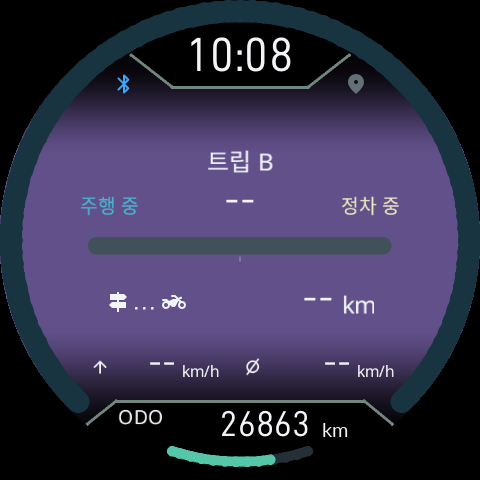

**ODO는 차량 계기판에서 받은 누적 거리**입니다. 값이 없으면 `------`로 표시합니다. 누도의 ODO를 따로 보정하거나 과거 값을 불러오는 메뉴는 없습니다.

트립 A/B·오늘·이번 주행·오일·벨트·정비 기록은 별도로 유지됩니다. **정비 메뉴**에서 교체 주기와 교체 후 주행거리를 확인하고, 실제 교체 기록에 맞게 초기화하거나 조정하세요. 이 조작은 차량 계기판의 원래 ODO를 바꾸지 않습니다.

오일의 남은 비율은 **30% 이하 노랑 → 15% 이하 빨강 → 5% 이하 빨강 점멸**입니다. 이번 주행의 최고·평균 속도가 5km/h를 넘으면 속도 링에 표시합니다.

HOME의 AUTO는 **새 알림 → 재생 중인 음악 → 나머지 정보** 순으로 표시합니다. 새 알림과 직접 고른 정보 화면은 기본 20초 후 자동 우선순위로 돌아갑니다.

키 OFF에서는 이번 부팅 중 마지막으로 받은 ODO를 본체와 폰 대시보드에 유지합니다. 키를 다시 ON으로 하면 새 차량 값을 받아야 합니다. 재부팅하면 임시 ODO는 사라지며, 예전에 저장한 ODO를 복원하지 않습니다. 트립·정비 카운터는 별도로 보존합니다.

## 13. 음악·전화·알림

- **음악:** 폰에서 음악을 재생하고 알림 접근을 허용합니다. 음악 페이지에서 UP 짧게는 재생/일시정지, DOWN 짧게는 다음 곡, UP 길게는 이전 곡입니다.
- **스마트폰 페이지:** UP으로 최근 전화, DOWN으로 최신 알림을 엽니다. 상세 화면에서는 화면의 버튼 안내를 따릅니다. 전화 팝업 닫기와 실제 통화 종료는 다른 조작입니다.
- **새 알림:** 상단 아이콘이 약 2초 깜빡입니다. 여러 메시지가 이어지면 최신 내용을 표시하며, 준비 중에는 Updating...이 보일 수 있습니다.
- **빠른 답장:** 1–7번은 저장 문구, 8번은 위치+이번 주행 정보+음악, 9번은 위치, 10번은 음악입니다. 8–10번에는 서명이 붙습니다. 상대와 전송할 내용을 확인하고 보내세요.
- **계기판 깜빡임:** 알림·경고 때 계기판 밝기가 잠시 변합니다. 원하지 않으면 설정 → Display → **Dash blink alerts**를 끕니다.

## 14. 지도와 축척

앱의 지도 메뉴에서 사용할 지역의 **.map 파일**을 가져옵니다. GPS·위치 권한을 켜고 주행 연결을 시작하세요. 지도 파일이 없으면 이동 격자와 궤적 선으로 표시합니다.

| 지도에서 | 조작 |
|---|---|
| **UP 길게** | AUTO / MANUAL 전환 |
| AUTO에서 **UP/DOWN** | −2 가까이 ~ +2 넓게 보기 선호도 |
| MANUAL에서 **UP/DOWN** | 축척 직접 변경 |
| **O 길게** | 북쪽 위 / 진행 방향 위 / 나침반 전환 |

처음 보는 지역은 지도를 준비하는 시간이 필요합니다. 현재 기능은 지도·위치·주행 궤적 표시입니다.

## 15. 폰의 홈·꾸미기·기기 화면

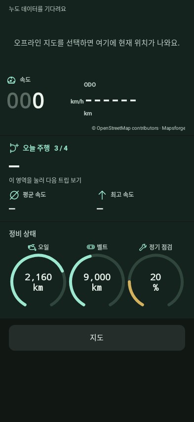

**기기 · 홈 · 꾸미기**는 좌우로 넘기거나 아래 버튼으로 이동합니다.

- **홈:** 지도·속도·ODO, 트립, 오일·벨트의 남은 km와 정기 점검의 남은 %를 원형 호 세 개로를 봅니다. **트립 표시 영역 자체를 눌러** 다음 정보로 넘깁니다. 순정 누도에 연결하면 아래 영역은 순정 정보로 바뀝니다.
- **꾸미기:** 배경 사진·알림 앱·팝업·빠른 답장·전화 즐겨찾기를 고릅니다.
- **기기:** 설치·업데이트·현재 상태·언어팩·설명서를 엽니다.

**UI 테스트 모드**에서는 연결하지 않은 상태로 원하는 속도·ODO·CFW/순정 화면을 미리 볼 수 있습니다. 실제 차량 값은 바뀌지 않습니다. 사용을 마치면 테스트 모드를 끄고 연결하세요.

**Bluetooth가 꺼져 있어요:** 연결 버튼을 잠그고 HOME에서도 켜 달라는 안내를 표시합니다. Bluetooth 설정 열기로 켜세요. 기존 자동 주행 연결 설정에 따라 재연결하며, 직접 일시정지했다면 그 상태를 유지합니다. 설치를 임의로 다시 시작하지는 않습니다.

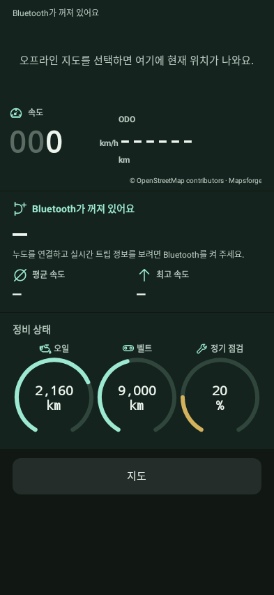

처음 새로 설치하면 배경 1에 검은 480 × 480 사진과 중앙 NEWDOE 워드마크가 들어갑니다. 다른 사진으로 바꾸면 워드마크도 완전히 사라집니다. 데이터 보존 재설치·일반 업데이트에서는 기존 사진을 유지하고, 배경 2·3은 바꾸지 않습니다.

## 16. 키를 끈 뒤와 장기 주차

키를 끄면 **Ride Summary**를 보여준 뒤 설정한 주차 화면·절전 순서로 넘어갑니다. O를 누른 채 키를 끄고 놓으면 키 OFF 후 최대 10분 동안 사용할 수 있습니다.

**설정 → 시스템 → 전원 순서 → 장기 주차 전원 끄기**에서 **끄기 / 2일 / 3일 / 7일**을 고릅니다. 기본값은 2일이며, 이전에 바꾼 값은 업데이트해도 유지됩니다.

설정한 시간이 지나 전원이 종료되면 폰 접근에 따른 재연결·웰컴 라이트도 멈춥니다. 다시 키를 켜면 시작 화면부터 켜집니다. 오랫동안 세워둘 때 이 설정을 확인하세요. 배터리가 이미 방전됐거나 전압이 크게 낮아졌다면 먼저 배터리·차량 점검을 받으세요.

## 17. 해결되지 않으면 이렇게 보내 주세요

앱의 **문제가 생겼나요? · 복구와 진단 → 진단 자료 저장·공유**를 엽니다. [프로젝트 문의](https://github.com/SerialSniffyHeck3r/noodoe_cfw/issues)에 아래를 함께 남겨 주세요.

- 차량 모델·연식, 휴대폰 모델과 Android 버전.
- 앱 버전, 누도 펌웨어 버전, 선택한 ZIP 이름.
- 현재 누도 화면 사진과 오류 문구·코드.
- 마지막에 누른 버튼과 그 뒤 달라진 점.
- 언어 문제라면 기기 언어·영어 전용 설정·언어팩 상태.

진단을 남기기 전 앱 데이터를 삭제하지 마세요. 보관한 백업 파일은 다른 저장장치에도 복사해 두면 좋습니다.

[처음으로](#top) · [다운로드](https://github.com/SerialSniffyHeck3r/noodoe_cfw/releases/latest) · [English](Guide.en.md)
