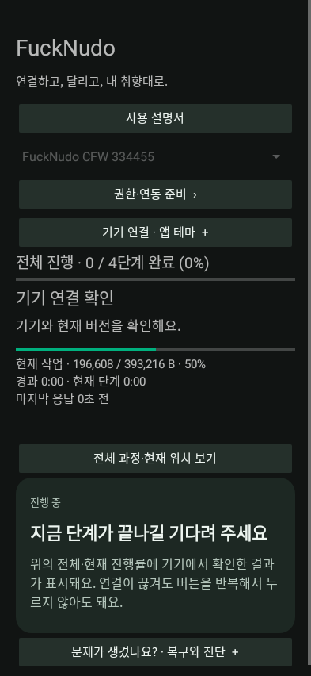
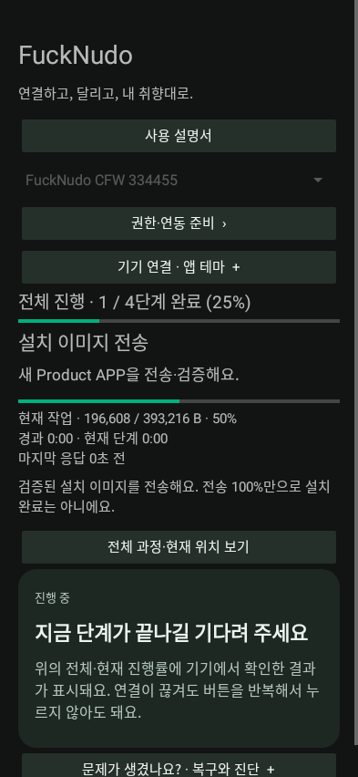
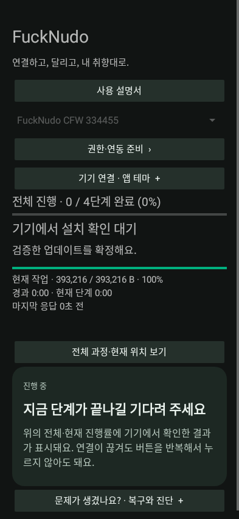
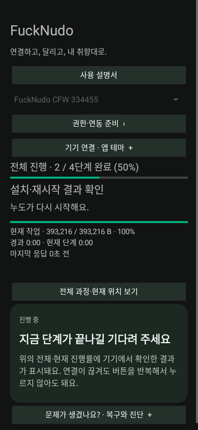
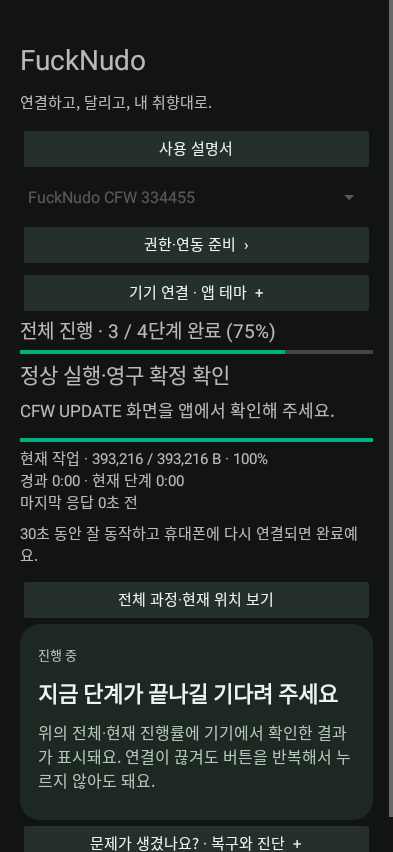
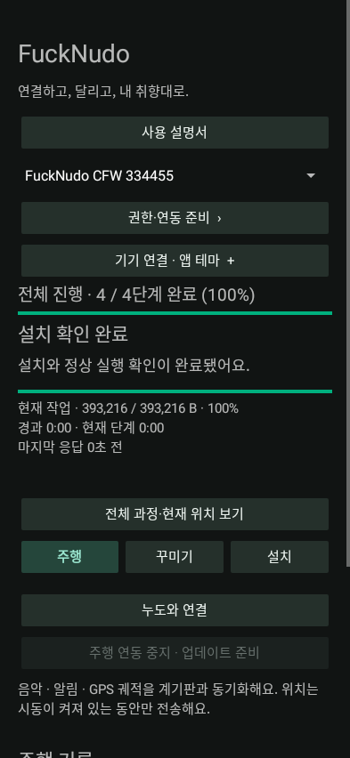

**0.11.0 Gate migration / Gate 교체:** [Read first / 먼저 읽기](../User/36-NewDoe-Recovery.en.md).

# Update an existing CFW

**0.11.0 beta:** [current installation and language-pack sequence](../User/35-Languages.en.md). Confirm normal firmware startup before installing optional language resources.

**Keep permanent power connected:** a power interruption while older CFW records its keep-data stock-return request can stop boot before the new recovery code runs. Automatic recovery is not guaranteed in that legacy interval. Keep permanent power connected throughout stock return/reinstallation and do not operate the starter. IGN OFF is not removal of permanent power. If already stuck, do not assume another reset will recover it; retain diagnostics and ask for help.

**APK / Product 0.11.0 · Manual revision 5 · 2026-10-17**

[Installation index](README.en.md) · [한국어](09-Update.md)

## Ordinary update

1. **Install APK 0.11.0 over the existing app**, retaining app data, logs and backups.
2. Select the correct Noodoe and **stop riding integration**.
3. Select the matching **0.11.0 ZIP** and start an ordinary CFW/Product update. The stock 5.14/5.16 requirement does not apply to the older CFW currently running.
4. Follow transfer, verification, local approval and restart instructions. When Gate and resources already match, the ordinary payload is the 384KiB Product APP.
5. Confirm the actual new `CFW UPDATE` screen in the app. Reconnect to the same device/candidate and wait for at least 5 seconds of healthy execution and permanent confirmation. The current candidate's maximum window is 5 minutes; follow the device-reported deadline for older firmware.

| Connection | Transfer and verification | Approval |
|---|---|---|
|  |  |  |
| Restart | New screen confirmation | Complete |
|  |  |  |

Update APK and ZIP as a pair. This ZIP replaces Gate. 0.9.x and 0.10.x both need the one-time keep-data stock-return route. For an older Gate, use **keep-data stock return → Check current device → Bootstrap from the new ZIP → Restore stored data → Gate+CFW installation → confirmed normal startup**. Later updates with the matching Gate use ordinary Product transfer.

## Resume after interruption

Use the same device and ZIP and follow **Identify device → Inspect last operation → Continue**. A complete staged image may be reused after integrity checks. A lost COMMIT/RESET reply does not justify repeating the request or bypassing unresolved records by changing ZIPs or clearing app data.

If 0.11.0 displays the manual-reset instruction, follow [recovery](10-Recovery.en.md). **The previously installed firmware performs the first restart, so older wording such as `Paused. See phone help.` may still appear during that handoff.** The new wording is not a fix for every underlying installation failure.

## Rollback and retained data

Ordinary updates and failed-candidate rollback retain settings, rider name, photos, trips and maintenance baselines. Explicit fresh start, reset and full removal are separate actions. A normal update does not repeatedly back up the entire NOR or recreate every file.

A candidate that fails execution or confirmation attempts a known-good rollback. If none exists or rollback fails, use Gate recovery. **100% transfer is different from permanent candidate confirmation.** See [troubleshooting](11-Troubleshooting.en.md).

The app now saves and restores settings around CFW updates. See [settings retention](../User/30-Sharing-Settings.en.md). Do not clear app data before completion.

## 0.11.0: language installation with ignition ON or OFF

Update both the APK and firmware ZIP to 0.11.0. The new Gate requires the migration described above. The language resources themselves need no formatting or app-data deletion. Confirm CFW UPDATE and firmware completion first, then accept the resource offer or use **Install / resume language resources**.

Ignition ON/OFF is ignored throughout language inspection, optional FONT repair, transfer, verification, saving and automatic restart. Switching ignition or losing vehicle telemetry does not pause, cancel or restart the operation. No five-second ignition admission wait remains. A fresh speed of at least 3km/h still pauses uncommitted work; keep the vehicle parked. The active installation keeps the module awake even with ignition OFF. Keep its permanent power supply connected.

Transfer 100% is followed by real file/index verification, journaled saving, automatic restart and resource-ready confirmation. Wait for that final confirmation. If Bluetooth disconnects or progress times out, use the same resource menu to resume; recorded candidate pages are reused only after physical hash comparison. Committed metadata finishes or recovers through Gate before normal filesystem access resumes.

The new archive is **NewDoe-LANGUAGE-B-0.11.0.zip**, with separate TEXT.PAK and FONTS.PAK entries. Its combined device content is identical to the previous pack, so a healthy installed pack is reused without retransmission. An explicitly enabled **English only** preference is preserved; turn it off, select Follow app or the desired language and accept the restart. Firmware completion and language-resource completion remain separate.

0.11.0 prepares the saved device language after configuration restore and checks actual menu readiness after restart. Resources are distributed as text/common-font parts; identical installed pack content is not resent.
