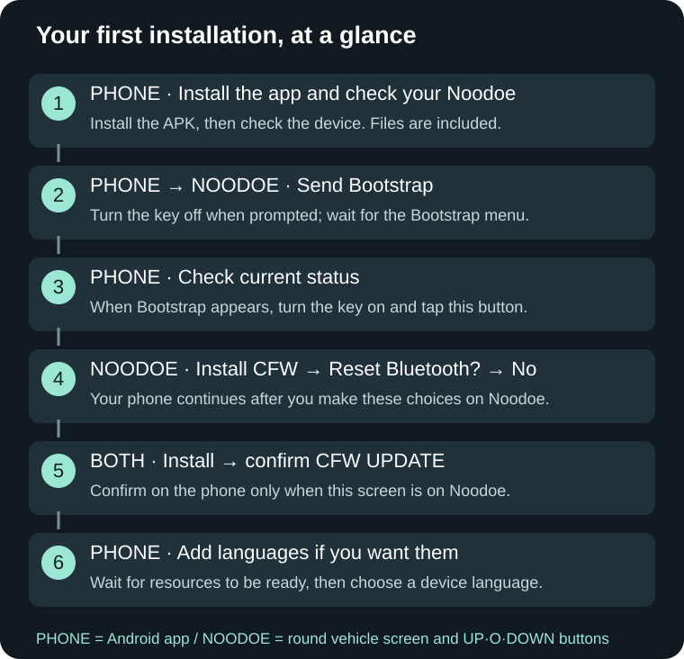

# NewDoe — Install and recover

**APK 0.13.0 / CFW 0.12.2 / B language 0.12.2 · 2026-10-29**

[← Full guide](../README.en.md)

- [Compatible devices](../Guide.en.md#compatibility)
- [Buttons and the ignition key](../Guide.en.md#basics)
- [Downloads and preparation](../Guide.en.md#prepare)
- [First installation, screen by screen](../Guide.en.md#first-install)
- [Updating existing CFW](../Guide.en.md#update)
- [Language resources and selection](../Guide.en.md#language)
- [Connection help](../Guide.en.md#connection)
- [Screen-by-screen troubleshooting](../Guide.en.md#troubleshooting)
- [Recovery without a phone](../Guide.en.md#recovery)

App 0.13.0 includes firmware and language resources 0.12.2. Download the APK, check the device, then install or update. Manual ZIP installation remains in Expert settings.
