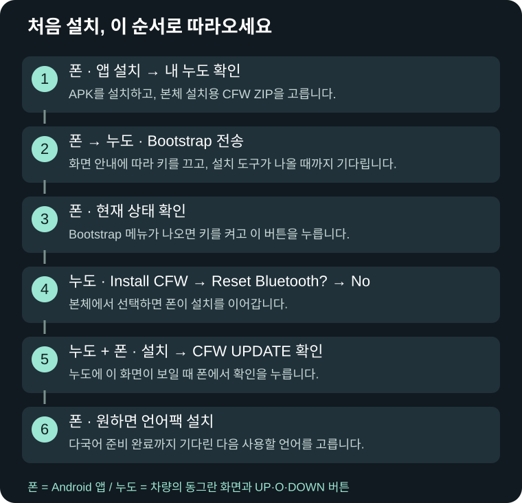

# NewDoe — 설치와 복구

**0.11.15 · 2026-10-20**

[← 전체 설명서](../README.md)

- [내 누도에 설치할 수 있나요?](../Guide.md#compatibility)
- [버튼과 키 ON/OFF](../Guide.md#basics)
- [파일 받기와 준비](../Guide.md#prepare)
- [처음 설치, 화면 보며 따라하기](../Guide.md#first-install)
- [기존 CFW 업데이트](../Guide.md#update)
- [언어팩과 언어 변경](../Guide.md#language)
- [연결할 수 없을 때](../Guide.md#connection)
- [화면별 문제 해결](../Guide.md#troubleshooting)
- [폰 없이 복구·순정 복귀](../Guide.md#recovery)
