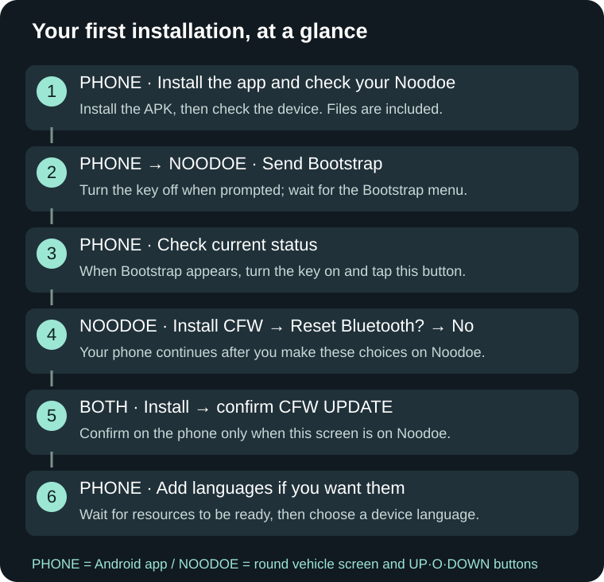

# NewDoe illustrated user guide

**APK 0.15.9 (157) / CFW 0.15.9 · 2026-11-12**

[한국어](README.md) · [Downloads / 다운로드](https://github.com/SerialSniffyHeck3r/noodoe_cfw/releases/latest)

Use the screen examples to follow each step on your phone and Noodoe.

**[Open the illustrated guide](Guide.en.md)**

| What you need | Guide |
|---|---|
| Compatible devices | [Open](Guide.en.md#compatibility) |
| Buttons and the ignition key | [Open](Guide.en.md#basics) |
| Downloads and preparation | [Open](Guide.en.md#prepare) |
| First installation, screen by screen | [Open](Guide.en.md#first-install) |
| Updating existing CFW | [Open](Guide.en.md#update) |
| System language selection and changes | [Open](Guide.en.md#language) |
| Connection help | [Open](Guide.en.md#connection) |
| Screen-by-screen troubleshooting | [Open](Guide.en.md#troubleshooting) |
| Recovery without a phone | [Open](Guide.en.md#recovery) |
| Phone permissions and connection | [Open](Guide.en.md#phone) |
| Device buttons and settings | [Open](Guide.en.md#controls) |
| Odometer, trips and maintenance | [Open](Guide.en.md#vehicle) |
| Music, calls and notifications | [Open](Guide.en.md#media) |
| Maps and zoom | [Open](Guide.en.md#map) |
| BRouter and external app TBT | [Open](Guide.en.md#navigation) |
| Weather API setup and queries | [Open](Guide.en.md#weather) |
| App pages and preview | [Open](Guide.en.md#dashboard) |
| Ignition-off and long parking | [Open](Guide.en.md#parking) |
| Get help and save diagnostics | [Open](Guide.en.md#report) |

Healthy devices update directly. A 0.14.1 settings error that blocks updating requires data-preserving stock return and reinstallation. Read [language choices and insufficient CJ space](Guide.en.md#language).

[Download the illustrated offline guide](https://github.com/SerialSniffyHeck3r/noodoe_cfw/releases/download/cfw-v0.15.7/NewDoe-Illustrated-Manual-0.15.7.zip)

Language-specific firmware, base resources and fonts are included in the APK. Manual ZIP installation remains in Expert settings.
