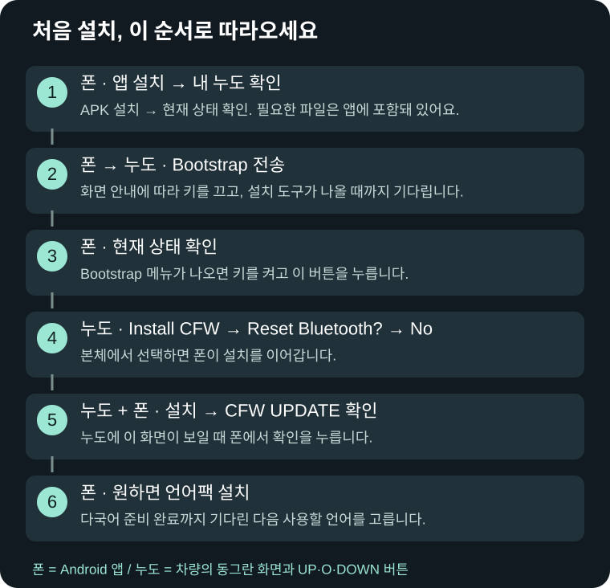

# NewDoe 그림 사용 설명서

**APK 0.15.15 (165) / CFW 0.15.15 · 2026-11-15**

[English](README.en.md) · [Downloads / 다운로드](https://github.com/SerialSniffyHeck3r/noodoe_cfw/releases/latest)

화면을 보며 휴대폰에서 할 일과 누도에서 할 일을 순서대로 따라오세요.

**[그림 설명서 처음부터 보기](Guide.md)**

| 하고 싶은 일 | 안내 |
|---|---|
| 내 누도에 설치할 수 있나요? | [보기](Guide.md#compatibility) |
| 버튼과 키 ON/OFF | [보기](Guide.md#basics) |
| 파일 받기와 준비 | [보기](Guide.md#prepare) |
| 처음 설치, 화면 보며 따라하기 | [보기](Guide.md#first-install) |
| 기존 CFW 업데이트 | [보기](Guide.md#update) |
| 시스템 언어 선택·변경 | [보기](Guide.md#language) |
| 연결할 수 없을 때 | [보기](Guide.md#connection) |
| 화면별 문제 해결 | [보기](Guide.md#troubleshooting) |
| 폰 없이 복구·순정 복귀 | [보기](Guide.md#recovery) |
| 휴대폰 권한과 연결 | [보기](Guide.md#phone) |
| 본체 버튼과 설정 | [보기](Guide.md#controls) |
| ODO·트립·정비 | [보기](Guide.md#vehicle) |
| 음악·전화·알림 | [보기](Guide.md#media) |
| 지도와 축척 | [보기](Guide.md#map) |
| BRouter·외부 앱 TBT 안내 | [보기](Guide.md#navigation) |
| 날씨 API 등록·조회 | [보기](Guide.md#weather) |
| 앱 화면과 미리보기 | [보기](Guide.md#dashboard) |
| 키 OFF·장기 주차 | [보기](Guide.md#parking) |
| 문의와 진단 | [보기](Guide.md#report) |

정상 기기는 직접 업데이트합니다. 0.14.1 설정 오류로 업데이트가 막히면 데이터 보존 순정 복귀 후 재설치합니다. 언어 선택과 CJ 공간 부족 시의 선택은 [언어 안내](Guide.md#language)를 확인하세요.

[그림 포함 오프라인 설명서 받기](https://github.com/SerialSniffyHeck3r/noodoe_cfw/releases/download/cfw-v0.15.7/NewDoe-Illustrated-Manual-0.15.7.zip)

언어별 펌웨어·기본 자원·필요한 글꼴은 APK에 포함돼 있습니다. ZIP 직접 설치는 전문가용 설정에 남아 있습니다.
