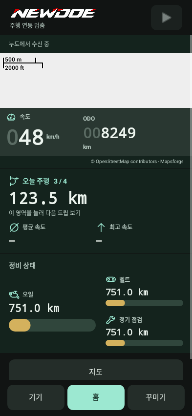

# App dashboard, customization and preview

**NewDoe 0.11.16 · 2026-10-20**

**[Open the illustrated instructions](../Guide.en.md#dashboard)**

[← Full manual](../README.en.md)

## 0.15.12

- Fixed malformed language-status requests that repeatedly produced “Device rejected the request” in Settings. Read-only query failures are separate from setting changes; uncertain writes are never automatically resent.
- The device screen compares the observed firmware hash with the selected installation package. It shows already installed for a match, Update for a difference, and a status check when unknown. Unfinished installation/recovery notices take precedence.
- The top-right app area is a connection indicator, with no start/stop button. The notification area uses a static NewDoe icon instead of the animated upload arrow.
- The notification-app chooser now has **Select all / Deselect all**. Individual choices remain available. **Save** applies the draft; **Cancel** keeps the previous selection. Apps installed later must be selected separately.
- Compass directions follow the installed device language: N/E/S/W in English and 北/東/南/西 in Taiwanese Chinese. Taiwanese TRIP A/B labels now use **行程 A/B**.
