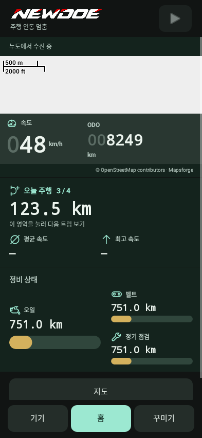

# 앱 홈·꾸미기·테스트 모드

**NewDoe 0.11.16 · 2026-10-20**

**[화면 보며 순서대로 따라하기](../Guide.md#dashboard)**

[← 전체 설명서](../README.md)

## 0.15.12

- 설정 화면에서 언어 상태를 읽을 때 잘못된 명령 형식으로 요청이 반복 거절되던 문제를 수정했습니다. 읽기 실패는 설정 변경 실패와 구분하며, 설정 저장 명령은 자동 재전송하지 않습니다.
- 기기 화면은 확인된 실제 펌웨어 해시와 선택한 설치 파일을 비교합니다. 같으면 이미 설치됨, 다르면 업데이트를 표시하며, 아직 확인하지 않았다면 기기 상태 확인을 안내합니다. 미완료 설치·복구 안내가 우선합니다.
- 앱 오른쪽 위는 조작 버튼 대신 연결 상태만 표시합니다. 알림 영역에는 움직이는 업로드 화살표 대신 고정 NewDoe 아이콘을 사용합니다.
- 알림을 받을 앱 선택 화면 위에 **모두 선택 / 모두 해제**가 있습니다. 개별 선택도 가능하며 **저장**을 눌러야 적용됩니다. **취소**하면 이전 선택을 유지합니다. 이후 새로 설치한 앱은 따로 선택해 주세요.
- 나침반 방향은 본체에 설치된 언어를 따릅니다. 영어는 N/E/S/W, 대만 번체는 北/東/南/西를 사용하며, 대만의 TRIP A/B는 **行程 A/B**로 표시합니다.
