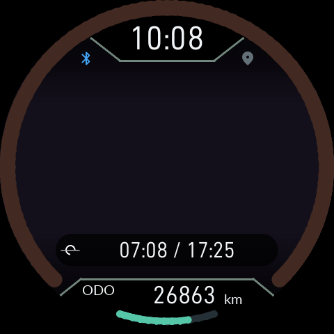
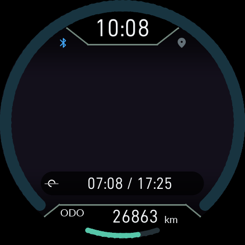
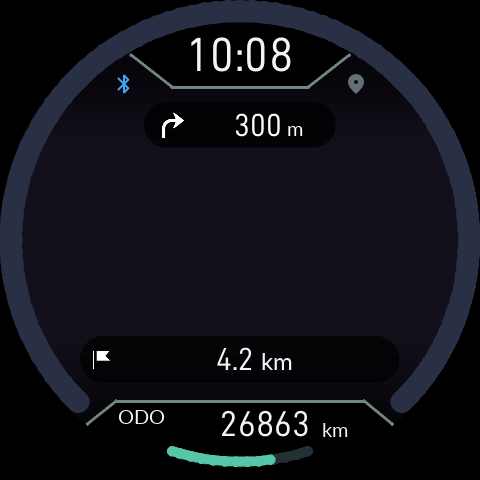
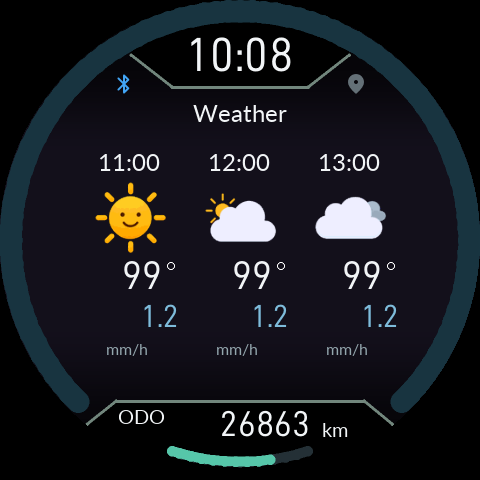
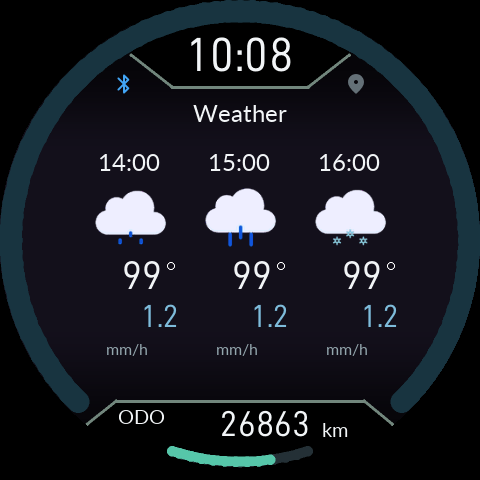

# Instrument arc color and six-hour forecast

Use the matching 0.15.10 app and firmware.

## Arc color theme

Choose **Settings → Display → Arc color theme** on the instrument, or change the same device setting in the app.

- **Default** preserves the existing color. Updating does not enable the automatic theme.
- **Sunrise / sunset** gradually changes only the hue of the unfilled speed arc using the selected reference city, date and local time. Its perceptual lightness and chroma stay matched to the original arc. The filled speed arc, ticks and lower distance arc retain their existing colors.

Set the sunrise/sunset reference city, date/time and UTC offset first. Continuous GPS is unnecessary. If the clock/reference or solar events are unavailable, the default color is shown. Ignition OFF retains the original gray.

The HOME information strip now uses the same 32px numeric face for sunrise/sunset and destination distance as battery and notification counts. The smaller map footer retains its own layout.

## Next six hours

1. Use UP/DOWN in HOME to select **Weather**.
2. **Hold O** to open the next-six-hours view.
3. The first page shows +1, +2 and +3 hours; the second shows +4, +5 and +6 hours. No footer caption or page counter is displayed. Each larger cell shows source forecast time, icon, temperature and precipitation amount (mm/h). Temperature follows the device unit setting.
4. Use **UP or DOWN** to switch the two pages. The same buttons do not leave Weather while details are open.
5. **Press O** to return to the overview; holding O also closes details. From the overview, UP/DOWN selects another HOME view. Reopening details starts on page 1.

The overview and its two bars still cover **now through +12 hours**. Opening details does not trigger another API request. With weather enabled, a verified NewDoe connection triggers one query as soon as a recent location and API key are available, then sends the result to instrument RAM. Later automatic queries require the instrument Weather view and one hour or 30 km since the last query. Without a connection, both automatic and manual weather API requests stop; cached information remains visible. Missing location waits rather than querying an invented position.

**Basic API 2.5** supplies three-hour forecasts. The detail view retains the actual source forecast timestamps, so neighboring cells may repeat a time and value. It does not manufacture hourly precision. One Call hourly data shows individual hourly forecasts. Missing values appear as `--`.

If an older app cannot supply details, the instrument asks you to open Weather in the phone app. Update the app and firmware together.

Images are software renders of the Product LVGL/EVE code, not authenticated live weather or vehicle validation.

The detail page has no high/low temperatures. Blue numbers show precipitation in mm/h. Temperature sits below each icon with its degree sign at the upper right.

A loading icon appears during refresh. The completed forecast replaces the central mm/h caption below the timeline with its age in minutes or hours. The 0 and +12 endpoints and the hourly-detail mm/h units remain. Changed data is delivered to RAM even on other pages; after the initial connection query, periodic requests follow the weather-page one-hour/30 km policy. Disconnected devices never trigger requests. Both bars blend colors between forecast times.
