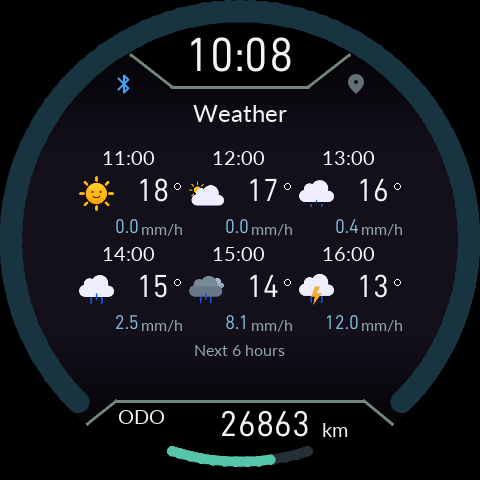

# Instrument arc color and six-hour forecast

Use the matching 0.15.6 app and firmware.

## Arc color theme

Choose **Settings → Display → Arc color theme** on the instrument, or change the same device setting in the app.

- **Default** preserves the existing color. Updating does not enable the automatic theme.
- **Sunrise / sunset** gradually changes only the hue of the unfilled speed arc using the selected reference city, date and local time. Its perceptual lightness and chroma stay matched to the original arc. The filled speed arc, ticks and lower distance arc retain their existing colors.

Set the sunrise/sunset reference city, date/time and UTC offset first. Continuous GPS is unnecessary. If the clock/reference or solar events are unavailable, the default color is shown. Ignition OFF retains the original gray.

The HOME information strip now uses the same 32px numeric face for sunrise/sunset and destination distance as battery and notification counts. The smaller map footer retains its own layout.

## Next six hours

1. Use UP/DOWN in HOME to select **Weather**.
2. **Hold O** to open the next-six-hours view.
3. Each cell shows local forecast time, condition icon, temperature and precipitation amount (mm/h). Temperature follows the device unit setting.
4. **Press O** to return to the overview; holding O also toggles views. UP/DOWN selects another HOME view.

The overview and its two bars still cover **now through +12 hours**. Opening details does not trigger another API request. The existing hourly / 30km refresh policy applies only while the Weather page is visible. Weather stays in RAM.

**Basic API 2.5** supplies three-hour forecasts. The detail view shows **3-hour intervals** and the actual source forecast timestamps, so neighboring cells may repeat a time and value. It does not manufacture hourly precision. One Call hourly data shows individual hourly forecasts. Missing values appear as `--`.

If an older app cannot supply details, the instrument asks you to open Weather in the phone app. Update the app and firmware together.

Images are software renders of the Product LVGL/EVE code, not authenticated live weather or vehicle validation.
