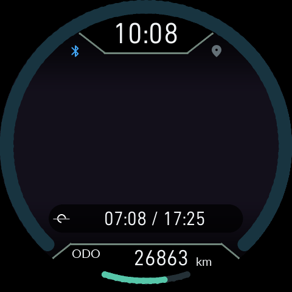
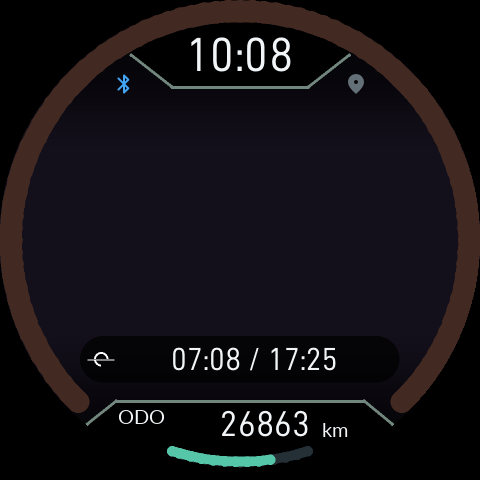
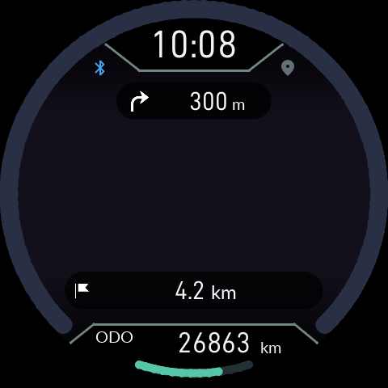
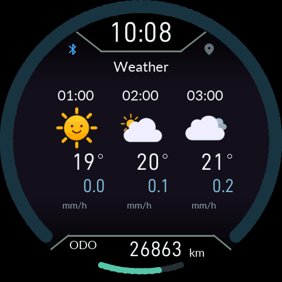
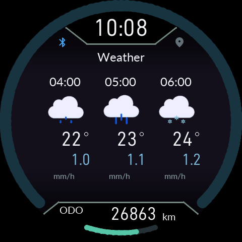
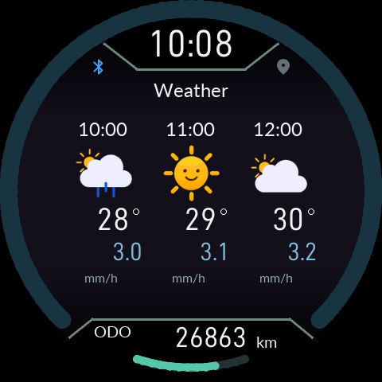

# 계기판 호 색상과 12시간 예보

0.15.12 앱과 펌웨어를 함께 업데이트한 뒤 사용합니다.

## 계기판 호 색상

본체 **설정 → 표시 → 계기판 호 색상**에서 선택합니다. 앱의 본체 설정에서도 같은 값을 바꿀 수 있습니다.

- **기본값**: 지금까지 사용하던 색상을 유지합니다. 업데이트해도 자동 모드로 바뀌지 않습니다.
- **일출 / 일몰**: 설정한 일출·일몰 기준 지역과 기기의 날짜·현지 시각에 맞춰 빈 속도 호의 색조를 천천히 바꿉니다. 밝기와 채도는 기존 빈 호에 맞춘 값입니다. 실제 속도로 채워진 구간, 눈금과 하단 주행거리 호는 그대로입니다.

먼저 일출·일몰 기준 지역, 날짜·시간과 UTC 시간대를 맞춰 주세요. GPS를 계속 받아야 하는 기능은 아닙니다. 시각·지역을 확인하지 못하거나 일출·일몰이 없는 날짜에는 기본 색을 표시합니다. 시동 OFF는 기존 회색을 유지합니다.

일출·일몰 및 목적지 거리의 HOME 정보 줄은 배터리·알림 숫자와 같은 32px 숫자 서체를 사용합니다. 지도 하단의 작은 표시와 HOME 정보 줄은 각각의 배치를 유지합니다.

## 향후 12시간 자세히 보기

1. HOME에서 위·아래 버튼으로 **날씨**를 선택합니다.
2. **O를 길게** 눌러 향후 12시간 예보를 엽니다.
3. 첫 화면은 +1·+2·+3시간이며, 다음 화면은 +4~6, +7~9, +10~12시간을 세 칸씩 표시합니다. 하단 설명 문구와 페이지 번호는 없습니다. 커진 세 칸에서 예보 원본의 현지 시각, 아이콘, 온도와 강수량(mm/h)을 확인합니다. 온도 단위는 본체 설정을 따릅니다.
4. **위 또는 아래 버튼**으로 네 페이지를 전환합니다. 상세 예보 안에서는 다른 HOME 보기로 넘어가지 않습니다.
5. **O를 짧게** 눌러 원래 날씨 개요로 돌아갑니다. O를 길게 눌러도 닫힙니다. 개요에서 위·아래 버튼을 누르면 다른 HOME 보기로 이동합니다. 상세 예보를 다시 열면 1페이지부터 표시합니다.

기존 날씨 개요와 두 예보 바는 **현재부터 +12시간** 범위를 유지합니다. 상세 화면을 열었다고 새 API 조회를 추가하지 않습니다. 날씨를 켠 상태에서 NewDoe와 실제 연결이 완료되면, 최근 위치와 API 키가 준비되는 즉시 한 번 조회하여 본체 RAM으로 전송합니다. 이후 자동 조회는 본체 날씨 화면에서 마지막 조회 후 1시간 또는 30km 이동 시에만 합니다. 미연결 중 자동 조회는 중단하지만, 사용자가 누른 수동 갱신은 가능합니다. 위치가 없으면 기다리며 임의 위치로 조회하지 않습니다.

**Basic API 2.5**는 원본이 3시간 간격입니다. 이 경우 원본 예보 시각을 사용하므로 여러 칸에 같은 시각·값이 나올 수 있습니다. 시간별 예보를 새로 만들어 낸 것은 아닙니다. One Call의 시간별 자료에서는 각 시간의 예보가 표시됩니다. 미제공 값은 `--`로 표시합니다.

구형 앱이 시간별 자료를 제공하지 못하면 본체에서 휴대폰 날씨 화면을 확인하라는 안내가 나옵니다. 앱과 펌웨어를 함께 최신 버전으로 업데이트하세요.

이 문서의 화면은 실제 Product의 LVGL/EVE 소프트웨어 렌더링으로 만든 예시입니다. 실제 날씨 조회 결과나 실차 검증 화면은 아닙니다.

상세 예보에는 최고/최저 온도를 표시하지 않습니다. 강수량은 푸른 숫자이며 단위는 mm/h입니다. 아이콘 아래 온도와 그 오른쪽 위의 도 기호를 확인하세요.

갱신 중에는 로딩 아이콘을 표시합니다. 완료 뒤에는 아래 예보 바 중앙의 mm/h 대신 업데이트 경과 시간을 분·시간 단위로 표시합니다. 왼쪽 0과 오른쪽 +12는 유지하며, 시간별 상세 화면의 mm/h도 유지합니다. 새 결과는 다른 페이지에 있어도 RAM에 전달합니다. 연결 직후 한 번 갱신한 뒤, 정기 조회는 본체 날씨 화면의 1시간·30km 조건을 따릅니다. 미연결 상태에서는 자동 조회하지 않으며 수동 갱신은 가능합니다. 두 바의 색은 시간 사이를 부드럽게 연결합니다.

## 0.15.12 — MAP 전환·음악 로딩·정보 우선순위

앱 빌드 161과 같은 버전의 내장 펌웨어를 함께 사용합니다. 기존 앱 위에 설치하며 데이터 삭제는 필요하지 않습니다.

- MAP을 나가면 지도 표시와 본체 지도 캐시를 무효화하고 화면 교체가 완료된 뒤 다음 화면으로 전환합니다. MAP 밖에서는 지도 타일과 내장 안내 경로 좌표를 전송하지 않습니다. TBT 안내는 계속됩니다.
- 음악 화면은 TBT 다음으로 앨범 아트와 음악 글자를 먼저 받습니다. MAP 화면은 TBT와 지도 전송을 먼저 처리합니다. 이미 시작한 전송과 제어·GPS 명령의 처리 순서는 보호됩니다.
- 다음 곡 준비 중에는 로딩 아이콘을 표시합니다. 같은 곡으로 음악 화면을 다시 열면 보관된 그림과 글자를 재사용합니다. 재생 세션이 사라지면 짧은 전환 유예 뒤 Media Off를 표시합니다.
- 한 줄 AUTO는 **알림 → 통화 → 음악 → ETA** 순으로 우선 표시합니다. 해당 정보가 모두 없으면 일반 항목을 10초마다 순환합니다. 위/아래 길게로 잠시 다른 항목을 봐도 20초 후 활성 우선 정보로 돌아옵니다.
- 두 줄은 음악 재생 중 음악을 유지합니다. 음악이 없으면 아래는 선택한 TRIP, 위는 한 줄 AUTO의 우선순위를 사용합니다. 수동으로 선택한 일반 정보와 안내 중 MAP/TBT의 ETA 두 장 순환은 유지합니다.
- TRIP의 km/mi는 숫자 아래쪽 기준선에 맞췄습니다.
- 날씨에서 O를 길게 누르면 한 화면에 세 시간씩 표시합니다. 위/아래로 **+1~3 / +4~6 / +7~9 / +10~12시간** 네 화면을 넘기고 O로 돌아옵니다. 추가 API 조회 없이 이미 받은 예보를 사용합니다. Basic API의 3시간 자료는 실제 제공 시각으로 표시합니다.

Bluetooth 재연결·차량 접근 감지 정책은 이번 변경에서 제외했습니다. 집에서 반복 접속을 시도하는 문제를 해결했다고 주장하지 않습니다. Gate, NOR 파일 배치, 사용자 저장 데이터와 설치·복구 경로는 유지합니다.

본체 이미지는 실제 ARM/LVGL/EVE 코드의 소프트웨어 렌더링 예시입니다. 실차 LCD·무선 통신·소비전력 검증은 별도입니다.

