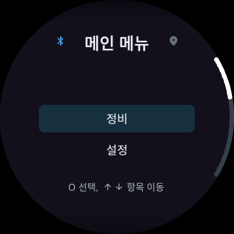

# NewDoe — 평소 사용하기

**0.15.7 · 2026-11-12**

[← 전체 설명서](../README.md)

- [언어팩과 언어 변경](../Guide.md#language)
- [휴대폰 권한과 연결](../Guide.md#phone)
- [본체 버튼과 설정](../Guide.md#controls)
- [ODO·트립·정비](../Guide.md#vehicle)
- [음악·전화·알림](../Guide.md#media)
- [지도와 축척](../Guide.md#map)
- [앱 화면과 미리보기](../Guide.md#dashboard)
- [키 OFF·장기 주차](../Guide.md#parking)
- [문의와 진단](../Guide.md#report)

- [계기판 호 색상·12시간 예보](38-Solar-Weather.md)
