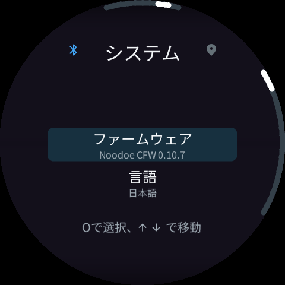
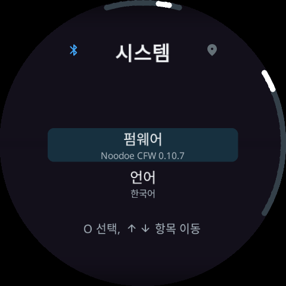

# 0.10.7 validation

All results below are software checks. No physical scooter, phone RF timing, current draw or real power-cut qualification was performed.

- Product Debug and Release use 392,092 / 393,216 flash bytes, leaving **1,124 bytes** each (hard minimum 1,024). Language-only code/metadata sharing saved 824 bytes relative to the unoptimized new-feature build; the final image uses 28 more bytes than 0.10.6. Compiler profiles, heap/stack reservations and pre-existing font/icon assets were not reduced.
- The final optimized shipped Release ELF loads saved Korean without a phone action: 8,397 scheduler steps, 7,548 reads and 1,455,168 bytes allocated for the test scenario. This is an emulator result, not a wall-clock hardware measurement.
- Real language data and healthy stock B fonts prepare all nine system locales. Native language names render with stock fonts in both tested menu sizes. Unit tests preserve visible glyph pixels and baselines while removing transparent bottom rows.
- 27 actual ARM/LVGL/EVE rendered frames cover settings, system-language rows and trip views in all nine locales. Preparation must reach the requested locale; English fallback is not accepted as a successful translated frame. No file reads occur from drawing; display lists remain below 8KiB. The 72 English baseline frames preserve identical submitted display-list/RAM_G bytes.
- O0 and Os checks pass: installation 28/29 cases (Os includes the full production pack); transfer 148 cases each including all 35 candidate-write cut boundaries; old-page reuse 3 cases each; runtime 117; catalog 3,191; cache 90; compact metadata validates all 46 exact FONT pins and rejects seven malformed names.
- The full 11,965,392-byte production pack completes actual FAT/allocation/hash/index/publication code and matches the original SHA-256. Identical old content needs zero payload bytes; a synthetic fixed-length text change transmits 8,192 bytes; a corrupt old source page transmits 4,096 bytes. Source chains remain intact. Offset shifts may require additional transfer.
- Late configuration restore and dark/parked persistence tests pass at O0/Os. The existing restart confirmation and save/reset flow is preserved; waiting/English fallback no longer suppresses a changed-language request.
- Android: **128 passed, 1 optional pre-publication download test skipped, 0 failed**. Tests include actual split-archive import, real ARM wire transfer, normal-boot waiting and current-epoch activation requests. The skipped test requires the new release URL; public artifact download hashes are separately verified after publication.
- Final ELF worst-case SDRAM allocation inventory fits: 30,688,640 bytes, 34 of 40 owner records. This conservative combined inventory is not a claim that all data are allocated on every boot.
- APK version 0.10.7/code110 preserves its signing certificate and matches the exact Product SHA in the ZIP. Replacement-library objects match compiled classes; D8 reconstruction and alignment pass. The reconstructed copy is not signed or physically installed.
- Gate, Bootstrap, stock image, fixed resources, uninstall and diagnostic binaries are byte-identical to 0.10.6. Bluetooth pairing and ordinary firmware transfer are unchanged.
- TEXT.PAK is 112,400 bytes and FONTS.PAK is 11,852,992 bytes. Their concatenation is byte-identical to the previous LANGUAGE.PAK. All nine menu languages and the full common glyph/emoji coverage remain. The on-device file stays atomic and compatible with the unchanged Gate.
- Matching-Gate 0.10.x uses direct CFW update. The accepted legacy stock-return power-interruption limitation is unchanged. Software tests do not eliminate that old-code limitation.

## Rendered firmware examples

These images are software renderings from actual ARM firmware display lists, not photographs.

| Korean settings | Japanese system |
|---|---|
|  |  |

| Korean system | Korean trip units |
|---|---|
|  |  |
