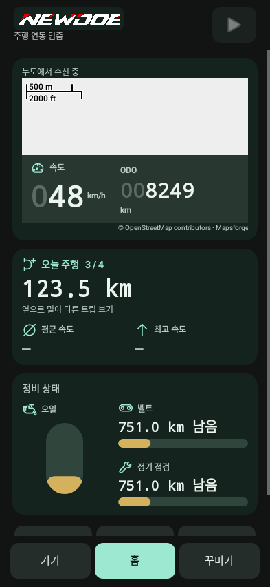
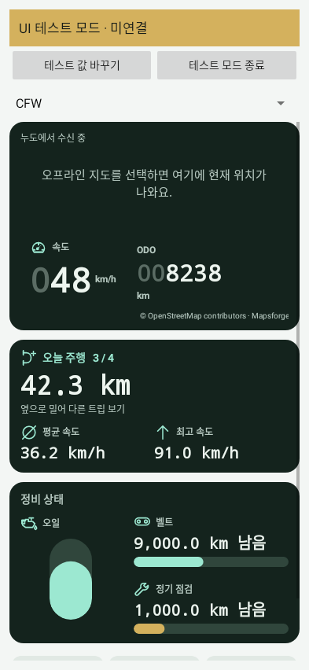
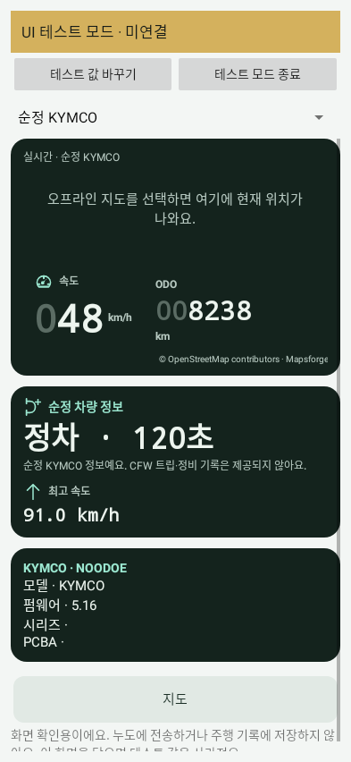
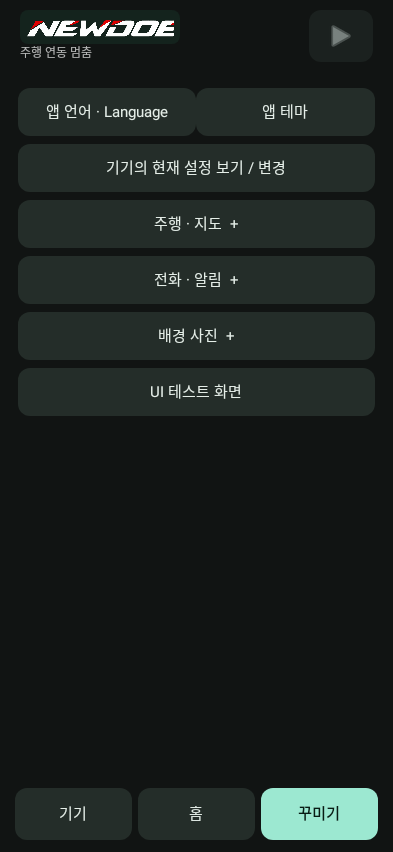

# NewDoe 0.11.10 validation

- Android: 164 tests in 20 suites, no failures, errors or skips. Covers schema1/2, original stock read-only commands/identity, dashboard layout/numerals, preview isolation and auto-exit, updater settings preservation, installation/bond/handoff/reconnect regressions.
- Compiled ARM O0/Os: existing/new counter layout, unknown/manual maintenance distances, settings catalogs/UI, remote operations and durable ride/update preservation pass.
- Product Debug free: 580 bytes; Release free: 580 bytes. Both exceed the required 512-byte minimum. SRAM153496 and CCM49216 unchanged; compiler flags, heap/stack reservations, existing assets and features unchanged.
- 81 Gate/Bootstrap/Update/linker source files and Android installer/protocol implementations are unchanged. Matched APK/ZIP/Product contract, original signing identity and replaceable-library relink checks pass.
- Original user wordmark copied byte-for-byte; header/pre-Android12 splash crop only empty margins while drawing. Android12+ native splash uses the same original image as its branding resource.
- Final APK installed wirelessly with install -r, preserving app data. See verification.json for the device/version record. No new Product flashed to a physical Noodoe; real counter/correction and stock RF qualification remain user hardware tests.
- Current distance device label uses English fallback with the existing language resources. Preview tool labels are English/Korean. Other existing app language support is retained.
- The accepted old-code stock-return power-loss limitation is unchanged.

Screenshots below are native Android software captures with simulated data; asynchronous map tiles may be absent.

See [installation](INSTALL.md) and the [dashboard guide](../../../Projects/Manuals/User/37-Phone-Dashboard.en.md).
