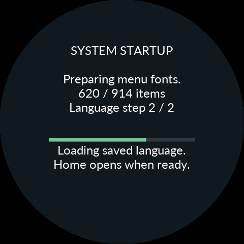
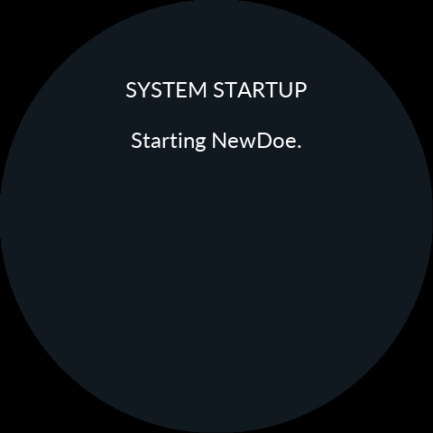

# NewDoe 0.11.15 validation

- Android: 273 tests in 33 suites, no failures/errors/skips. Covers split queued replies, timeout/EOF, session epochs, installation/readback/reconnection and bundle identity.
- ARM component tests at O0/Os: installed-resource open, full installer reader validation, all nine catalogs/runtime preferences, publication and interruption recovery. Exact counts are in the release verification JSON.
- Actual Release ELF with file/config IO and RTOS locks modeled: Korean → Korean cold reboot → Japanese. No phone or IGN event is needed. Changed boots show preparation progress; unchanged reboot does not.
- Korean selected text: 9,524 bytes; 1,448,064 total allocated bytes for this isolated language test. 3,710 worker visits, 3,215 file reads, 3,719,714 requested bytes. Japanese: 4,527 reads / 2,132,565 requested bytes, down from 16,549 / 66,078,229 before index caching. Final glyph-arena hashes and allocations match exactly.
- The complete 11,966,608-byte pack is not scanned at boot. Only48 distinct pack pages were needed for Korean,471 for Japanese; index misses now read32 bytes. This is an IO trace, not measured device time.
- Actual LVGL/EVE startup frames were rendered and visually inspected inside the circular display; display lists stay below8KiB. Fixture progress drives these captures; no physical LCD claim.
- Debug/Release free internal flash: 848 / 848 bytes, exceeding the512-byte minimum. No compiler-policy, heap/stack, Gate or font/icon reductions.
- Gate, Bootstrap, language archive, installation publication/transfer machinery, UART/trip/maintenance and power paths are unchanged. Matching APK signer/Product hash/ZIP and replacement-library relink checks pass.
- Camera-triggered RF loss and physical boot time remain unverified. Previously accepted legacy stock-return power-cut limitation remains. No source files are published in the public repository.

[Install](INSTALL.md)

