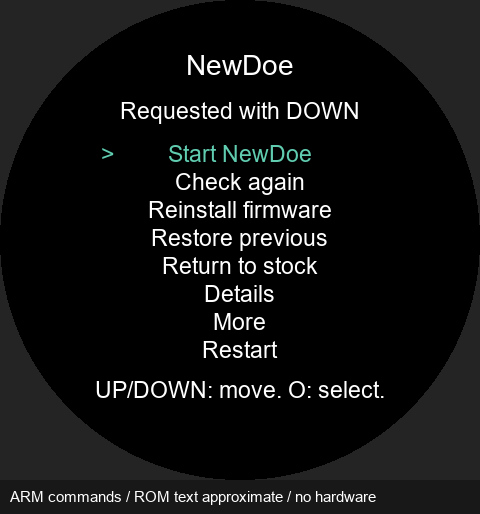
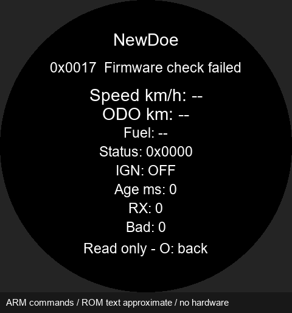
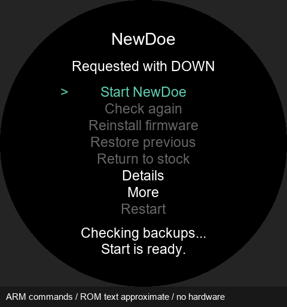

# NewDoe 0.11.4 software validation

Gate: 61152 of65536 bytes, 4384 free. Product Debug/Release: {'Debug': 512, 'Release': 512}; hard minimum512 bytes. Compiler policy, assets and RAM/CCM/heap/stack reservations are unchanged.

- Actual Gate ARM ELF:61 boot-path cases plus2 reset-entry cases,84 menu/input/reason checks,7 sealed handoffs,2 capability-scan scheduling cases. Active-image and resource hashing remain mandatory before every Product jump.
-80 journal writer cases at O0/Os cover normal handoff and power-reset normalization, including partial erase/program/completion marker and corrupt readback. The previous committed record survives; READY and the decremented count are published together.
-79 Gate screen frames stay within the circular aperture. Main-menu font is unchanged; all smaller text is raised to at least that size. The captures below use actual Gate draw commands with approximate substitute ROM glyph pixels; they are not photographs.
- Android: 133 selected tests passed. The actual0.11.3/new ZIP pair requires Gate migration; the language content and original Bootstrap/stock/uninstall/diagnostic/resources remain matched. Same-Gate release regression is inapplicable and public network hashing is performed at publication.
- APK/Product/ZIP hashes, existing signer and replaceable-library relink kit verified.0.11.3 language implementation is retained; only Product version metadata/text changes in this release.

No physical LCD, RF, voltage-collapse or installation power-cut test was performed. Original stock bootloader behavior is unchanged, including the accepted old-code stock-return power-loss limitation. See [installation and hardware checks](INSTALL.md).

## Software screen previews

