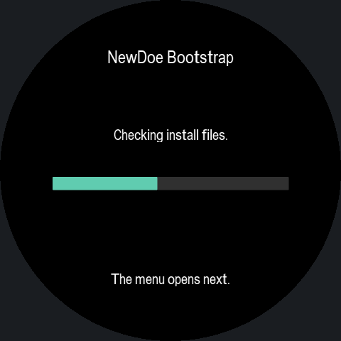
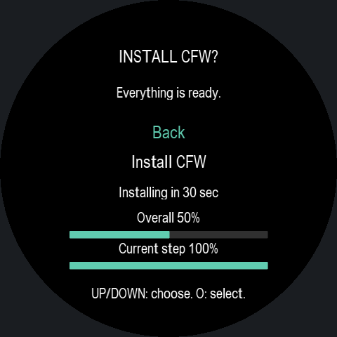
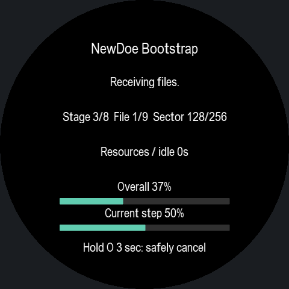

# NewDoe0.11.5 software validation

-54 ARM cases passed at O0/Os: countdown timing/wrap/one-shot, cancel, disconnect/new link/new transaction, message paging, progress, target checks and EVE FIFO errors. Existing Gate binaries are identical to0.11.4; the old Bootstrap suite’s obsolete Gate-menu fixture was excluded from this scoped run.
-45 actual Bootstrap ARM screen frames, including all17 message pages, fit inside the round aperture. Original private message bytes and every visible character were compared. The previews approximate ROM glyph shapes while preserving measured ROM metrics and actual drawing commands; these are not device photographs.
-169 Android tests passed across18 suites, including same-Gate update from0.11.4, migration from an older Gate, connection handoff, language installation and device-owned progress. One public-download fixture was skipped; actual published asset hashes are checked by the publisher.
-Bootstrap: 450448 /458752 bytes; 8304 free. Product Debug/Release:512 bytes free each. Sensor symbols are absent from Bootstrap and retained in Product. Existing Product brightness/Bluetooth functions preprocess identically; its new unused UI accessor is discarded. LTO relocation means the rebuilt Product is not byte-for-byte identical except version text.
-APK signature, APK/ZIP/Product hash agreement, language archive, replaceable-library kit and version-record CRC verified. No physical LCD, RF or installation test was performed.

See [installation and controls](INSTALL.md).

