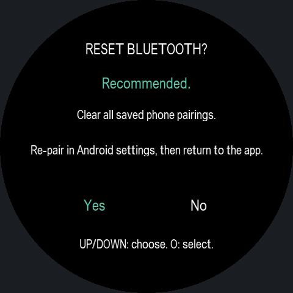
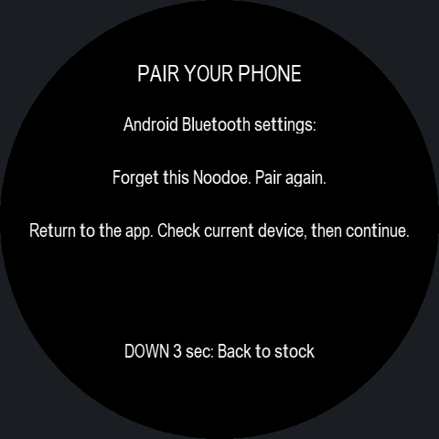
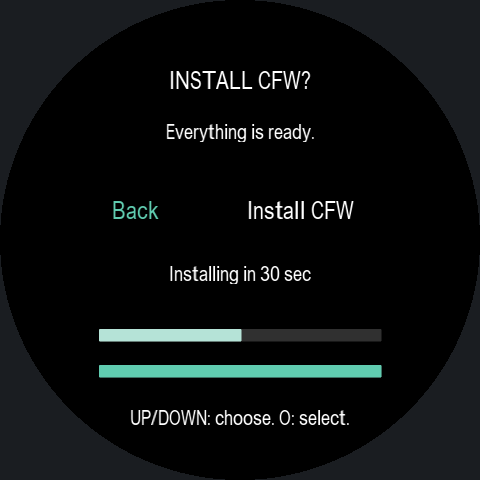
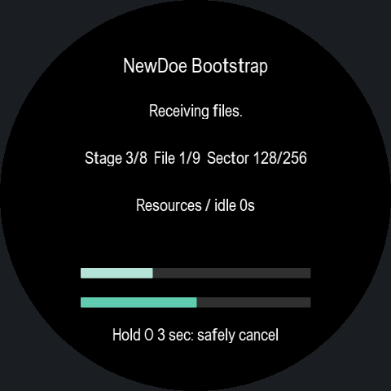

# NewDoe0.11.6 software validation

-54 ARM Bootstrap cases and20 ARM connection-recovery cases passed at O0/Os. Covers Yes/No authorization, connection loss during the prompt, existing CFG vs first-install pairing, persistence barriers, original cancellation and automatic confirmation, fractional progress and all message bytes/pages.
-45 actual Bootstrap ARM screen frames fit the round aperture, including all8 developer-text screens and both reset choices. All visible original message characters accounted for. The previews preserve recorded EVE ROM metrics; glyph shapes are approximated. These are not hardware photographs.
-179 Android tests passed across19 suites. One public-download fixture skipped; actual release assets are hash-verified after publication.
-Bootstrap: 451136/458752 bytes, 7616 free. Product Debug/Release each512 bytes free. Shared Product Bluetooth/brightness behavior is equivalent after preprocessing; new reset logic is Bootstrap-only. Gate is byte-identical to0.11.4/0.11.5.
-APK signer, APK/ZIP/Product hash binding, language archive, replaceable-library kit, version record/CRC and flash budgets verified. No physical LCD, RF, pairing or installation claim.

See [installation and controls](INSTALL.md). A normal Product update does not run Bootstrap; these screens appear during stock installation with the new ZIP.

