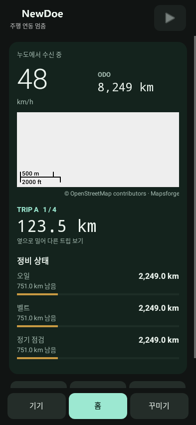
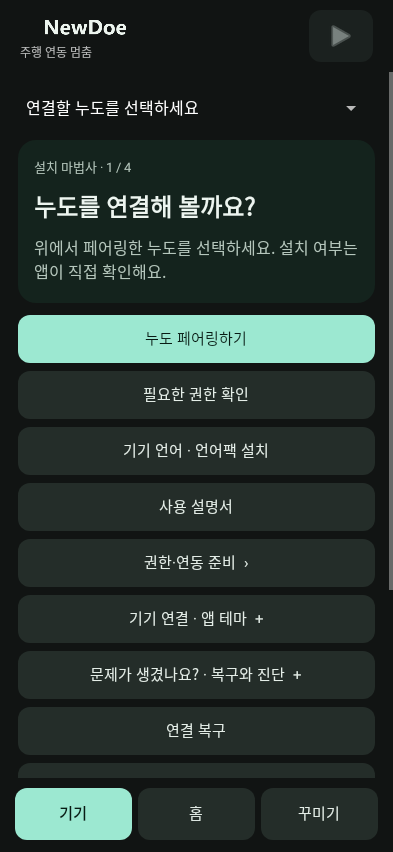
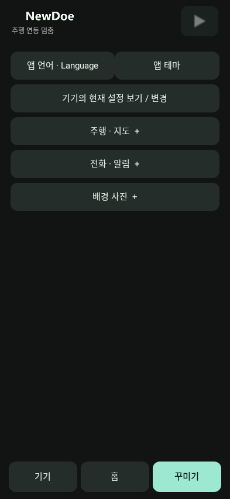

# NewDoe 0.11.9 validation

- Android: 104 tests in 17 suites; zero failures, errors or skips. Covers counter parsing, freshness, partial/backward data, interval calculations, notification deduplication, API23 behavior, request cadence, three-page gestures, trial confirmation and installation/bond/handoff regressions.
- Compiled ARM: detailed counters and unchanged status tested at O0/Os; control-host tests have 134 assertions at each optimization; diagnostics response tested in 400 cases at O0/Oz. NOR backup retains full response scratch capacity.
- 28 critical recovery/Bootstrap/Update files and Android installer/protocol implementations are unchanged. Counter addition is read-only. Diagnostics bytes are written directly into the existing scratch to avoid temporary arrays/copies.
- Product Debug and Release: 392624/393216 bytes, 592 free. This is 80 fewer used bytes than 0.11.8 despite added counters. SRAM153496/196352, CCM49216/65536; compiler policies, heap and stack reservations unchanged. Gate, Bootstrap and language archive hashes match 0.11.8.
- Matching APK/ZIP/Product contract, existing signing identity, version records and replaceable-library kit reconstruction/alignment/signature checks passed.
- The final APK was installed wirelessly with ADB install -r on Samsung SM-S928N over 0.11.2, preserving app data. Version120/name0.11.9 verified. Home map tiles were visually confirmed on the phone. The phone then locked. The captures below are Robolectric native Android captures with fixture data, not phone photographs. Asynchronous map tiles are absent in the software Home capture.
- No physical Noodoe firmware installation, vehicle counter, service-notification end-to-end or RF endurance qualification was performed. Those remain hardware validation steps. The accepted old-code stock-return power-interruption limitation is unchanged.

See [installation](INSTALL.md) and the [dashboard guide](../../../Projects/Manuals/User/37-Phone-Dashboard.en.md).
